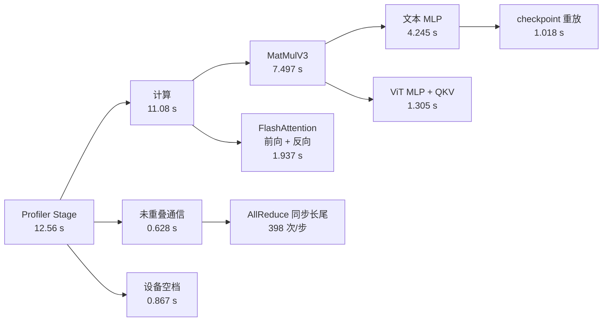

# A53+A54：FA2 缓存版 50 步 Profiler 分析

实验 `fa2dual1113-01`，2026-11-13。模型为 Qwen3-VL-8B-Instruct + ROSS、SD1.5 UNet 与冻结 VAE，数据为 OpenScene/NAVSIM trainval 子集。两机各 8 卡，BF16、FlashAttention-2、ZeRO-2、MBS 24、GBS 384、梯度累积 1，文本末 2/36 层不重算。正式测速关闭 Profiler；另跑关闭计数和标记的 50 步 Insight 采集。A53、A54 均退出 0，16 个 rank 各记录 50 步。

本报告用第 11–50 步的 640 个 rank-step 描述关键路径。Profiler 会改变运行时，所以这里的步时用来定位耗时，不替换无 Profiler 的正式成绩。

同一配置下，关闭 Profiler 的稳态步时为 **12.2517 s**，采集时为 **12.5602 s**，采集开销约 **0.31 s/步（2.5%）**。两者不能混作同一轮 MFU 分子或分母。

## 结论

FA2 去 padding 元数据缓存有效，但收益很小。每个 rank 在 50 步内只准备 50 次元数据，平均命中 3,450 次；正式 50 步墙钟从 **641.901 s** 降到 **641.260 s**，稳态平均步时从 **12.3142 s** 降到 **12.2517 s**，分别改善 **0.10%** 和 **0.51%**。这说明重复 `.item()`/`nonzero` 元数据不是当前 12 秒步时的主要矛盾。

稳态关键路径约 **88.2% 在计算、5.0% 在未与计算重叠的通信、6.9% 在设备空闲**。通信时间线覆盖约 1.328 s，其中约一半已经与计算重叠。计算中 MatMulV3 累计 **7.497 s/rank/step**，文本 MLP 为 **4.245 s**，其中 checkpoint 重放为 **1.018 s**，是现有配置下最明确、可验证的重复计算。通信虽然总存在，但大部分已被计算覆盖；真正需要处理的是少数 rank-step 的同步长尾。

按历史 MindSpeed + ROSS 口径，本版有效 MFU 为 **48.07%**，HFU 为 **61.23%**。**61.23% 是含重算的 HFU，不能作为有效 MFU 达标值。** 若到达 60% 有效 MFU，固定当前 FLOPs 分子时步时需降到约 **9.816 s**，即再从 12.252 s 省 **2.436 s（19.9%）**。只消除全部未重叠通信和设备空闲的理论上限仍不够，必须同时减少计算路径上的工作。

## 本次代码优化

[`utils/fa2_unpad_cache.py`](../utils/fa2_unpad_cache.py) 包装了 Qwen3-VL 的
`_get_unpad_data`。同一 microbatch 的 mask 在 36 个文本层前向及 checkpoint
重放之间会重复使用；现在先按 mask 身份缓存有效索引、累计序列长度和最大长度，
同一 batch 内命中后直接复用，并在 forward/backward 结束后清理。它不改变
Q/K/V gather、FlashAttention 算法、位置编码、mask 或 MLP 计算。

[`utils/train_qwen_vla.py`](../utils/train_qwen_vla.py) 只在
`ROSS_FA2_UNPAD_CACHE=1` 时安装该缓存，并可通过
`ROSS_FA2_UNPAD_MARKERS=1`/`ROSS_FA2_UNPAD_STATS=1` 收集独立 Profile
标记和调用计数。实验每 rank 50 步只执行 50 次元数据准备、命中 3,450 次，
但正式墙钟只快约 0.10%–0.51%。因此这是正确且低风险的小优化，不足以解决
Qwen3-VL 的主要计算量。

## 正式测速

| 指标 | 旧 GC2 | FA2 缓存版 | 改善 |
| --- | ---: | ---: | ---: |
| 50 步 Trainer runtime | 641.901 s | **641.260 s** | 0.641 s / 0.10% |
| 第 11–50 步平均步时 | 12.3142 s | **12.2517 s** | 0.0625 s / 0.51% |
| 稳态 P50 / P95 | 12.3223 / 12.3899 s | **12.2765 / 12.3337 s** | P50 −0.0458 s |
| 稳态样本吞吐 | 31.1836 样本/s | **31.3427 样本/s** | +0.51% |
| 端到端样本吞吐 | 29.9112 样本/s | **29.9410 样本/s** | +0.10% |
| 稳态输入 TPS（含 padding） | 55,307 token/s | **55,589 token/s** | +0.51% |
| 16 卡框架峰值 HBM 最大值 | 未记录 | **79.523 GB** | 尚未接近 96 GB |
| 第 1 步 / 第 50 步 loss | 19.0397 / 2.9551 | **19.0447 / 2.9407** | loss 有限，非收敛结论 |

两轮固定了模型、数据路径、代码基础版本、MBS、GBS、seed、热身窗口和输入形状，并核对了逐 rank、逐步的形状。它们仍是跨日比较，因此 0.10%–0.51% 的差异只能视为小幅改善，不能证明长期稳定收益。

## 配置与正确性

| 项目 | 本次实际值 |
| --- | --- |
| 代码基础版本 | `bf729327b24b687bb910153dfe5d74c34dbb1b69` |
| 模型 | `/work/zhaobo/models/Qwen3-VL-8B-Instruct` + ROSS |
| 辅助生成模型 | `/work/zhaobo/models/stable-diffusion-v1-5`，VAE 冻结 |
| 数据 | `/work/zhaobo/data/prepared-trainval/train.pkl` |
| 原图 | `/work/zhaobo/data/raw-camera/openscene-v1.1/sensor_blobs/trainval` |
| 数据快照 | `fd029c4c5b6946cf4ba032c1f380e55d89a4526e3181aaff0594d716f61ff71d` |
| 并行与 batch | 16 卡、ZeRO-2、MBS 24、梯度累积 1、GBS 384 |
| 精度与注意力 | BF16、FlashAttention-2 |
| 运行结果 | 两机退出码 0；16 rank × 50 step 完整 |

正式测速轮和投影计数轮的每个 rank、每个稳态 step 都核对了输入形状；两机的 `pair`/workload 签名和共享数据路径一致。能确认的是模型、数据和训练机制按预期进入训练，loss 全程有限且完成 50 步；本实验没有验证集精度，因此不能据此证明收敛效果或最终驾驶指标。

## 关键路径

| Insight 指标 | P50 | 平均值 | P95 | 最大值 |
| --- | ---: | ---: | ---: | ---: |
| Stage | 12.5602 s | 12.5757 s | 12.8186 s | 12.8720 s |
| Computing | 11.0791 s | 11.0784 s | 11.1490 s | 11.1775 s |
| Communication（总覆盖） | 1.3282 s | 1.3385 s | 1.7034 s | 2.0806 s |
| Communication Not Overlapped | 0.6284 s | 0.6704 s | 0.9997 s | 1.3656 s |
| Free | 0.8668 s | 0.8268 s | 1.0272 s | 1.1266 s |
| HCCL 操作累计 | 1.3158 s | 1.3270 s | 1.6975 s | 2.0806 s |
| Bubble | 0 | 0 | 0 | 0 |
| 单次最长连续 Free | 0.4442 s | 0.3932 s | 0.5147 s | 0.5438 s |

典型 rank-step 满足：

```text
Stage ≈ Computing + Communication(Not Overlapped) + Free
```

按每一行分别计算后取中位数，三项占 Stage 的比例为：

| 关键路径部分 | 占比 |
| --- | ---: |
| Computing | 88.18% |
| Communication Not Overlapped | 5.00% |
| Free | 6.90% |



`Bubble=0` 是流水线并行气泡字段为 0，不表示没有设备空闲；未与计算重叠的通信和普通设备空档分别记入 CommNotOvl 与 Free。HCCL 操作累计时间和设备算子耗时都可能重叠，不能直接相加得到整步墙钟。

## 双机与 rank 扩展

| 范围 | Stage P50 | Stage P95 | CommNotOvl P50 | Free P50 | HCCL P50 |
| --- | ---: | ---: | ---: | ---: | ---: |
| A53 rank 0–7 | 12.5579 s | 12.7911 s | 0.6384 s | 0.8516 s | 1.3029 s |
| A54 rank 8–15 | 12.5613 s | 12.8202 s | 0.6227 s | 0.8874 s | 1.3307 s |
| 全部 rank | 12.5602 s | 12.8192 s | 0.6284 s | 0.8668 s | 1.3158 s |

两机 Stage 中位数只差 **3.4 ms（0.027%）**，没有出现一节点整体拖慢另一节点的情况。最大 Stage 为 **12.8720 s**，出现在 rank 12 的第 34 步；各 rank 的第 34 步都接近 12.87 s，属于共同同步抬升，不应归因于单张卡。

通信中位数偏高的是 rank 4（**0.8406 s**）和 rank 12（**0.9053 s**），对应两机的本地 NPU4。最大单点未重叠通信是 rank 4 第 32 步的 **1.3656 s**。但 A53、A54 的 NPU4 链路均处于 `UP`，历史 down count 为 0，现有数据不支持“链路故障”的结论。

| 慢 step | 全 rank Stage 中位数 | Computing 中位数 | CommNotOvl 中位数 | 最慢单点 |
| ---: | ---: | ---: | ---: | --- |
| 34 | 12.8715 s | 11.0821 s | 0.9257 s | 16 个 rank 共同抬高 |
| 32 | 12.8637 s | 11.0785 s | 0.9172 s | rank 4：CommNotOvl 1.3656 s |
| 18 | 12.7890 s | 11.0821 s | 0.8427 s | rank 12：CommNotOvl 1.2104 s |
| 20 | 12.7520 s | 11.0846 s | 0.7761 s | rank 4：CommNotOvl 1.2531 s |
| 40 | 12.7032 s | 11.0730 s | 0.7565 s | 全 rank 通信略升 |

按每一步的 16-rank 中位数看，Computing 在 **11.0730–11.0881 s** 之间波动，说明慢 step 主要来自通信同步和个别设备空档，不是数据形状导致的核心计算量忽高忽低。

## 通信热点

稳态每 rank-step 中位数：

| HCCL 算子 | 累计/步 | 调用/步 | 单次 P50 | 单次 P95 | 单次最大 | Wait | Transit |
| --- | ---: | ---: | ---: | ---: | ---: | ---: | ---: |
| AllReduce | **1,278.339 ms** | **398** | 0.627 ms | 13.762 ms | 607.178 ms | **1,096.630 ms** | 179.677 ms |
| AllGather（主组） | 39.127 ms | 2 | 18.378 ms | 39.813 ms | 41.799 ms | 3.422 ms | 35.637 ms |
| AllGather（另一组） | 13.741 ms | 0.62 | 30.656 ms | 33.745 ms | 35.471 ms | 13.677 ms | 0.044 ms |

AllReduce 约占 HCCL 累计时间的 **95.8%**。其中 **85.8% 是等待，14.1% 是实际 transit**；Synchronization 和 Idle 合计只有约 1.7 ms。不能把等待时间全部解释成网络带宽不足，它更符合“先进入 collective、等待较慢 participant 或同步边界”的长尾。

对两个最慢点读出单笔调用：

| rank / step | AllReduce 累计 | 最慢单笔 | 该笔 wait | 该笔 transit |
| --- | ---: | ---: | ---: | ---: |
| rank 4 / 32 | 2,080.605 ms | 541.111 ms | 539.942 ms | 1.169 ms |
| rank 12 / 15 | 2,014.878 ms | 597.390 ms | 596.094 ms | 1.296 ms |

这两个 500–600 ms 的长尾中，等待占比都超过 **99%**，不是单笔传输本身突然变慢。后续应沿着 collective 的时间线检查 bucket、算子排队和 participant 对齐，同时对照 ZeRO-2 的 `overlap_comm` 与 bucket 设置；仅凭 FEC 历史累计值不能判定硬件故障。

以 rank 4 第 32 步为例，持续 541 ms 的 AllReduce 传输量为 **16,056,004** 个元素；同一步内另一次 **596,440,858** 个元素的 AllReduce 只用了 **6.76 ms**。更大的数据量反而快约 80 倍，进一步说明该 541 ms 不能用“数据太大、带宽不够”解释，更像 collective 进入时机、依赖链或调度等待。bucket 仍需 A/B，但应结合时间线，而不是只放大 bucket。

同一步中，本地 NPU5 的 rank 5、rank 13 也出现约 553 ms、541 ms 的同类调用，因此长尾并非只出现在 NPU4；它更像某个 collective 轮次或 rank 配对上的同步形态。先核对同一 collective 的 participant 到达时间和 bucket 边界，再决定是否调整设备绑定或 HCCL 参数。

## 设备算子热点

下表是各 rank 稳定窗口内平均值的跨 rank 中位数。累计时长可重叠，不能把所有行相加。

| 算子/形状组 | 累计/rank/step | 占 Computing | 说明 |
| --- | ---: | ---: | --- |
| MatMulV3 全部 | 7.4974 s | 67.7% | MLP、QKV、投影和梯度矩阵乘 |
| 其中：文本 MLP | **4.2455 s** | **38.3%** | gate/up、down 的正常与重放路径 |
| 其中：文本 MLP 重放 | **1.0176 s / 68 次** | **9.2%** | checkpoint backward 内再次执行的前向矩阵乘 |
| 其中：ViT MLP | 0.9473 s / 216 次 | 8.6% | 视觉 block 的 MLP |
| 其中：ViT QKV | 0.3581 s / 108 次 | 3.2% | 视觉 Q/K/V 投影 |
| FlashAttention 前向 | 0.9750 s / 189 次 | 8.8% | 文本与视觉注意力 |
| FlashAttention 反向 | 0.9617 s / 95 次 | 8.7% | 文本与视觉注意力 |
| Conv2DV2 | 0.1217 s / 182 次 | 1.1% | 视觉与 ROSS 路径 |

其中耗时最高的几组 MatMulV3 形状（rank 4，40 个稳态 step 平均）：

| 输入 / 权重形状 | 设备时间/step | 调用数/step |
| --- | ---: | ---: |
| `[42528,4096] × [24576,4096]` | 0.384 s | 19.2 |
| `[42552,4096] × [24576,4096]` | 0.245 s | 12.2 |
| `[164736,1152] × [4304,1152]` | 0.230 s | 54.0 |
| `[164736,4304] × [1152,4304]` | 0.214 s | 54.0 |
| `[42528,24576] × [24576,4096]` | 0.197 s | 9.9 |
| `[42528,4096] × [4096,4096]` | 0.194 s | 58.3 |

`42528–42624` 的行数差异来自每个 micro-batch 动态 padding 后长度略有不同，不代表算子配置不断变化。文本 gate/up 的单次大形状约 20 ms，和 429 TFLOP/s 的估算一致；真正要减少的是执行次数和总 token 数。

文本 MLP 的单一融合 gate/up 矩阵很大。以历史 rank 0 的输入 `[42528,4096]`、权重 `[24576,4096]` 为例，一次前向约 `8.56e12` FLOPs，按实测约 20 ms，对应约 **429 TFLOP/s**。这说明它耗时主要是因为 token/权重维度和执行次数大，单算子已经接近当前假设峰值；继续换同一个 GEMM 的调用方式通常无法单独带来 20% 的整步收益。

现有配置已经把文本最后 2 层移出 checkpoint。剩下 34 层每层约贡献 **1.018 / 34 ≈ 29.9 ms** 的重放矩阵乘，全部剩余 MLP 重放的理论上限也只有约 1.018 s。单个 gate/up BF16 输出约 `42528 × 24576 × 2 B ≈ 2.09 GB`，而当前框架峰值已达到 **79.523 GB**，不能把 34 层中间结果全部常驻显存。

## 进一步优化顺序

1. **先做 ZeRO-2 bucket 与通信长尾 A/B。** 当前配置为 `overlap_comm=true`、`reduce_bucket_size=auto`，每步 398 次 AllReduce。把 bucket 大小提高 2×/4×可能减少 collective 次数和等待，但过大 bucket 可能削弱细粒度重叠；以相同 20–30 步、相同全 rank HBM 和 loss 为约束做短测，先验证再跑 50 步。
2. **只增加可控数量的文本层不重算。** 继续从末 2 层扩到末 3–4 层，逐层测全 rank HBM。按当前设备时间每多跳过一层约省 30 ms，收益有限，任何结果都必须以 loss/梯度范数和全 rank 峰值为门槛。
3. **评估冻结部分 ViT 主干或只训练后段/merger。** ViT MLP + QKV 合计约 1.305 s，且反向会带来梯度、通信和激活压力。冻结前段 Vision blocks 可能比继续堆 MLP 融合更有价值，但必须单独验证驾驶效果。
4. **减少视觉 token 数量。** 当前 `--max_pixels 903168`，每张图约 3,432 个 merger 前 patch，两个图经 2×2 合并后约 1,716 个文本主干视觉位置。降低分辨率或改视觉 tokenizer 可直接减少文本 MLP 和注意力工作量，但会改变 FLOPs 分子和任务精度，必须作为模型实验而不是单纯性能调参。
5. **把确定性开关单独做性能 A/B。** 代码默认设置 `HCCL_DETERMINISTIC=TRUE`。若最终性能验收允许关闭确定性，可在单独实验里比较关闭后的通信长尾、可复现性和 loss；不能在同一对比中混用。
6. **先不在当前配置切换 ZeRO-3。** 16 卡线性度已经接近 2×，扩大参数分片可能增加 AllGather/ReduceScatter 和通信频次；只有增加模型或 batch 导致 HBM 不足时，才把 ZeRO-3 作为单独架构方案评估。

如果只在现有计算图内完全消除 CommNotOvl 和 Free，理论上可从 12.252 s 降到约 **10.76 s**；按当前 FLOPs 分子，有效 MFU 约 **54.8%**。要到 60%，还需从计算路径再省约 **0.94 s**。因此“优化通信”是必要项，但只能覆盖约 60% 的目标差距，剩余必须依靠减少重放、冻结部分骨干或减少 token 工作量。

## 复现入口

```bash
# 正式 50 步测速和独立 Profiler 轮由共享盘 launch 脚本生成
ZB_PAIR_RUN=fa2dual1113-01
ZB_JOB=measure bash /mnt/sfs_turbo/zhaobo/drivevla-w0/scripts/a5/benchmark-mfu.sh
ZB_PAIR_RUN=fa2dual1113-01
ZB_JOB=profile ZB_PROFILE_FULL=1 ZB_FA2_UNPAD_CACHE=1 \
  ZB_FA2_UNPAD_MARKERS=1 ZB_FA2_UNPAD_STATS=1 \
  bash /mnt/sfs_turbo/zhaobo/drivevla-w0/scripts/a5/benchmark-mfu.sh

# 本地分析 Profiler 数据库
python utils/analyze_fa2_insight.py \
  artifacts/insight-fa2dual1113-01/import-db \
  --csv artifacts/insight-fa2dual1113-01/steady-rank-steps.csv

python utils/summarize_fa2_comm.py \
  artifacts/insight-fa2dual1113-01/import-analysis-db --steps 10-49

python utils/analyze_fa2_comm_steps.py \
  artifacts/insight-fa2dual1113-01/import-db \
  --rank-step 4:31 --rank-step 12:14
```

原始 Profiler 位于：

```text
/mnt/sfs_turbo/zhaobo/drivevla-w0/artifacts/runs/mfu/mfu-a53-a54-fa2dual1113-01-profile
```

本地汇总和 CSV 位于 `artifacts/insight-fa2dual1113-01/`。原始数据库约 45 GiB，里面包含算子级明细；只做 StepTrace、Communication Group 和 HCCL wait/transit 分析时，每 rank 约 23 MB 的 `analysis.db` 已足够。可用下面的命令下载 16 rank 的精简分析包：

```powershell
python utils/fetch_fa2_insight.py artifacts/insight-fa2dual1113-01 --analysis-only
```

### 本地 Insight 复核

16 个 rank 的精简分析包共约 **0.34 GiB**。用 MindStudio Insight 26.1 自带后端运行 `communication_time` 后，已生成完整本地 cluster 数据库：

```text
artifacts/insight-fa2dual1113-01/cluster_analysis_output-full/cluster_analysis_output/cluster_analysis.db
```

本地 `cluster_analysis.db` 约 **340.6 MiB**，包含 **16 个 rank、800 条 rank-step、321,766 条 HCCL 调用和 2,467,264 条带宽记录**。对第 11–50 步复算的 Computing/CommNotOvl/Free 中位数分别为 **11.0791 s / 0.6284 s / 0.8668 s**，与原始数据库上的 16-rank 统计逐项一致；最慢 CommNotOvl 仍为 rank 4、第 32 步的 **1.3656 s**。`all` 模式中可选的 Communication Matrix 配方触发了随附 pandas 版本的 object/int64 类型错误，因此采用 `communication_time` 模式生成干净的 StepTrace、Communication Group 和 HCCL 时间数据库；这不影响本报告采用的 Stage、CommNotOvl、HCCL wait/transit 和算子统计。

16-rank 汇总分别位于 `artifacts/insight-fa2dual1113-01/local-full16-summary.md`、`comm-summary-full16.md` 和 `slow-step-analysis-full16.md`。此外保留了 rank 2–5 的完整原始算子库作为代表性样本，其中包含慢点 rank 4；逐 rank-step AllReduce 明细位于 `local-sample-comm.csv`，共 200 行。算子级热点来自 16-rank 原始库的只读全量统计，以及这份 4-rank 本地样本复核，不使用精简时间线库冒充算子明细。

本地后端复算命令：

```powershell
& 'D:\Software\MindStudio Insight\resources\profiler\server\python\python.exe' `
  'D:\Software\MindStudio Insight\resources\profiler\server\msprof_analyze\cluster_analyse\cluster_analysis.py' `
  -d 'D:\OTT9\DriveVLA-W0\artifacts\insight-fa2dual1113-01\import-analysis-db' `
  -m communication_time `
  -o 'D:\OTT9\DriveVLA-W0\artifacts\insight-fa2dual1113-01\cluster_analysis_output-full' `
  --force --parallel_mode concurrent --export_type db
```

## 统计边界

- 这是 50 步性能与 Profiler 实验，不是精度训练。loss 有限及下降只说明运行正确，不能推出验证集 PDMS 或驾驶效果。
- 有效 MFU 使用对应文档定义的 FLOPs 分子和假设峰值分母；不同口径不能用同一个 60% 门槛混谈。
- HFU 包含 checkpoint 重算，不能作为有效 MFU。
- Profiler 改写了调度和采样间隔，分项比例用于定位；正式吞吐和端到端成绩取关闭 Profiler 的测速轮。
- 设备算子累计可重叠，关键路径以 Stage、Computing、CommNotOvl 和 Free 分解为准。
- `Computing` 是 Insight 对关键路径区间的时间归类，不等同于 NPU 硬件利用率；硬件效率仍以明确口径的 MFU/HFU 表示。
