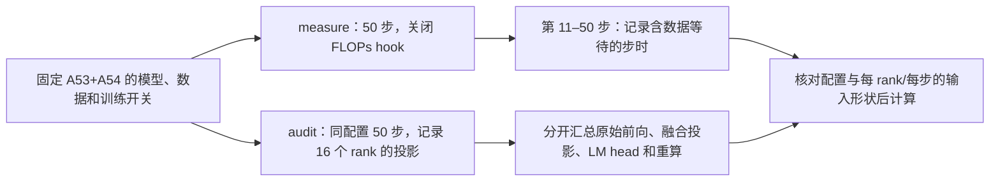

# A53 + A54：按两份文档复测 MFU / HFU

上午的 50 步训练跑通了。真正可比的是同样用 Qwen3-VL + ROSS、完整重算、同样计数的历史结果：11 月 11 日 **12.180 秒/步、48.36% useful + ROSS**，11 月 12 日 **12.462 秒/步、47.26%**。这是约 **2.3%** 的步时变化，不是从 63.2% 掉到了 36.82%。

| 报告 | 分子（记哪些活） | 分母 | 结果 |
| --- | --- | --- | ---: |
| Emu3 文档一 | 仅带权重的投影矩阵乘，按 32 层和该批 token 计 | 486.354，示例 6.85 秒 | 57.1% MFU |
| Emu3 文档二 | 同样只算投影；HFU 额外加实际 checkpoint 层的前向投影 | 该份日志的步时，峰值改为 432 | 63.2% MFU / 约 79.9% HFU |
| 上午的 Qwen3 旧报告 | 用关闭融合的 6 步计数轮最后一步作分子，用开启融合的 50 步轮测速 | 486.354 | 36.82%；只换 432 则约 41.45%，吞吐没变 |
| 上午的 Qwen3 历史比较 | Qwen3 文本、视觉、注意力矩阵乘和 ROSS 的解析估算 | 486 | 47.26% useful；含骨干重算约 60.76% |

两份 Emu3 文档可以理解为两张账单：**MFU 是正常训练的计算量；HFU 再加为了省显存、反向时补做的那部分前向**。两张都除以相同的时间和峰值。模型做了更多重算，HFU 可能升高，即使每步反而变慢。这里的 HFU 也只是投影估算，不是 NPU 硬件计数器读取的整卡利用率。

## 为什么以前的数差得多

- **分母不同。** 432 相比 486.354 会把同一数值放大约 12.6%。公开 [950DT 规格](https://support.huaweicloud.com/productdesc-aics/aics_01_0005.html)仅确认 FP16 486；432 和 486.354 在报告里均作分母假设，客户确认 BF16 Cube 峰值前不作为验收结论。
- **统计范围不同。** 文档二只数带权重的投影。Qwen3 的 ViT 和 ROSS 会消耗时间，Linear hook 可以看到其中的 Linear，但看不到 ROSS 卷积，也不包含注意力里的 QKᵀ/AV。完整口径和投影口径要分列。
- **实际投影行数不同。** Emu3 例子把所有 token 投进词表。Qwen3 当前启用 valid-token CE，LM head 多数只投影有监督标签的位置。少做的工作不能再算作有用 FLOPs。融合 gate/up 是把两次矩阵乘合成一次，数学 FLOPs 不变，但旧 hook 在融合开启时看不到那两层，必须补一次。上午关闭融合计数可以绕开漏记，仍无法证明两轮的分子、分母完全对应。
- **重算不能乘整模型。** 文档二把重算限定在 checkpoint 层，这一点应保留。对 Qwen3，直接记反向期间再次执行的投影；LM head 仍单独列出并检查没有重算。按文档，训练投影用前向 ×3、冻结投影 ×1，故结果是解析估算；冻结权重但仍传播输入梯度等场景不在该近似覆盖范围。

## 两轮怎么跑

两轮使用同一版本、起始权重、数据、seed、MBS 24、GBS 384、BF16、FA2、ZeRO-2、融合 gate/up、valid-token CE、相同的重算层数和学习率日程。两轮均关闭 Insight profiling。



每步用 16 个 rank 中最长的相邻 optimizer step 结束间隔，包含数据等待和同步；同时保留过去不含数据等待的步时供历史比较。报告使用 `16 × 单卡峰值 × Σ稳态步时` 作为分母，分子使用同一窗口的 16 卡 FLOPs 总和。审计轮也单独显示步时和 MFU，便于发现计数开销；机器上有别的任务或时间差异常时应先排除干扰，再比较。

完成常规发布后（A53、A54 的代码与共享 release 的 `REVISION` 一致，且包含本次修改），将新版 `benchmark-mfu.sh`、`benchmark_mfu.py`、`npu_zero2_compat.py`、`mfu-fast-bin/` 放入新的共享启动目录。例如 `/mnt/sfs_turbo/zhaobo/drivevla-w0/artifacts/code/mfu-projection-v1`。先做原有 HCCL 验收。下面两台执行同样的命令，各自开 tmux；每轮尽量连续启动，脚本会先等两端预检通过。使用新的 run ID。

```bash
cd /mnt/sfs_turbo/zhaobo/drivevla-w0/artifacts/code/mfu-projection-v1
export ZB_PAIR_RUN=zhao-projection-gc2-01 ZB_MBS=24 ZB_FUSED_GATEUP=1
export ZB_FAST_ZERO_STAGE=2 ZB_GC_SKIP_TEXT_LAST=2 ZB_MFU_STEPS=50 ZB_MFU_WARMUP=10
ZB_JOB=measure bash benchmark-mfu.sh &&
ZB_JOB=audit bash benchmark-mfu.sh
```

如果要证明「跳过两层」的收益，用同一版本再做一组，唯一的训练变量改为 `ZB_GC_SKIP_TEXT_LAST=0`，并更换 run ID。先做短测可将 **两轮** 同时改为 6 步、warmup 2；短测只验证计数和双机启动。不要直接用 GC4 长跑：该档已在 A54 实测达到 98,267 / 98,304 MB。

两轮都完成后，在含新代码的 checkout 执行：

```bash
root=/mnt/sfs_turbo/zhaobo/drivevla-w0/artifacts/runs/mfu
run="$root/mfu-a53-a54-zhao-projection-gc2-01"
python utils/report_projection_mfu.py "$run-measure" "$run-audit" | tee "$run-audit/projection-report.md"
```

报告会拒绝两端退出码不为 0、缺 rank、缺步、训练配置不同、或同 rank 同步输入形状不同的结果。形状核对不能证明原始样本内容逐位相同；数据与起始模型应保持不变。报告同时列出 432、486、486.354 下的投影 MFU 和投影 HFU 估算，便于对齐文档；客户验收仍以双方确认的 **有效 MFU** 口径为准。

## 双机线性度：与同配置 8 卡对照

固定每卡 batch 为 24：A54 单机 GBS 192，A53+A54 双机 GBS 384。模型、数据、seed、融合、ZeRO、重算、50 步总长和 10 步 warmup 都保持一致。线性度 = **双机吞吐 ÷ (2 × 单机吞吐)**；稳态时等价于 **单机平均步时 ÷ 双机平均步时**。报告分开给第 11–50 步的含等待线性度和整次训练的端到端线性度，均用关闭计数和 profiling 的测速轮。

单机在 A54 执行，跟双机测量分开跑：

```bash
cd /mnt/sfs_turbo/zhaobo/drivevla-w0/artifacts/code/mfu-projection-v1
env -u ZB_PAIR_RUN ZB_SINGLE_RUN=zhao-projection-gc2-01 ZB_JOB=measure \
  ZB_MBS=24 ZB_FUSED_GATEUP=1 ZB_FAST_ZERO_STAGE=2 ZB_GC_SKIP_TEXT_LAST=2 \
  ZB_MFU_STEPS=50 ZB_MFU_WARMUP=10 bash benchmark-mfu.sh
```

在含新版代码的 checkout 生成联合报告。只看线性度时，可以省略 `"$run-audit"`，无需跑计数轮。

```bash
root=/mnt/sfs_turbo/zhaobo/drivevla-w0/artifacts/runs/mfu
run="$root/mfu-a53-a54-zhao-projection-gc2-01"
python utils/report_projection_mfu.py "$run-measure" "$run-audit" \
  --single "$root/mfu-a54-zhao-projection-gc2-01-measure"
```

历史参考：11 月 11 日同版本、MBS 24、ZeRO-2、融合 gate/up、完整重算的 A54 12 步和双机 50 步，从原始状态文件同取第 6–12 步。旧指标不含等数据，单机 **12.188 秒/步、15.75 样本/秒**，双机 **12.187 秒/步、31.51 样本/秒**，对应约 **100.0%** 的初步稳态线性度。两轮总步数和 warmup 不同，不能用各自的整轮吞吐计算正式端到端线性度，也不能把这一结果当作跳过两层重算档的线性度。
