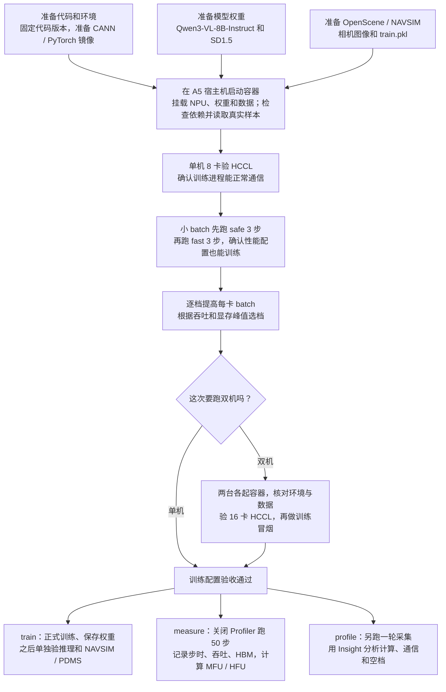
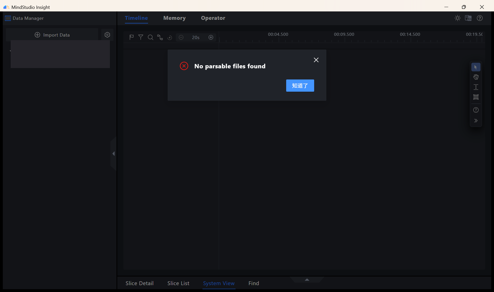
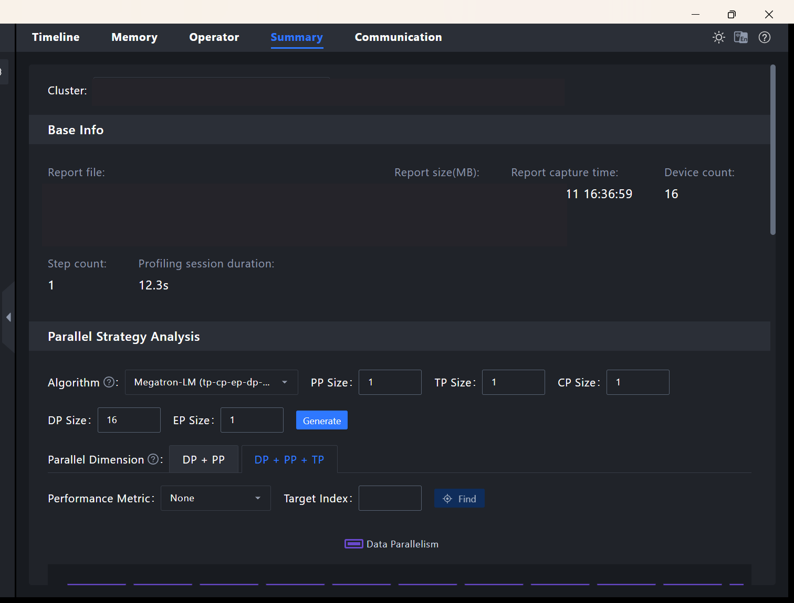

# DriveVLA-W0 部署与训练复盘

## 项目背景

[DriveVLA-W0](../README.md) 是一个自动驾驶训练项目。它根据车载相机画面等输入学习预测车辆接下来的动作，并在训练时加入未来画面的预测任务，帮助模型理解驾驶场景会怎么变化。这次用 **Qwen3-VL-8B-Instruct** 做视觉语言骨干，保留 **ROSS** 分支来做画面预测，在昇腾 NPU 上用真实驾驶数据跑训练。

先用**单机 8 卡**，是为了确认模型和数据能读、反向传播和参数更新能完成，并建立一套可复跑的速度基线。再上**双机 16 卡**，用相同的模型、数据和每卡 batch，看看卡数翻倍后，每秒处理的样本是否也接近翻倍，以及跨机通信有没有拉长每一步。最后用 MindStudio Insight 拆开看，时间花在模型计算、通信等待还是设备空档上。

这次的性能目标是 **60% 有效 MFU**，关注的是有效训练计算占设备理论算力的比例。50 步测试用来验证训练链路和比较性能，驾驶效果仍要另做 NAVSIM/PDMS 评估。后面的案例来自实际部署、训练和分析过程；原始日志做了脱敏，未保存原件的地方注明来自历史记录。

| 项目 | 当时怎么跑 |
|---|---|
| 模型 | **Qwen3-VL-8B-Instruct + ROSS**。Qwen3-VL 是视觉语言骨干，ROSS 使用 Stable Diffusion 1.5 的 UNet 和 VAE，动作 tokenizer 用仓库里的 `configs/fast`。 |
| 数据 | **OpenScene/NAVSIM trainval 子集**。单机历史基线使用 40 个相机分片，索引包含 61,898 条训练样本。容器分别读取 `train.pkl` 和相机图片根目录。 |
| 环境 | Linux + Docker，每台 **8 × Ascend 950DT**。历史实测镜像记录为 CANN 9.2.0、Python 3.12、PyTorch / torch_npu 2.11 系列、DeepSpeed 0.19.7、仓库内 Transformers 4.56.0。复跑以镜像 ID 和实测版本为准。 |
| 训练设置 | `safe` 用 SDPA + ZeRO-3 CPU offload；`fast` 用 BF16 + FA2 + ZeRO-2。并行方式是数据并行加 ZeRO；单机和双机固定每卡 MBS 24 时，梯度累积为 1，GBS 分别是 192 和 384。 |

复跑用[单机与多机启动命令](drivevla-w0-launch-commands.zh-CN.md)，部署中常见的问题查[通用 FAQ](drivevla-w0-deployment-training-faq.zh-CN.md)。

## 从零部署到训练验收



图中最后三项按目的分别启动。要交付权重就跑 `train`；只测速度用 `measure`；想查耗时分布再跑 `profile`。部署和训练命令见[启动命令手册](drivevla-w0-launch-commands.zh-CN.md)。

## 这次是怎么跑的

这里的 `safe` 和 `fast` 是训练配置：`safe` 用 SDPA + ZeRO-3 CPU 卸载，先用小 batch 跑 3 步确认能训练；`fast` 用 FA2 + ZeRO-2，无 CPU 卸载，同样先跑 3 步，再试更大的 batch。

`measure` 是正式测速。后面的单机和双机对比用 `fast` 关掉 Profiler 跑 50 步，不保存模型，取第 11–50 步算稳态速度。拆耗时另跑 `profile`，所以报告里有 50 步测速成绩，Insight 也可能只采到一步。

## MFU 是怎么算出来的？

MFU 可以理解为：**每一步真正为训练做了多少计算，占这些卡在同一段时间里理论上最多能做的多少。** FLOPs 是计算量，FLOP/s 是每秒能做的计算量。计算前先把步时从毫秒换成秒。

```text
有效 MFU = 每步全局有效 FLOPs ÷（NPU 数 × 单卡峰值 FLOP/s × 稳态平均步时）× 100%
         = 每卡每步有效 FLOPs ÷（单卡峰值 FLOP/s × 稳态平均步时）× 100%
HFU     = 把分子里的有效 FLOPs 加上激活重算 FLOPs，其余保持相同
```

分母的步时取 50 步 `measure` 中的**第 11–50 步**：每一步先取最慢 rank 的墙钟时间，再对 40 步求平均。分子按 MindSpeed 方法，根据实际样本形状估算 Qwen3-VL 骨干的计算量，再加上 ROSS。用每样本 FLOPs 时，要乘整步处理的样本数（GBS）才能得到全局 FLOPs；如果已经是每卡每步的 FLOPs，就直接用第二行。双机每卡 MBS 24、16 卡、梯度累积 1，所以 `GBS = 24 × 16 × 1 = 384`。**MBS 只告诉你样本数；图片和 token 的长度也会影响计算量。**

以 11 月 14 日双机为例，正式稳态步时是 **12.12628 秒**，每卡 BF16 峰值按 **486 TFLOP/s** 估算。为方便代入，下式把历史 MindSpeed + ROSS 汇总结果换算回每卡每步的近似计算量：有效计算 **2.86238 × 10¹⁵ FLOPs**，额外重算 **7.83424 × 10¹⁴ FLOPs**。

```text
单卡在这一步的理论计算量 = 486 × 10¹² × 12.12628 ≈ 5.89337 × 10¹⁵ FLOPs
有效 MFU = (2.86238 × 10¹⁵) ÷ (5.89337 × 10¹⁵) ≈ 48.57%
含重算 HFU = (2.86238 × 10¹⁵ + 7.83424 × 10¹⁴) ÷ (5.89337 × 10¹⁵) ≈ 61.86%
```

单机和双机采用相同口径。输出层（LM head）如果只计参与损失计算的标签位置，有效 FLOPs 会少一些，因此也单列了修正后的结果。

| 指标 | 单机 8 卡 | 双机 16 卡 |
|---|---:|---:|
| MindSpeed 有效 MFU / HFU（骨干 + ROSS，486 TFLOP/s） | 48.51% / 61.79% | 48.57% / 61.86% |
| 同上，修正 LM head 有效标签计数后 | 45.85% / 59.13% | 45.90% / 59.19% |

双机的 **61.86% 是 HFU**。按同一行的历史口径，有效 MFU 是 **48.57%**，没有达到 60%。下面案例里的 **48.07% / 61.23%** 来自另一轮 FA2 缓存对比，不是这组结果。复算和口径定义见 [汇总脚本](../utils/report_scaling.py)与 [MindSpeed 计算脚本](../utils/flops_mindspeed.py)。

## 11 月 14 日：结果里的各项耗时怎么看？

**第一张表是正式测速。** 两组都跑 50 步，Profiler 关闭。表里的时间统一用毫秒；P50 是中位数，P95 用来看较慢的步。

| 指标 | 单机 8 卡 | 双机 16 卡 | 怎么读 |
|---|---:|---:|---|
| 总用时 `time_elapsed`（ms） | 632,673.5 | 633,737.4 | 完整 50 步的 Trainer runtime，不含模型加载和任务启动。 |
| 稳态平均步时（ms） | 12,140.5 | 12,126.3 | 取第 11–50 步，每步按最慢 rank 计时。 |
| 稳态步时 P50（ms） | 12,141.6 | 12,125.7 | 一半的稳态步用时不超过这个值。 |
| 稳态步时 P95（ms） | 12,164.8 | 12,151.6 | 约 95% 的稳态步用时不超过这个值。 |
| 稳态吞吐（样本/s） | 15.81 | 31.67 | GBS 除以稳态平均步时。 |
| 端到端吞吐（样本/s） | 15.17 | 30.30 | 50 步处理的总样本数除以完整用时。 |
| 稳态 TPS（token/s） | 27,962.99 | 55,991.79 | 稳态样本吞吐 × 实测样本的平均 token 数。 |
| 全 rank 峰值 HBM（GB） | 87.45 | 79.52 | 所有 rank 的框架显存分配峰值取最大；这是容量，不是耗时。 |
| 末步 loss | 2.9124 | 2.9519 | 用来确认训练记录正常；不用于判断最终驾驶效果。 |

双机一步从处理 192 条样本变成 384 条，稳态平均步时只差约 **14 ms**，所以稳态吞吐约为单机 **2.002 倍**。以理想的 2 倍吞吐为分母，稳态线性度约 **100.12%**，端到端线性度为 **99.83%**。两者都接近线性；单次测试里略高于 100%，不代表扩大规模后还能超过理想倍数。

**第二张表是 Insight 第 28 步。** 两组各对本组所有 rank 取中位数。它解释这一步的时间花在哪，不能用来计算上表的平均步时或 MFU。

| 指标 | 单机 8 卡 | 双机 16 卡 | 怎么读 |
|---|---:|---:|---|
| Stage / Step Trace（ms） | 12,202.2 | 12,186.1 | Profiler 捕获这一步的总时长。 |
| Computing（ms） | 11,111.9 | 11,078.2 | 设备计算时间。 |
| Computing 占 Stage | 91.06% | 90.91% | 这一采集步约九成时间在计算；这是时间占比，不是 MFU。 |
| CommNotOvl（ms） | 205.3 | 217.0 | 没有被计算覆盖的通信，会占用训练关键路径。 |
| 重叠通信 `Overlapped`（ms） | 480.7 | 610.2 | 同时在计算的通信时间，不重复加到 Stage。 |
| Communication 总覆盖（ms） | 691.3 | 860.2 | 包含重叠与未重叠通信。表中各列独立取中位数，分项相加未必恰好相等。 |
| Free（ms） | 888.7 | 887.9 | 设备空档，可能来自取数、数据传输或同步等待，需看时间线判断。 |
| Preparing（ms） | 0.9 | 1.0 | 工具单独列的准备阶段字段，不再加到 Stage 上。 |
| Bubble（ms） | 0.0 | 0.0 | 流水线气泡字段；为 0 时仍可能有 Free。 |
| HCCL 总耗时（ms） | 691.3 | 860.2 | HCCL 操作耗时累计，不能当成整步被通信阻塞的时间。 |

对同一个 rank，可以用 `Stage ≈ Computing + CommNotOvl + Free` 理解关键路径。双机在第 28 步的通信总覆盖时长比单机长约 **169 ms**，未重叠通信只多约 **12 ms**。这说明该步的大部分通信已被计算覆盖；至于其他步是否也一样，这轮只采了一步，不能下结论。

## 案例 1：空闲卡被判成占用，新容器又被判成就绪

**现象。** 单机预检报 `npu_busy=8/8`，逐卡查却没有训练进程，利用率为 0。另一次重建容器后，旧状态文件还写着 `env=READY`，训练进 Python 就报 `No module named transformers`。这三条是当时记录下来的输出或报错关键词，没有保留现场截图。

**影响。** 一次是资源可用却被脚本拦住，另一次是依赖没就绪却通过了准备检查。两次都还没开始训练。

**如何解决。** 先改性能任务启动前的空闲检查。旧状态脚本的计数是这样写的：

```bash
busy=$(npu-smi info 2>/dev/null | grep -oE '[0-9]+ +/ +[0-9]+' |
  awk -F' +/ +' '$2+0 >= 16384 && $1+0 > 2048 {c++} END{print c+0}' || true)
```

它从「已用 / 总显存」里筛出总容量至少 16 GiB 的记录，已用超过 2 GiB 就给 `busy` 加 1。当时每张空闲卡本来就有约 4.8 GiB 的显存占用，因此 8 张卡都被计入。

新的[性能启动器](../scripts/a5/benchmark-mfu.sh)先数卡、显存记录、运行进程和逐卡的「无运行进程」标记。下面是 `assert_idle()` 里最后的放行条件：

```awk
exit !(cards==8 && rows==8 && !processes && (!busy || (idle_count==8 && !high)))
```

这里 `busy` 是显存超过 2 GiB 的卡数，`high` 是超过 8 GiB 的卡数。必须读到 8 张卡、8 条显存记录，且没有识别到运行进程。如果有卡超过 2 GiB，只有 **8 张卡都有明确的无进程标记、且没有任何一张超过 8 GiB**，性能任务才会放行。这样既能识别 4.8 GiB 的空闲基线，又保留了对较高占用的限制。`start-training.sh status` 的 `npu_busy` 字段仍按旧阈值显示；上面的新条件是 `benchmark-mfu.sh` 启动任务时用的。

容器的 `READY` 是另一个问题。新启动器除了读状态文件，还会在当前容器里检查 PyTorch、Transformers 等关键包能否被找到。遇到这次的缺包问题，我们在**当前容器**里装回仓库指定版本，再验依赖和真实样本：

```bash
# 在已加载训练环境的容器内、仓库根目录执行
env -u PYTHONPATH python -m pip install -e ./reference/transformers
env -u PYTHONPATH python -m pip check
```

调整后，空闲卡能通过预检；新容器依赖检查和样本读取也都通过，随后才做 8 卡 HCCL 验收。现在交接环境时，会分别确认卡可用、包能导入、数据能读，不只看一行 `READY`。

## 案例 2：safe 能跑，fast 第一步就报 `aclnnAmax 561000`

**现象。** 两次切到 fast，都在 ZeRO-2 的首步梯度检查失败。原始日志节选，省略了时间戳和文件名：

```text
NPU function error: call aclnnAmax failed, error code is 561000
Launch failed for CopyToNpu, errno:561000.
```

**影响。** fast 连第一步都过不去，FA2 + ZeRO-2 这条性能路线没法继续测。出错的 BF16 张量视图逻辑上只有 **1 个元素（2 字节）**，却引用约 **2.97 GB** 的梯度存储。先试过给大张量分块，仍没解决，因为这次的视图从元素数看并不大。

**如何解决。** 只调整这类单元素梯度视图的检查方式，保留 NaN 和 Inf 检查。下面是新旧代码的关键片段。

**旧代码：** [DeepSpeed v0.19.7 的 `has_inf_or_nan()`](https://github.com/deepspeedai/DeepSpeed/blob/v0.19.7/deepspeed/runtime/utils.py#L206-L226)先用 `amax()`、`amin()` 取张量的最大值和最小值，再看两者是否有限：

```python
return torch.isfinite(x.amax()).logical_and(torch.isfinite(x.amin())).logical_not()
```

这次出错的视图虽然只读到 1 个 BF16 元素，`amax()` 仍需走 NPU 的归约路径，实际就在这里报了 `aclnnAmax 561000`。按元素个数给大张量分块解决不了这个情况，因为它本来就只有 1 个元素。

**新代码：** [项目的梯度检查兼容层](../utils/npu_zero2_compat.py)先比较张量自身大小和它引用的底层存储大小。遇到这种单元素视图时，直接检查这个值，跳过最大值和最小值归约：

```python
size = grad.numel() * grad.element_size()
if grad.numel() == 1 and grad.untyped_storage().nbytes() > size:
    return torch.isfinite(grad.view(())).logical_not()
```

`view(())` 把这一个元素作为标量来检查。返回值含义没变：有限值返回 `False`，NaN 或正负 Inf 返回 `True`。普通小张量仍用 DeepSpeed 原来的检查，逻辑上很大的 NPU 张量保留分块检查。

[torchrun 包装入口](../scripts/a5/mfu-fast-bin/torchrun)只在对应的 `fast` ZeRO-2 训练子进程启用这段代码，不修改容器里安装的 DeepSpeed。验证了有限值、NaN 和正负 Inf；随后 fast 跑完 3 步冒烟，也在 MBS 2 完成 50 步。相同 batch 下，safe 和修复后 fast 的有效 MFU 分别是 **8.74% / 34.32%**（历史 Qwen3-VL 骨干口径）。这组数据是两套配置的对比，补丁的直接作用是让 fast 能正常跑完。

## 案例 3：把 batch 调大后，先是取数失败，后来是通信初始化失败

**现象。** MBS 从 8 升到 16，DataLoader 报共享内存分配失败。另一轮用 MBS 27 做 50 步确认时，卡在 `HcclBroadcast`，历史记录还注明了 `EI0020` 和 HCCL 设备端口 16666 已绑定。下面两行分别来自两次原始日志，第一行临时文件名已省略：

```text
RuntimeError: unable to allocate shared memory(shm) for file <…>: Resource temporarily unavailable (11)
[rank6]: RuntimeError: The Inner error is reported as above. The process exits for this inner error, and the current working operator name is HcclBroadcast.
```

**影响。** 第一次是 DataLoader 不能把 batch 传给训练进程，batch 扫描停住。第二次核对到 8 卡都已有其他任务进程，自己的容器还没开始训练；这次 50 步没有成绩。设备侧 HCCL 端口也不等于 torchrun 的 master port，单改后者不能解决卡已被占用的问题。

**如何解决。** 自己容器的私有 `/dev/shm` 从 **16 GiB 调到 96 GiB** 后，MBS 16、24、27、32 都通过了短测。以后重建容器可用 `--shm-size=96g` 保留这个设置；宿主机共享内存和 NPU 显存配置没动。资源冲突那次保留短测结果，长跑单独记为未启动，等独占资源再测。

| 单机档位 | 12 步有效 MFU（骨干口径） | 端到端吞吐 | Rank 0 峰值 HBM |
|---|---:|---:|---:|
| MBS 24 | 47.56% | 13.51 样本/s | 74.4 GB |
| MBS 27 | 47.76% | 13.54 样本/s | 79.4 GB |

MBS 27 每秒只多处理 **0.03 条样本**，rank 0 却多用了约 **5 GB** 显存。长跑优先确认 MBS 24 有实际依据；**47.76% 仍然是 12 步短测结果。**

## 案例 4：3 步算出 4.87%，后面怎么又出现了 61.23%？

**现象。** 早期单机 3 步冒烟估出 **4.87% MFU**，单机 fast 正式跑 50 步则是 **34.32%**。另一次双机试验，同一轮结果里同时有 **48.07% 有效 MFU** 和 **61.23% HFU**。

**影响。** 3 步受初始化和预热影响，不能说明稳态速度。双机的 61.23% 算进了反向时重跑的那部分前向计算，也不能拿它对照 60% 的有效 MFU 目标。两份单机、双机报告的等待时间和 FLOPs 范围也不同，不能直接拿百分比计算扩卡收益。

**如何解决。** 把冒烟、正式测速、FLOPs 统计和 Profiler 采集分开。单机历史 fast 取第 6–50 步，步时不含 DataLoader 等待，计算量只计 Qwen3-VL 骨干。后续双机实验取第 11–50 步，用含等待的墙钟时间；按当时 MindSpeed + ROSS 口径，有效 MFU 为 **48.07%**，修正 LM head 有效标签数后为 **45.43%**。对外报数字时，把测量窗口、峰值假设、是否计 ROSS 和重算一起写清楚。

## 案例 5：Insight 导入空白，和只采到第 28 步是两回事

**现象。** 有一次双机数据已经采到，从原来的嵌套目录导入时，Insight 还是提示 `No parsable files found`。



*图 1：现场截图。原目录层级下，Insight 没有找到可解析文件。*

11 月 14 日的问题不同。单机和双机的正式测速各做了 50 步，但单独的 Profiler 任务实际跑了 30 步，数据库每张卡只记了一个 step。以下是脱敏运行记录和数据库核对结果：

```text
# 单机和双机的 run-info.txt 中均有
steps=30
warmup=10
job=profile

# 查各 rank 的 analysis.db → StepTraceTime
单机：8 份库，step 都只有 28
双机：16 份库，step 都只有 28
```

**影响。** 第一次是页面打不开；14 日的文件则能导入，但只能看第 28 步，没办法判断其他步有没有相同的通信等待或设备空档。报告里的 **Computing 占比 91.06%（单机）/ 90.91%（双机）只代表这一采集步**。平均步时、TPS 和线性度来自独立的正式测速，不能跟这一步混算。

**如何解决。** 导入失败那次，另建 `import-db`，把 16 个 `*_ascend_pt` 目录放到它的直接下一级，再用 Insight 选择 `import-db` 本身。同一批文件能重新看到 16 个设备，无须重采。



*图 2：导入修复现场。这是较早的一次单步采集，并非 11 月 14 日的截图，也不是 50 步原始时间线。*

14 日只有一步，是因为 [Profiler 默认调度](../utils/train_qwen_vla.py)跳过 26 步，再等 1 步、热身 1 步、只录 1 步。要采整段，给支持全程采样的启动器传入 `ZB_JOB=profile ZB_MFU_STEPS=50 ZB_PROFILE_FULL=1`，启动参数按单机或双机保持一致；结束后逐 rank 核对数据库真的有 50 步。未采到的步不能靠重新导入补出来。[旧扩卡汇总脚本](../utils/report_scaling.py)只支持单步，不能拿来直接汇总整段采集。

另外，另一轮双机全程采集确实保留了 **16 × 50 条 rank-step 记录**。那次的 `all` 分析在 Communication Matrix 遇到 pandas 类型错误，改用 `communication_time` 后得到完整的集群步时和通信统计。要看 MatMul 等逐算子轨道，仍需原始算子库；精简汇总导入成功也不会凭空生成时间线。

## 案例 6：FA2 缓存命中了几千次，为什么整步没明显变快？

**缓存的是什么？** FA2（FlashAttention-2）要先根据 `attention_mask` 找出有效 token，跳过为对齐长度补进去的 `PAD`。例如 `[A B C] [D E PAD]` 去填充后是 `[A B C D E]`，样本边界是 `[0, 3, 5]`。缓存存的是有效位置、样本边界和最长序列长度。它不存注意力结果，也不是推理用的 KV Cache。

**现象。** 同一小批数据经过多层注意力，反向时还可能重跑部分前向。用的是同一份 mask，原来却会反复算这份索引。改动后，第一次算好就复用，这一小批处理完就清掉，注意力仍照常计算。实测每个 rank 50 步大约只准备 **50 次**，命中约 **3,450 次**，但前后测速相差不大：

| 双机 16 卡，每卡 MBS 24、GBS 384 | 关缓存 | 开缓存 |
|---|---:|---:|
| 50 步总用时 | 641,901 ms | 641,260 ms |
| 第 11–50 步平均步时 | 12,314.2 ms | 12,251.7 ms |
| 稳态吞吐 | 31.1836 样本/s | 31.3427 样本/s |
| 有效 MFU（历史 MindSpeed + ROSS） | 47.83% | 48.07% |
| HFU（同口径，含重算） | 60.92% | 61.23% |

**影响。** 跨天对比的稳态步时仅少 **62.5 ms（0.51%）**，总用时少约 0.10%；同机做过的 12 步对照只快约 0.02%。能确认的是省掉了重复准备，还不能确认有稳定的整步提速。

**如何解决。** 保留 [FA2 缓存开关](../utils/fa2_unpad_cache.py)供对照，把主要精力转向时间占比更大的路径。独立的全程采集在第 11–50 步里，Computing 中位数约 **11,079 ms（88.18%）**，未重叠通信约 **628 ms**、Free 约 **867 ms**。文本 MLP 重放的矩阵乘累计约 **1,018 ms/rank-step**，可以先做少量层不重算的 A/B，同时看全卡峰值显存。算子的累计耗时不能直接当成能省下的步时。

按这次历史 FLOPs 口径，保持工作量不变，要到 60% 有效 MFU，平均步时需从 **12,252 ms** 降到约 **9,816 ms**，还差约 **2,436 ms**。先复跑验证能省下多少，再决定是否改变视觉 token 或冻结范围；涉及模型训练范围变化时，驾驶指标也要单独验证。这些短跑验证的是链路和性能，未覆盖完整收敛与 NAVSIM/PDMS 验收。
