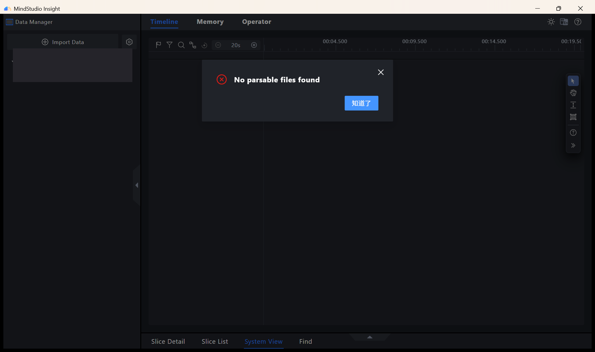

# DriveVLA-W0 部署与训练 FAQ

这篇给第一次在昇腾 NPU 上跑 DriveVLA-W0、或接手复跑任务的同事看。遇到问题可以从下面几节直接找；需要看完整命令，用[启动命令手册](drivevla-w0-launch-commands.zh-CN.md)，需要看当时的日志和结果，用[实际问题复盘](drivevla-w0-deployment-training-common-issues.zh-CN.md)。

| 项目 | 本次分享对应的配置 |
|---|---|
| 模型 | **Qwen3-VL-8B-Instruct + ROSS**。Qwen3-VL 是视觉语言骨干，ROSS 用到 Stable Diffusion 1.5 的 UNet 和 VAE；动作 tokenizer 用仓库里的 `configs/fast`。 |
| 数据 | **OpenScene/NAVSIM**。拿 `mini` 检查数据链路，用 `trainval` 子集做正式训练和测速。历史单机基线用了 40 个相机分片，索引有 61,898 条样本；这个数不是整个数据集的规模。 |
| 环境 | Linux 宿主机 + Docker，每台 **8 × Ascend 950DT**。历史实测镜像：CANN 9.2.0、Python 3.12、PyTorch / torch_npu 2.11 系列、DeepSpeed 0.19.7，使用仓库内的 Transformers 4.56.0。这些是该镜像的版本记录，复跑先确认镜像 ID 和实际包版本。 |
| 训练 | 单机 8 卡、双机 16 卡，使用数据并行加 ZeRO。`safe` 用 SDPA + ZeRO-3 CPU offload，`fast` 用 BF16 + FlashAttention-2 + ZeRO-2。 |

## 先跑什么，后跑什么

**验容器和数据 → 验 HCCL → `safe` 跑 3 步 → `fast` 跑 3 步 → 提高每卡 batch → 正式测速 → 单独采集 Insight。**

**`safe` 和 `fast` 选训练配置，`measure` 选任务类型。** 可以用 `fast` 跑 `measure`。

| 名称 | 含义 | 怎么用 |
|---|---|---|
| `safe` | SDPA + ZeRO-3，参数和优化器状态卸载到 CPU，NPU 显存压力较小。 | 先用每卡 2 条样本跑 3 步，确认取数、反向和更新都能完成。 |
| `fast` | FA2 + ZeRO-2，无 CPU 卸载，通常更快，NPU 显存压力也更大。 | 先用同样的小 batch 跑 3 步，确认 loss 和梯度范数正常，再提高 batch。 |
| `measure` | 正式测速，关掉 Profiler，不保存模型。 | 通常用 `fast` 跑 50 步，跳过前 10 步，取第 11–50 步算稳态速度。 |

单机通过后，上双机先验 16 卡通信，再跑冒烟。想看慢在哪里，单独跑 `profile`；要采满 50 步，需显式开启全程采集。

## 1. 容器显示 READY，为什么还是跑不起来？

**现象。** 重建过容器，状态文件还是 `env=READY`，进入训练却报 `No module named transformers`（历史复盘记录中的报错关键词）。另外，宿主机能看到 NPU，容器里的 `torch.npu.is_available()` 也可能是 `False`。

**影响。** 前一种连训练代码都没导入，后一种是容器没有可用的 NPU。两种都会让训练在第一步之前停住。一个旧状态文件不能替代当前容器的检查。

**如何解决。** 先在宿主机运行 `npu-smi info`，看设备、逐卡进程和显存。空闲卡可以有几 GB 基线显存；利用率为 0 也不能排除驻留的服务进程。再进入训练容器，加载部署时的环境，确认设备和包都能用：

```bash
# 在训练容器内，加载训练环境后执行
python -c 'import torch, torch_npu, transformers, deepspeed; print(torch.npu.is_available(), torch.npu.device_count()); print(torch.__version__, torch_npu.__version__, deepspeed.__version__); print(transformers.__file__)'
python -m pip check
```

- 宿主机能看卡、容器里看不到：核对 `--device`、驱动挂载和 CANN 环境入口。
- NPU 正常、Transformers 缺失或路径不对：在仓库根目录执行 `env -u PYTHONPATH python -m pip install -e ./reference/transformers`，再查导入路径是否落在 `reference/transformers`。
- 最后读一批真实数据、验 HCCL、跑 3 步训练。只做导入检查，还没覆盖模型、数据和反向传播。

## 2. 权重和 pkl 都在，为什么还会报缺文件？

**现象。** 模型目录里有 `config.json`，但权重索引指向的某个分片下载不全；或 `train.pkl` 能读取，DataLoader 仍找不到相机图片。这里是常见现象，没有把它们写成某次实验的原始报错。

**影响。** 缺权重会在加载模型时停住；`pkl` 与图片根目录不匹配则可能跑到第一批数据才报错。换 batch 或调 ZeRO 解决不了这类问题。

**如何解决。** 在**容器里**按下表检查，两台机器都要能访问同一份内容：

| 检查项 | 应该核对什么 |
|---|---|
| Qwen3-VL 权重 | 检查 tokenizer、processor 和 `model.safetensors.index.json`，按索引列出的文件把每个分片核对一遍。空文件和 Git LFS 指针都不是权重。 |
| ROSS 资源 | 检查 SD1.5 的 `unet/`、`vae/` 及相应配置，动作 tokenizer 用仓库的 `configs/fast`。 |
| `ZB_DATA` | 容器内的 `train.pkl`。它是样本索引，图片不在这个文件里。 |
| `ZB_DATA_ROOT` | pkl 中图片相对路径对应的根目录。切到 `trainval` 时，pkl 和根目录一起换。 |

最后用实际的取数代码读几条数据，确认图片能打开、能转成训练输入。如果已在容器里设置 `QWEN_DIR`、`ZB_DATA` 和 `ZB_DATA_ROOT` 为对应的绝对路径，可在仓库根目录跑一次小样本检查：

```bash
python utils/benchmark_mfu.py shapes \
  "$QWEN_DIR" "$ZB_DATA" "$ZB_DATA_ROOT" /tmp/drivevla-shapes.json --count 4
```

详细的分片下载和数据准备步骤在[单机部署指南](drivevla-w0-qwen3vl-a5-single-node-from-zero.zh-CN.md)里。

## 3. 单机能跑，双机为什么卡在初始化？

**现象。** 两个容器都已经启动，任务却卡在 HCCL 初始化，或者报错里出现 `HcclBroadcast`。这行是一次真实失败日志留下的末尾信息：

```text
[rank6]: RuntimeError: The Inner error is reported as above. The process exits for this inner error, and the current working operator name is HcclBroadcast.
```

**影响。** 一边没有成功加入通信组，另一边就不能继续梯度同步。端口冲突、卡被占用和会合配置不一致都可能卡在这里；仅凭 `HcclBroadcast` 不能判定根因。这次还查到了 `EI0020`、设备端口已绑定及其他任务占卡，正式 50 步测试没有开始。

**如何解决。** 每台各起一个容器、各挂 8 张本机卡。两边用同一镜像 ID、发布版本、权重、数据和训练配置；`nnodes=2`，`node_rank` 分别是 0 和 1，`master_addr` 指向 rank 0 可达的会合地址，`master_port` 一致。启动器的配对和端口配置见[启动命令手册](drivevla-w0-launch-commands.zh-CN.md)。先在两边确认卡和端口空闲，再跑 16 卡 HCCL 检查和训练冒烟。一次失败里出现的 HCCL 设备端口和 torchrun 会合端口不是同一个概念。

`NGPUS=8` 是**每台**的卡数。固定每卡 batch 24、梯度累积 1 时，单机和双机每次更新分别处理 192、384 条样本。步时接近时，双机吞吐仍可能接近单机的两倍。

## 4. fast 第一步报错，或 batch 一调大就失败，该先看哪儿？

| 现象（历史日志关键词） | 影响 | 如何解决 |
|---|---|---|
| `call aclnnAmax failed, error code is 561000` | fast 的首步卡在 ZeRO-2 梯度检查。已有单元素 BF16 视图引用比自身大得多的底层梯度存储的实测案例。 | 用 [benchmark-mfu.sh](../scripts/a5/benchmark-mfu.sh) 启动 fast 档，让 [ZeRO-2 兼容层](../utils/npu_zero2_compat.py)检查该视图对应元素的有限性，保留 NaN/Inf 检查。先跑低 MBS 冒烟，再确认 50 步。 |
| `unable to allocate shared memory(shm)` | DataLoader 工作进程传输 batch 时失败，未必用完 NPU 显存。 | 用 `docker exec "$ZB_CONTAINER" df -h /dev/shm` 查容器共享内存。历史上自己的容器从 16 GiB 调到 96 GiB 后，MBS 16–32 短测通过。重建时可由 `--shm-size=96g` 保留。 |
| 日志明确指向 NPU 显存不足 | 模型、优化器状态或激活超出 HBM，可能只有一个 rank 先失败。 | 先观察所有 rank 峰值，从降 MBS 开始；若动图片大小、重算或 ZeRO，分别验证吞吐、显存和训练是否正常。扩大容器的 `/dev/shm` 不会增加 HBM。 |

如果 safe 能跑、fast 失败，优先看两套配置切换了什么：注意力实现、ZeRO 阶段和 DataLoader。日志里最先出错的 rank 往往比最后一行 `torchrun` 失败提示更有用。

## 5. 为什么 3 步、50 步、MFU、HFU 的数字不一样？

**现象。** 历史单机 3 步冒烟曾估出 **4.87% MFU**；后续 MBS 2 的 fast 50 步正式跑，按当时的骨干口径算出 **34.32%**。另一次双机实验同轮给出 **48.07% 有效 MFU** 和 **61.23% HFU**。

**影响。** 把冒烟结果当稳态会误判速度；把含重算的 HFU 当有效 MFU，会误报已达到 60% 目标。

**如何解决。** 把实验分开，写清楚每个数字来自哪一轮：

| 轮次 | 回答的问题 |
|---|---|
| `smoke` | 3 步能不能跑通，loss、梯度范数是否有限。 |
| `measure` | 关闭 Profiler 跑正式速度。常用 50 步、取第 11–50 步的平均步时/P50/P95 和吞吐；端到端结果用完整 50 步。 |
| `audit` | 记录 FLOPs 或核对输入形状，确认有效工作量、ROSS 和重算分别怎么算。 |
| `profile` | 定位慢在哪一段。采集本身有开销，不用这轮的步时替代正式测速。 |

有效 MFU 用有效训练 FLOPs；HFU 另外计入为省显存而重跑的前向。两者都要说明时间、卡数和每卡峰值假设。`utils/flops_mindspeed.py` 负责 FLOPs/MFU 口径计算；`utils/benchmark_mfu.py` 用实测样本形状和计时做汇总，默认骨干口径不会自动变成含 ROSS 的结果。扩卡线性度是**实际吞吐增长 ÷ 理想卡数倍数**，不等于单步耗时。

## 6. Insight 里为什么是空的，或者只有第 28 步？

**现象。** 这两种情况要分开看。一次导入层级不对，Insight 提示 `No parsable files found`。另一种情况是采集文件能正常读取，但 11 月 14 日单机 8 卡和双机 16 卡的 Profiler 数据库每张卡都只记录了 `step=28`。



**影响。** 导入失败会连时间线都打不开；单步采集能分析这一步，但不能判断等待或空档是否在其他步反复出现。汇总库即便有 16 卡、50 步，也可能没有逐算子轨道，和缺步是不同的问题。

**如何解决。**

- **导入报错：** 另建 `import-db`，把要看的各个 `*_ascend_pt` 目录放到它的直接下一级，然后选 `import-db` 本身。看集群统计用汇总库；看 MatMul 等算子时间线用各 rank 的原始 `ascend_pytorch_profiler_*.db`。若 `all` 分析卡在 Communication Matrix，可用 `communication_time` 保留 Step Trace 和通信统计；界面的矩阵图仍可能为空。
- **只有第 28 步：** 默认调度跳过 26 步，再等 1 步、预热 1 步，只采 1 步。跑 30 步或 50 步不等于采这么多步。要采整段，使用支持全程采样的启动器和代码，保持原来的单机或双机参数，设置 `ZB_JOB=profile ZB_MFU_STEPS=50 ZB_PROFILE_FULL=1`。跑完查看每个 rank 的数据库是否真的有 50 个不同 step。旧的扩卡汇总脚本只读单步，全程数据不能直接交给它出同口径的多步报告。

如果已导出各 rank 的 `analysis.db`，可以在 SQLite 里用下面这句确认采了几步。再核对文件数是否与计划的 8 卡或 16 卡一致：

```sql
SELECT COUNT(DISTINCT step) AS captured_steps FROM StepTraceTime;
```

拿到数据后，先看 Stage、Computing、未重叠通信和 Free。通信总时长有一部分和计算重叠，不能全部算成能省的时间；Free 也不一定全是读数据慢。先找出哪张卡、哪些步异常，再到原始时间线看原因。两次真实采集的区别见[复盘案例 5](drivevla-w0-deployment-training-common-issues.zh-CN.md)。
