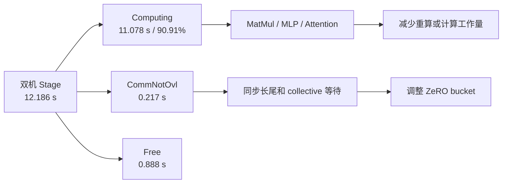
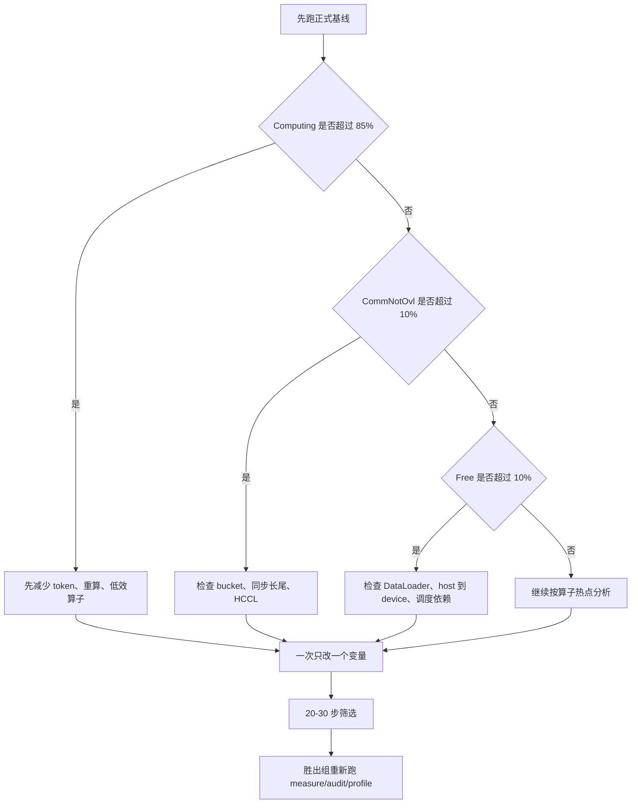

# DriveVLA-W0 + Qwen3-VL：A5 双机部署、性能对比与调优指南

更新日期：2026-11-14  
适用范围：两台 A5 机器，每台 8 张 Ascend NPU，通过静态 `torchrun` 组成 16 卡训练任务。  
训练路线：DriveVLA-W0 + Qwen3-VL-8B-Instruct + ROSS，OpenScene/NAVSIM trainval 子集，BF16、FlashAttention-2、DeepSpeed ZeRO-2。  
隔离方式：代码工作区、容器、共享目录和实验记录统一使用 `zhaobo` 命名。

> 这是一份双机执行指南。单机侧的宿主检查、镜像构建、模型下载和数据准备，应先按
> [DriveVLA-W0 + Qwen3-VL：A5 单机从零部署与训练指南](drivevla-w0-qwen3vl-a5-single-node-from-zero.zh-CN.md)
> 完成。本文从“两台机器都已有自己的容器和本地工作区”开始，重点说明如何验证两边一致、
> 如何启动 16 卡训练、如何正式测速、如何看 Insight，以及如何做可回退的性能优化。
>
> 常见判断和新手问题先看
> [部署与训练通用 FAQ](drivevla-w0-deployment-training-faq.zh-CN.md)；真实事故经过和截图见
> [实际问题复盘](drivevla-w0-deployment-training-common-issues.zh-CN.md)。

## 1. 最终链路


“双机跑通”需要同时满足以下条件：

| 层级 | 验收条件 |
|---|---|
| 硬件 | 两台机器各有 8 张空闲 NPU，16 个 rank 均可见设备 |
| 通信 | 两机 16 rank 的 HCCL all-reduce 全部返回正确结果 |
| 配置 | 代码提交、镜像、模型 revision、数据、batch、ZeRO、GC 和 attention 完全一致 |
| 训练 | 3 步冒烟完成，所有 rank loss 和 grad norm 有限 |
| 性能 | 50 步正式测速完成，16 个 rank 文件齐全，HBM 未达到上限 |
| 分析 | measure、audit、profile 分开执行，指标没有混用 |

## 2. 固定资源

机器标识不写进文档。在 `node1` 和 `node2` 上分别设置自己的短名，其余资源保持一致。

| 项目 | 固定值 |
|---|---|
| 代码仓库 | `https://github.com/zhaobo999666-lab/DriveVLA-W0.git` |
| 分支 | `qwen3vl-backbone` |
| 已验证基线提交 | `bf729327b24b687bb910153dfe5d74c34dbb1b69` |
| 骨干模型 | `Qwen/Qwen3-VL-8B-Instruct`，约 17 GB |
| ROSS 辅助模型 | `stable-diffusion-v1-5/stable-diffusion-v1-5` 的 UNet、VAE、scheduler |
| 数据 | OpenScene/NAVSIM；先 mini，再做 40 个 trainval 相机分片 |
| 精度 | BF16 |
| 性能路线 | FA2 + ZeRO-2 + fused gate/up + FA2 metadata cache |
| 单机配置 | 8 卡，MBS 24，GBS 192 |
| 双机配置 | 16 卡，MBS 24，GBS 384 |
| 训练端口 | 29555 |
| 通信验收端口 | 29556 |

镜像由公共 CANN 基础镜像加项目依赖构建：

```text
基础镜像：
swr.cn-south-1.myhuaweicloud.com/ascendhub/cann@sha256:f81ad0b1f1e9b57e7859a334a9b63ba4444f6af1f0721e87300922627756ec1c

本地训练标签：
zhaobo/drivevla-w0:qwen3vl-cann9.2-torch2.11-py312
```

本地训练标签不是公共镜像。公共基础来自 AscendHub；项目依赖、Python 虚拟环境和
DriveVLA-W0 所需的 `torch_npu`、DeepSpeed、Diffusers 等由仓库 Dockerfile 安装。

两台机器必须使用同一镜像 ID。标签相同不代表内容相同，验收记录中要保存：

```bash
docker image inspect --format '{{.Id}}' "$ZB_IMAGE"
```

## 3. 目录、容器与命名

在每台宿主机分别设置：

```bash
export ZB_NODE='node1'                         # node2 改成 node2
export ZB_HOME="/data1/zhaobo/drivevla-w0-${ZB_NODE}"
export ZB_SHARED=/mnt/sfs_turbo/zhaobo/drivevla-w0
export ZB_CONTAINER="zhaobo-drivevla-${ZB_NODE}"
export ZB_IMAGE=zhaobo/drivevla-w0:qwen3vl-cann9.2-torch2.11-py312
export ZB_REPO_URL=https://github.com/zhaobo999666-lab/DriveVLA-W0.git
export ZB_REPO_BRANCH=qwen3vl-backbone
export ZB_RELEASE_DIR="$ZB_SHARED/artifacts/code/qwen3vl-dual"
```

目录职责：

| 路径 | 作用 | 是否需要两台各一份 |
|---|---|---|
| `/data1/zhaobo/drivevla-w0-${ZB_NODE}` | 节点本地工作区、日志、临时数据 | 是 |
| `/mnt/sfs_turbo/zhaobo/drivevla-w0/models` | Qwen3-VL、SD1.5 权重 | 共享一份 |
| `/mnt/sfs_turbo/zhaobo/drivevla-w0/data` | OpenScene 原图和 pkl | 共享一份 |
| `/mnt/sfs_turbo/zhaobo/drivevla-w0/artifacts/code` | 共享代码 release | 共享一份 |
| `/mnt/sfs_turbo/zhaobo/drivevla-w0/artifacts/images` | 镜像 tar 和校验文件 | 共享一份 |
| `/mnt/sfs_turbo/zhaobo/drivevla-w0/artifacts/runs` | 训练和测速结果 | 共享一份 |

`/data1` 是节点本地盘，不能假设两台共享。`/mnt/sfs_turbo` 才是共享盘。开始前确认两台
看到的是同一个文件系统，并且只有 `zhaobo` 目录由自己写入：

```bash
# [两台宿主机分别执行]
mountpoint -q /mnt/sfs_turbo
mkdir -p "$ZB_SHARED/.mount-check"
hostname -s > "$ZB_SHARED/.mount-check/from-${ZB_NODE}"
ls -l "$ZB_SHARED/.mount-check"
stat -c '%d:%i %n' "$ZB_SHARED/.mount-check/from-${ZB_NODE}"
```

在两台机器上应看到彼此的文件。不要把自己任务的结果写到其他用户目录，也不要删除共享
目录中的他人文件。

## 4. 双机前置验收

两台机器先分别完成单机指南中的宿主机、镜像、容器、模型、数据和单机 HCCL 验收。

### 4.1 每台机器分别检查

```bash
# [两台宿主机分别执行]
hostname
uname -m
npu-smi info
docker version
df -h /data1 /mnt/sfs_turbo
ss -lnt '( sport = :29555 or sport = :29556 )'
docker ps --filter "name=^${ZB_CONTAINER}$"
docker exec "$ZB_CONTAINER" df -h /dev/shm
```

必须满足：

- `uname -m` 为 `aarch64`。
- 每台 `npu-smi info` 都能看到 8 张 `Ascend950DT`。
- 节点自己的 8 张卡没有其他人的进程，也不存在大块 HBM 驻留。
- 29555 和 29556 没有被占用。
- 容器运行中、使用 host network、`/dev/shm` 至少 64 GiB。
- 本地盘和共享盘都有足够空间。

### 4.2 镜像一致性

推荐只在一台构建，然后通过共享盘同步镜像 tar：

```bash
# [node1 宿主机]
source "$ZB_HOME/bootstrap/zb-env.sh"
ZB_DOCKERFILE=$(find "$ZB_HOME/code/DriveVLA-W0/docs" -type f -name Dockerfile | head -n 1)
test -n "$ZB_DOCKERFILE"

docker pull --platform linux/arm64 \
  swr.cn-south-1.myhuaweicloud.com/ascendhub/cann@sha256:f81ad0b1f1e9b57e7859a334a9b63ba4444f6af1f0721e87300922627756ec1c

docker build --platform linux/arm64 \
  -f "$ZB_DOCKERFILE" \
  -t "$ZB_IMAGE" \
  "$(dirname "$ZB_DOCKERFILE")"

IMAGE_DIR="$ZB_SHARED/artifacts/images/qwen3vl-a5"
mkdir -p "$IMAGE_DIR"
docker save -o "$IMAGE_DIR/image.tar" "$ZB_IMAGE"
docker image inspect --format '{{.Id}}' "$ZB_IMAGE" > "$IMAGE_DIR/image.id"
(
  cd "$IMAGE_DIR"
  sha256sum image.tar image.id > SHA256SUMS
)
```

在另一台机器导入：

```bash
# [node2 宿主机]
source "$ZB_HOME/bootstrap/zb-env.sh"
IMAGE_DIR="$ZB_SHARED/artifacts/images/qwen3vl-a5"

(
  cd "$IMAGE_DIR"
  sha256sum -c SHA256SUMS
)

if ! docker image inspect "$ZB_IMAGE" >/dev/null 2>&1; then
  docker load -i "$IMAGE_DIR/image.tar"
fi

test "$(docker image inspect --format '{{.Id}}' "$ZB_IMAGE")" = \
  "$(cat "$IMAGE_DIR/image.id")"
```

如果镜像已经预先准备好，也必须重新执行最后的 image ID 对比。不要只看标签。

### 4.3 Python、NPU 与训练依赖

```bash
# [两台宿主机分别执行]
docker exec "$ZB_CONTAINER" bash --noprofile --norc -lc '
source /work/zhaobo/bootstrap/enter-env.sh
python - <<"PY"
import torch
import torch_npu
import transformers
import deepspeed
import diffusers
print("torch       =", torch.__version__)
print("torch_npu   =", torch_npu.__version__)
print("transformers=", transformers.__version__, transformers.__file__)
print("deepspeed   =", deepspeed.__version__)
print("diffusers   =", diffusers.__version__)
print("npu         =", torch.npu.is_available(), torch.npu.device_count())
assert torch.npu.is_available()
assert torch.npu.device_count() == 8
PY
'
```

两边的包版本和 vendored Transformers 路径必须一致。若一边导入的是 PyPI
Transformers、另一边导入的是仓库版本，双机训练可能出现难以解释的行为差异。

## 5. 模型、数据和代码一致性

### 5.1 共享模型与数据

模型、SD1.5 和 trainval 数据只需要在共享盘准备一次。双机训练读取相同的容器绝对路径：

```text
/work/zhaobo/models/Qwen3-VL-8B-Instruct
/work/zhaobo/models/stable-diffusion-v1-5
/work/zhaobo/data/prepared-trainval/train.pkl
/work/zhaobo/data/raw-camera/openscene-v1.1/sensor_blobs/trainval
```

推荐至少准备 40 个 trainval 相机分片。历史 40 分片配置约 250 GB，生成约 6 万条训练样本。
全量 200 片约 1.24 TB，第一次跑通和性能调优没有必要下载全量。

在两台机器分别检查：

```bash
# [两台宿主机分别执行]
docker exec "$ZB_CONTAINER" bash --noprofile --norc -lc '
source /work/zhaobo/bootstrap/enter-env.sh
test -s /work/zhaobo/models/Qwen3-VL-8B-Instruct/config.json
test -d /work/zhaobo/models/stable-diffusion-v1-5/unet
test -d /work/zhaobo/models/stable-diffusion-v1-5/vae
test -s /work/zhaobo/data/prepared-trainval/train.pkl
test -d /work/zhaobo/data/raw-camera/openscene-v1.1/sensor_blobs/trainval
python - <<"PY"
import json
import pickle
from pathlib import Path

qwen = Path("/work/zhaobo/models/Qwen3-VL-8B-Instruct")
index = json.loads((qwen / "model.safetensors.index.json").read_text())
shards = sorted(set(index["weight_map"].values()))
assert shards and all((qwen / name).is_file() for name in shards)

with open("/work/zhaobo/data/prepared-trainval/train.pkl", "rb") as stream:
    samples = pickle.load(stream)
assert samples
print("qwen_shards =", len(shards))
print("train_samples =", len(samples))
PY
'
```

模型 revision、SD1.5 revision、数据分片范围和样本数都要写进本次实验记录。模型文件大小正确
不代表两边一致，正式任务应依赖共享盘上的同一份文件。

### 5.2 代码提交一致

在每台机器上固定同一提交：

```bash
# [两台宿主机分别执行]
cd "$ZB_HOME/code/DriveVLA-W0"
git fetch origin "$ZB_REPO_BRANCH"
git checkout "$ZB_REPO_BRANCH"
git pull --ff-only origin "$ZB_REPO_BRANCH"
git rev-parse HEAD
```

两边输出的 commit 必须相同。已知稳定提交可直接切换：

```bash
git checkout bf729327b24b687bb910153dfe5d74c34dbb1b69
```

训练真正执行的共享脚本不是节点本地仓库，而是发布到共享盘上的 release。任一节点发布一次：

```bash
# [建议在 rank 0 执行]
REPO="$ZB_HOME/code/DriveVLA-W0"
mkdir -p "$ZB_RELEASE_DIR"

# 首次初始化 release 时，先把两个入口脚本放进共享目录。
if [[ ! -x "$ZB_RELEASE_DIR/start-training.sh" ]]; then
  ZB_NODE_LAUNCHER=$(find "$REPO/scripts/a5" -maxdepth 1 -type f \
    -exec grep -Il 'prepare-peer' {} + | head -n 1)
  test -n "$ZB_NODE_LAUNCHER"
  install -m 0755 "$REPO/scripts/a5/start-training.sh" \
    "$ZB_RELEASE_DIR/start-training.sh"
  install -m 0755 "$ZB_NODE_LAUNCHER" \
    "$ZB_RELEASE_DIR/${ZB_NODE_LAUNCHER##*/}"
fi

cd "$ZB_RELEASE_DIR"
ZB_RELEASE_DIR="$ZB_RELEASE_DIR" ZB_NODE="$ZB_NODE" \
  bash start-training.sh publish
cat REVISION
```

然后两台分别检查：

```bash
# [两台宿主机分别执行]
cd "$ZB_RELEASE_DIR"
ZB_RELEASE_DIR="$ZB_RELEASE_DIR" ZB_NODE="$ZB_NODE" \
  bash start-training.sh status
```

输出必须同时包含：

```text
env=READY
npu_busy=0/8
container=Up
sync=ok
```

如果出现 `sync=STALE`，先重新发布，不要直接启动训练。

## 6. 网络与会合参数

当前启动器使用 HCCL 网卡 `enp39s0f3`：

```bash
# [两台宿主机分别执行]
ip -o -4 addr show dev enp39s0f3
HCCL_IP=$(ip -o -4 addr show dev enp39s0f3 |
  awk '{sub(/\/.+$/, "", $4); print $4; exit}')
test -n "$HCCL_IP"
printf '%s\n' "$HCCL_IP"
```

记下两台机器各自的 HCCL IP，只在当前终端中通过变量保存。以下示例中的值必须替换成你自己的
rank 0、rank 1 HCCL IP：

```bash
# [两台宿主机都设置相同变量]
export ZB_NODE_LIST=node1,node2
export ZB_NODE_IP_NODE1='rank0 的 enp39s0f3 IP'
export ZB_NODE_IP_NODE2='rank1 的 enp39s0f3 IP'
export ZB_PAIR=zhaobo-qwen3vl-dual-01
```

各自再设置：

```bash
# [node1]
export ZB_NODE=node1
export ZB_NODE_RANK=0

# [node2]
export ZB_NODE=node2
export ZB_NODE_RANK=1
```

双向网络检查：

```bash
# [node1]
ping -c 3 "$ZB_NODE_IP_NODE2"

# [node2]
ping -c 3 "$ZB_NODE_IP_NODE1"
```

静态 `torchrun` 的参数关系：

| 参数 | 双机值 |
|---|---:|
| `--nnodes` | `2` |
| `--nproc_per_node` | `8` |
| rank 0 的 `--node_rank` | `0` |
| rank 1 的 `--node_rank` | `1` |
| `--master_addr` | rank 0 的 HCCL IP |
| 训练 `--master_port` | `29555` |
| HCCL 验收端口 | `29556` |

`ZB_PAIR` 让 rank 0 把本机 HCCL IP 写入共享盘，rank 1 自动读取，避免手工复制。
如果显式设置 `ZB_MASTER_ADDR`，它会覆盖自动发现值。

两套变量用途不同：

- `start-training.sh check/smoke/train` 使用 `ZB_PAIR` 完成 rank 0 到 rank 1 的会合地址握手。
- `benchmark-mfu.sh` 使用 `ZB_PAIR_RUN` 给同一次性能实验命名，并根据 `ZB_NODE_LIST`
  自动推导本机 rank。

## 7. 16 rank HCCL 验收

在两台宿主机分别开 tmux：

```bash
tmux new -s zhaobo-dual-hccl
```

先在 rank 0 执行，再在 rank 1 执行同一条命令：

```bash
cd "$ZB_RELEASE_DIR"

export ZB_NODE_LIST=node1,node2
export ZB_NODE_IP_NODE1='rank0 的 enp39s0f3 IP'
export ZB_NODE_IP_NODE2='rank1 的 enp39s0f3 IP'
export ZB_PAIR=zhaobo-qwen3vl-dual-01

ZB_RELEASE_DIR="$ZB_RELEASE_DIR" \
ZB_NODE="$ZB_NODE" \
ZB_NODE_RANK="$ZB_NODE_RANK" \
ZB_NODES=2 \
ZB_STRICT_RELEASE=1 \
bash start-training.sh check dual-hccl-01 fast 24 qwen3vl 2
```

启动顺序保持为 rank 0 先、rank 1 后。两边都要看到 16 个 rank 输出 `HCCL OK`。
若只看到 8 个，或某一边超时，检查：

1. 两台 `ZB_NODE_RANK` 是否分别为 0 和 1。
2. `ZB_NODE_LIST` 是否都是 `node1,node2`。
3. `ZB_NODE_IP_NODE1` 和 `ZB_NODE_IP_NODE2` 是否是 `enp39s0f3` 的地址。
4. rank 0 是否先启动，并写出共享盘中的 `master-<run-id>.ip`。
5. 29556 是否被其他进程占用。
6. 两台容器是否都使用 host network。

## 8. 分阶段启动训练

所有训练命令都由两台分别执行。每对命令使用相同 run ID、profile、MBS、模型和节点数。

### 8.1 safe 冒烟

safe 使用 SDPA、ZeRO-3 CPU offload、关闭 pinned loader。它较慢，但更适合确认模型、
数据和优化器链路：

```bash
# [两台分别执行]
cd "$ZB_RELEASE_DIR"
ZB_NODE="$ZB_NODE" ZB_NODE_RANK="$ZB_NODE_RANK" ZB_NODES=2 \
ZB_STRICT_RELEASE=1 \
ZB_RELEASE_DIR="$ZB_RELEASE_DIR" \
bash start-training.sh smoke dual-safe-01 safe 2 qwen3vl 2
```

成功标志为两台日志均退出 0，且本地记录出现 `SMOKE OK`。

### 8.2 fast MBS 2 冒烟

```bash
# [两台分别执行]
cd "$ZB_RELEASE_DIR"
ZB_NODE="$ZB_NODE" ZB_NODE_RANK="$ZB_NODE_RANK" ZB_NODES=2 \
ZB_STRICT_RELEASE=1 \
ZB_RELEASE_DIR="$ZB_RELEASE_DIR" \
bash start-training.sh smoke dual-fast-02 fast 2 qwen3vl 2
```

fast 使用 FA2 与 ZeRO-2。第一次如果失败，不要直接跳到 MBS 24。先分别回到单机 safe 档，
确认模型能够加载、数据能够读取，再检查双机 HCCL。

### 8.3 训练 batch 阶梯

链路通过后先试 MBS 8、16、24。每次只改 MBS，并重新做 smoke：

```bash
# [两台分别执行]
cd "$ZB_RELEASE_DIR"

export ZB_DATA=/work/zhaobo/data/prepared-trainval/train.pkl
export ZB_DATA_ROOT=/work/zhaobo/data/raw-camera/openscene-v1.1/sensor_blobs/trainval

for BATCH in 8 16 24; do
  ZB_RELEASE_DIR="$ZB_RELEASE_DIR" \
  ZB_NODE="$ZB_NODE" \
  ZB_NODE_RANK="$ZB_NODE_RANK" \
  ZB_NODES=2 \
  ZB_STRICT_RELEASE=1 \
  bash start-training.sh smoke "dual-fast-mbs${BATCH}" fast "$BATCH" qwen3vl 2
done
```

正式性能基线使用 MBS 24：

```text
GBS = MBS × 8 × 2 = 384
```

### 8.4 普通 50 步训练

这一步会保存权重和优化器状态，可能占用 100 GB 以上空间。仅做性能测试时应跳过它，
使用下一节的 benchmark。

```bash
# [两台分别执行]
export ZB_DATA=/work/zhaobo/data/prepared-trainval/train.pkl
export ZB_DATA_ROOT=/work/zhaobo/data/raw-camera/openscene-v1.1/sensor_blobs/trainval

ZB_NODE="$ZB_NODE" ZB_NODE_RANK="$ZB_NODE_RANK" ZB_NODES=2 \
ZB_STRICT_RELEASE=1 \
ZB_RELEASE_DIR="$ZB_RELEASE_DIR" \
bash start-training.sh train dual-real50-01 fast 24 qwen3vl 2
```

训练结束后必须检查：

- 两台进程退出码均为 0。
- 16 个 rank 都完成 50 步。
- loss、grad norm 为有限值。
- 保存目录中既有模型分片，也有索引、配置、processor 和 `trainer_state.json`。
- 全 rank 峰值 HBM 没有逼近 96 GB 上限。

## 9. 双机正式性能测速

性能测试应关闭 Profiler 和模型保存。measure 提供正式步时、TPS、MFU/HFU 和 HBM；
audit 单独统计 FLOPs；profile 只用于定位耗时。

### 9.1 创建可追溯的性能启动目录

先从 rank 0 发布代码 release，再把 benchmark 依赖复制到独立快照：

```bash
# [rank 0 宿主机]
source "$ZB_HOME/bootstrap/zb-env.sh"
cd "$ZB_HOME/code/DriveVLA-W0"

PERF="$ZB_SHARED/artifacts/code/qwen3vl-dual-v1"
mkdir -p "$PERF/mfu-fast-bin"

install -m 0755 scripts/a5/benchmark-mfu.sh "$PERF/benchmark-mfu.sh"
install -m 0644 scripts/a5/benchmark_mfu.py "$PERF/benchmark_mfu.py"
install -m 0644 utils/npu_zero2_compat.py "$PERF/npu_zero2_compat.py"
install -m 0755 scripts/a5/mfu-fast-bin/torchrun "$PERF/mfu-fast-bin/torchrun"

cd "$ZB_RELEASE_DIR"
ZB_RELEASE_DIR="$ZB_RELEASE_DIR" ZB_NODE="$ZB_NODE" \
  bash start-training.sh publish
```

两台各做一次 dry-run。dry-run 会校验节点、目录、代码版本、模型和数据，但不会占用 NPU：

```bash
# [先 node1，再 node2]
cd "$PERF"

ZB_NODE="$ZB_NODE" \
ZB_NODE_LIST=node1,node2 \
ZB_NODE_IP_NODE1='rank0 的 enp39s0f3 IP' \
ZB_NODE_IP_NODE2='rank1 的 enp39s0f3 IP' \
ZB_PAIR_RUN=zhaobo-dual-measure-01 \
ZB_JOB=measure \
ZB_MFU_PROFILE=fast \
ZB_MBS=24 \
ZB_MFU_STEPS=50 \
ZB_MFU_WARMUP=10 \
bash benchmark-mfu.sh --dry-run
```

### 9.2 关闭 Profiler 的 50 步正式测速

在两台分别执行。rank 0 先进入并等待 rank 1，最迟约 3 分钟内启动另一边。

```bash
# [两台分别执行，命令一致]
cd /mnt/sfs_turbo/zhaobo/drivevla-w0/artifacts/code/qwen3vl-dual-v1

ZB_NODE="$ZB_NODE" \
ZB_NODE_LIST=node1,node2 \
ZB_NODE_IP_NODE1='rank0 的 enp39s0f3 IP' \
ZB_NODE_IP_NODE2='rank1 的 enp39s0f3 IP' \
ZB_PAIR_RUN=zhaobo-dual-measure-01 \
ZB_JOB=measure \
ZB_MFU_PROFILE=fast \
ZB_MBS=24 \
ZB_MFU_STEPS=50 \
ZB_MFU_WARMUP=10 \
ZB_FUSED_GATEUP=1 \
ZB_GC_SKIP_TEXT_LAST=2 \
ZB_FA2_UNPAD_CACHE=1 \
ZB_FA2_UNPAD_MARKERS=0 \
ZB_FA2_UNPAD_STATS=0 \
ZB_ZERO2_BUCKET_SIZE=auto \
ZB_ZERO2_OVERLAP_COMM=1 \
ZB_HCCL_DETERMINISTIC=1 \
bash benchmark-mfu.sh
```

输出目录：

```text
/mnt/sfs_turbo/zhaobo/drivevla-w0/artifacts/runs/mfu/mfu-node1-node2-zhaobo-dual-measure-01-measure/
├── run-info.txt
├── shapes.json
├── shapes.log
├── summary.txt
├── train-node1.log
├── train-node2.log
├── train-node1.exit
└── train-node2.exit
```

### 9.3 独立 FLOPs audit

```bash
# [两台分别执行，先换新 run ID]
cd /mnt/sfs_turbo/zhaobo/drivevla-w0/artifacts/code/qwen3vl-dual-v1

ZB_NODE="$ZB_NODE" \
ZB_NODE_LIST=node1,node2 \
ZB_NODE_IP_NODE1='rank0 的 enp39s0f3 IP' \
ZB_NODE_IP_NODE2='rank1 的 enp39s0f3 IP' \
ZB_PAIR_RUN=zhaobo-dual-audit-01 \
ZB_JOB=audit \
ZB_MFU_PROFILE=fast \
ZB_MBS=24 \
ZB_MFU_STEPS=50 \
ZB_MFU_WARMUP=10 \
ZB_FUSED_GATEUP=1 \
ZB_GC_SKIP_TEXT_LAST=2 \
ZB_FA2_UNPAD_CACHE=1 \
bash benchmark-mfu.sh
```

### 9.4 独立 Insight profile

```bash
# [两台分别执行，先换新 run ID]
cd /mnt/sfs_turbo/zhaobo/drivevla-w0/artifacts/code/qwen3vl-dual-v1

ZB_NODE="$ZB_NODE" \
ZB_NODE_LIST=node1,node2 \
ZB_NODE_IP_NODE1='rank0 的 enp39s0f3 IP' \
ZB_NODE_IP_NODE2='rank1 的 enp39s0f3 IP' \
ZB_PAIR_RUN=zhaobo-dual-profile-01 \
ZB_JOB=profile \
ZB_MFU_PROFILE=fast \
ZB_PROFILE_FULL=1 \
ZB_MBS=24 \
ZB_MFU_STEPS=50 \
ZB_MFU_WARMUP=10 \
ZB_FUSED_GATEUP=1 \
ZB_GC_SKIP_TEXT_LAST=2 \
ZB_FA2_UNPAD_CACHE=1 \
ZB_FA2_UNPAD_MARKERS=1 \
ZB_FA2_UNPAD_STATS=1 \
bash benchmark-mfu.sh
```

Profiler 会改变调度和采样。profile 中 50 步总时长不能替代 measure 的 TPS 和 MFU。
全 rank Profile 数据库可能达到几十 GB，启动前先确认共享盘空间。

## 10. 指标口径

### 10.1 速度与资源

| 指标 | 定义 |
|---|---|
| `time_elapsed` | Trainer 完成 50 步的总运行时间，不含模型加载和任务启动 |
| Step Time | 相邻 optimizer step 的墙钟；每步取 16 个 rank 中最慢者 |
| TPS | 每步实际输入 token 总数除以步时 |
| samples/s | 每步全局样本数除以步时 |
| HBM | 16 个 rank 的框架分配峰值中的最大值 |
| 线性度 | 双机吞吐 ÷ 单机吞吐 ÷ 2 |

### 10.2 关键路径

```text
Stage ≈ Computing
      + Communication(Not Overlapped)
      + Free
```

| 指标 | 含义 |
|---|---|
| `Computing` | 关键路径上被设备计算占用的区间 |
| `CommNotOvl` | 没有与计算重叠、直接进入关键路径的通信 |
| `HCCL total` | HCCL 算子总耗时累计，可与计算重叠 |
| `Free` | 普通设备空档；与 `Bubble=0` 不矛盾 |
| `Bubble` | 流水线并行气泡字段 |
| `Preparing` | 准备阶段字段；不要再次加到 Stage |

### 10.3 MFU 与 HFU

| 指标 | 是否含 checkpoint 重算 | 用途 |
|---|---:|---|
| 有效 MFU | 否 | 性能验收和客户 60% 门槛 |
| HFU | 是 | 解释设备实际执行了多少重复前向 |

本项目会同时输出多套 FLOPs 口径。横向比较时必须固定同一套分子和峰值，不能把一篇文章的
MFU 直接和另一篇文章的 HFU 比较。

## 11. 单机 8 卡与双机 16 卡实测对比

以下数据来自相同模型、数据、MBS、BF16、FA2、ZeRO-2、GC2、seed 和热身窗口的配对实验。
只改变节点数。正式速度取关闭 Profiler 的 measure 轮；Step Trace 取独立 profile 轮。

### 11.1 总览

| 指标 | 单机 8 卡 | 双机 16 卡 |
|---|---:|---:|
| MBS / GBS | 24 / 192 | 24 / 384 |
| `time_elapsed`，ms | 632,673.5 | 633,737.4 |
| 稳态平均 Step Time，ms | 12,140.5 | 12,126.3 |
| P50，ms | 12,141.6 | 12,125.7 |
| P95，ms | 12,164.8 | 12,151.6 |
| 稳态 samples/s | 15.81 | 31.67 |
| 端到端 samples/s | 15.17 | 30.30 |
| 稳态 TPS | 27,962.99 | 55,991.79 |
| 全 rank 峰值 HBM | 87.45 GB | 79.52 GB |
| 末步 loss | 2.9124 | 2.9519 |

双机完成约两倍训练量，50 步墙钟只多 1,063.9 ms。稳态吞吐为单机的 `2.002×`，
端到端吞吐为 `1.997×`。

| 线性度指标 | 实测 |
|---|---:|
| 稳态 samples/s 倍数 | 2.002× |
| 稳态线性度 | 100.12% |
| 端到端 samples/s 倍数 | 1.997× |
| 端到端线性度 | 99.83% |
| 双机 / 单机 Step Time 比率 | 0.999× |

### 11.2 Insight Step Trace

| 指标，ms | 单机 8 卡 | 双机 16 卡 | 双机变化 |
|---|---:|---:|---:|
| Stage | 12,202.2 | 12,186.1 | -16.1 |
| Computing | 11,111.9 | 11,078.2 | -33.7 |
| Computing 占 Stage | 91.06% | 90.91% | -0.15 个百分点 |
| CommNotOvl | 205.3 | 217.0 | +11.7 |
| Communication 总覆盖 | 691.3 | 860.2 | +168.9 |
| Free | 888.7 | 887.9 | -0.8 |
| Preparing | 0.9 | 1.0 | +0.1 |
| Bubble | 0.0 | 0.0 | 0.0 |
| HCCL total | 691.3 | 860.2 | +168.9 |

`CommNotOvl + Free` 只占约 1.1 s。双机 HCCL 总耗时增加约 24.4%，但未重叠通信只增加约
5.7%，说明新增通信大部分与计算重叠。



### 11.3 MFU / HFU 的不同口径

| 指标 | 单机 8 卡 | 双机 16 卡 |
|---|---:|---:|
| 文档一 MFU，486.354T 峰值 | 37.79% | 37.83% |
| 文档二 MFU，432T 峰值 | 42.54% | 42.59% |
| 文档二 HFU | 55.83% | 55.89% |
| MindSpeed + ROSS MFU，486T 峰值 | 48.51% | 48.57% |
| MindSpeed + ROSS HFU | 61.79% | 61.86% |
| 修正 LM head 的有效 MFU | 45.85% | 45.90% |
| 修正 LM head 的 HFU | 59.13% | 59.19% |

**`61.86%` 是 HFU，不是有效 MFU。** 若客户按有效 MFU 60% 验收，应使用双方确认的同一套
有效 FLOPs 分子和硬件峰值分母。

### 11.4 怎样判读

这轮双机结果是“健康扩展”：

- 稳态吞吐接近理想 2 倍。
- 两机 Stage 和 P95 没有明显分叉。
- HCCL 总耗时增加，但大部分被重叠。
- 每卡 HBM 因 ZeRO-2 分片更多优化器状态而下降。
- Computing 约占 91%，下一阶段的主要收益来自计算路径和重算，不只是通信。

本报告只能证明训练执行、吞吐和显存行为，不能证明验证集精度或 PDMS 驾驶指标已经达标。

## 12. 从哪里开始调优

优化顺序应由 Insight 数据决定：



上一轮双机 profile 的结论是：

- Computing 约 88%–91%。
- MatMul 是主要计算耗时。
- 文本 MLP 是最大单项。
- checkpoint 重放约占 Computing 的 9%。
- AllReduce 调用多，但约 85% 的累计时间是等待参与者，不是实际链路传输。
- 单独消除全部 `CommNotOvl + Free` 仍不足以达到 60% 有效 MFU。

### 12.1 距离 60% 有效 MFU 的差距

在 12.252 s/step、有效 MFU 48.07% 的实验中，保持同一 FLOPs 分子：

```text
达到 60% 所需步时
= 12.252 × 48.07% / 60%
≈ 9.816 s/step

仍需节省
= 12.252 - 9.816
≈ 2.436 s/step，约 19.9%
```

若通信和 Free 全部消失：

```text
12.252 - 0.628 - 0.867
≈ 10.76 s/step

对应有效 MFU
≈ 54.8%
```

所以还需要从计算路径再节省约 0.94 s/step。只调 HCCL 参数无法单独达到 60%。

## 13. 可验证的调优矩阵

每次实验只改变一项，保持模型、数据、MBS、seed、GC、attention、deterministic 和 Profiler
状态一致。

| 优先级 | 变量 | 基线 | 建议试验 | 主要收益 | 风险 | 判据 |
|---:|---|---|---|---|---|---|
| 1 | ZeRO-2 bucket | `auto`，当前约 16,777,216 元素 | 2×、4× | 减少 collective 次数和等待 | 过大 bucket 可能削弱细粒度重叠 | CommNotOvl、AllReduce wait、P95、HBM |
| 2 | `overlap_comm` | `1` | 仅做 `0` 诊断 | 判断重叠是否真正有效 | 预期变慢 | HCCL total 与 Step Time 的变化 |
| 3 | HCCL deterministic | `1` | 单独做 `0` | 诊断确定性开销 | 可复现性改变 | 通信长尾和 loss，不能与生产基线混合 |
| 4 | 文本末层不重算 | GC2 | GC3 | 每层约几十毫秒 | HBM 上升 | 16 rank 峰值 HBM、loss、grad norm |
| 5 | FA2 元数据缓存 | `1` | 与 `0` 对比 | 避免重复 mask metadata | 小 | 命中/构建计数、Step Time |
| 6 | fused gate/up | `1` | 与 `0` 对比 | 减少 MLP cat 和算子调度 | 算子行为差异 | loss、算子数、Step Time |
| 7 | fused gate/up 权重缓存 | 未启用 | 先缓存少量层 | 减少每步重复 weight copy | 可多占约 0.2 GB/缓存层 | HBM、MLP 时间、loss |
| 8 | valid-token CE | `1` | 与 `0` 对比 | 跳过无监督 token | FLOPs 分子口径改变 | 同一口径 MFU、loss |
| 9 | 减少视觉 token | 当前 `max_pixels=903168` | 阶梯下调 | 直接减少 MLP/Attention 工作量 | 改变任务精度 | 精度、PDAL/PDMS 和有效 MFU |
| 10 | 冻结部分 ViT | 全量训练 | 冻结前段或只训练后段 | 减少视觉反传和梯度通信 | 改变可训练参数和精度 | 下游驾驶指标、有效 MFU |

### 13.1 ZeRO-2 bucket A/B

当前 `zero2.json` 的核心配置：

```json
{
  "zero_optimization": {
    "stage": 2,
    "overlap_comm": true,
    "contiguous_gradients": true,
    "sub_group_size": 1000000000,
    "reduce_bucket_size": "auto"
  }
}
```

当前代码支持在每次运行中生成独立配置，不直接覆盖仓库默认文件：

```bash
python3 utils/render_deepspeed_config.py \
  scripts/sft/zero2.json \
  /mnt/sfs_turbo/zhaobo/drivevla-w0/artifacts/runs/deepspeed-zero2-2x.json \
  --reduce-bucket-size 33554432 \
  --overlap-comm 1
```

`benchmark-mfu.sh` 中的对应开关：

```bash
ZB_ZERO2_BUCKET_SIZE=33554432
ZB_ZERO2_OVERLAP_COMM=1
```

建议矩阵：

| 组 | bucket 元素数 | overlap | deterministic |
|---|---:|:---:|:---:|
| base | `auto`，先记录解析值 | 1 | 1 |
| bucket2x | 33,554,432 | 1 | 1 |
| bucket4x | 67,108,864 | 1 | 1 |
| detoff | `auto` | 1 | 0 |
| overlapoff | `auto` | 0 | 1 |

每组先用 20–30 步筛选，第 10 步之后进入稳态。比较：

- 平均、P50、P95 和最大 Step Time。
- `CommNotOvl`。
- AllReduce 次数、wait 和 transit。
- 16 个 rank 的最大 HBM。
- loss 是否有限且轨迹合理。

### 13.2 文本末层不重算

实现位于
[`utils/train_qwen_vla.py`](../utils/train_qwen_vla.py)：

```python
class SkipLastLayersCheckpointCallback(TrainerCallback):
    def on_train_begin(self, args, state, control, model=None, **kwargs):
        if self.n <= 0 or model is None:
            return
        # 找到 text decoder layers
        for layer in layers[-n:]:
            if hasattr(layer, "gradient_checkpointing"):
                layer.gradient_checkpointing = False
```

启动参数：

```bash
ZB_GC_SKIP_TEXT_LAST=2   # 当前基线
ZB_GC_SKIP_TEXT_LAST=3   # 下一组建议试验
```

GC3 可能只节省每步几十毫秒。不要直接长期使用 GC4：历史实验曾达到
`98,267 / 98,304 MB`，几乎没有 HBM 余量。只能先做短步数探测，并采集全部 rank 峰值。

### 13.3 FA2 元数据缓存

实际实现位于 [`utils/fa2_unpad_cache.py`](../utils/fa2_unpad_cache.py)。同一 microbatch
在 36 个文本层和 checkpoint 重放中复用 padding metadata：

```python
@staticmethod
def _key(mask):
    return id(mask), mask._version

def _get(self, mask):
    key = self._key(mask) if self.enabled else None
    if key is not None and key in self._cache:
        self.hits += 1
        return self._cache[key][1]
    result = self._original(mask)
    self.builds += 1
    self._cache[key] = (mask, result)
    return result
```

启动方式：

```bash
ZB_FA2_UNPAD_CACHE=1
ZB_FA2_UNPAD_MARKERS=0
ZB_FA2_UNPAD_STATS=0
```

该优化历史收益约 0.1%–0.5%，可以保留，但不能期待它单独解决 60% 门槛。

### 13.4 fused gate/up

实际代码位于
[`reference/transformers/src/transformers/models/qwen3_vl/modeling_qwen3_vl.py`](../reference/transformers/src/transformers/models/qwen3_vl/modeling_qwen3_vl.py)：

```python
if _FUSED_GATEUP and _HAS_NPU_SWIGLU:
    w = torch.cat([self.gate_proj.weight, self.up_proj.weight], dim=0)
    gu = F.linear(x, w)
    return self.down_proj(_npu.npu_swiglu(gu, dim=-1))
```

启动方式：

```bash
ZB_FUSED_GATEUP=1
```

这段代码仍会在每次前向和 checkpoint 重放时执行 `torch.cat`。可以尝试缓存融合权重，
但必须验证参数更新和显存：

```python
# 候选实现：不要直接作为生产默认值
def _get_fused_weight(self):
    gate = self.gate_proj.weight
    up = self.up_proj.weight
    signature = (
        gate.data_ptr(), gate._version,
        up.data_ptr(), up._version,
    )
    if (
        self._fused_weight is None
        or self._fused_weight_signature != signature
    ):
        self._fused_weight = torch.cat((gate, up), dim=0)
        self._fused_weight_signature = signature
    return self._fused_weight

# forward 中
gu = F.linear(x, self._get_fused_weight())
return self.down_proj(_npu.npu_swiglu(gu, dim=-1))
```

这段候选代码依据参数的 data pointer 和 `_version` 检测 optimizer 更新。需要验证：

1. checkpoint 重放是否复用同一权重。
2. 下一次 optimizer step 后是否重建。
3. 每层缓存约 200 MB，全部 36 层可能增加约 7 GB HBM。
4. 先缓存 1 层、4 层、8 层，不要一次缓存全部。
5. loss、grad norm 和单步时间必须同时正常。

能获得更大收益的长期方案，是在模型加载时真正合并 gate/up 参数并完成 checkpoint 映射，
避免每一步 cat。它会改变参数结构、优化器状态和保存格式，应作为独立模型改造验证。

### 13.5 valid-token CE

训练入口默认启用：

```bash
export ROSS_VALID_CE=1
```

它跳过没有监督目标的 token，减少语言模型 loss 部分的无效计算。开启后 FLOPs 统计和
loss 定义都要按新口径解释，不能把旧口径 MFU 与新口径 MFU 直接混用。

### 13.6 视觉 token 与 ViT 训练范围

当前性能点使用：

```text
--max_pixels 903168
--min_pixels 12544
```

减少 `max_pixels` 会直接降低视觉 token、文本 MLP 和 Attention 工作量，但也会改变模型
输入和有效 FLOPs。应先做：

```text
903168 → 752640 → 602112
```

每一步都重新计算 FLOPs，并验证验证集精度和驾驶指标。不能把“训练更快”直接当成“优化成功”。

冻结视觉前段可从训练入口的下面三个开关着手：

```text
--tune_mm_vision true|false
--tune_mm_mlp true|false
--tune_mm_llm true|false
```

更细粒度的冻结前 N 层需要增加模型参数或回调。该方案减少视觉反传和梯度通信，但属于模型
实验，必须与任务精度一起验收。

## 14. MindStudio Insight 看什么

先看 `Step Trace`：

1. Stage 是否与 measure 步时保持合理比例。
2. Computing 占比是否继续超过 85%。
3. CommNotOvl 是否下降。
4. Free 是否由数据加载、host 到 device 或依赖等待造成。
5. 两机的 rank 0–7、8–15 是否出现一边整体偏慢。

再看 `Communication`：

1. AllReduce 次数是否随 bucket 调整而下降。
2. Wait 和 Transit 分别占多少。
3. 慢点是否来自少数 rank-step 的 500 ms 级等待。
4. AllGather、ReduceScatter 是否因 ZeRO 阶段改变而增加。

最后看 `Operator`：

1. MatMulV3 的形状、次数和单算子效率。
2. 文本 MLP forward 与 checkpoint 重放。
3. ViT MLP、ViT QKV。
4. FlashAttention forward/backward。
5. `FA2_unpad_metadata` 的 build/hit 次数。

设备算子累计可以重叠，不能直接把所有算子耗时相加来推算 Stage。Stage 分解优先使用
Computing、CommNotOvl、Free。

## 15. 常见故障定位

| 现象 | 优先检查 | 处理 |
|---|---|---|
| 一边只出现 8 rank | rank、pair ID、master IP、启动先后 | 重新确认 rank 0/1，先起 rank 0 |
| 29555 或 29556 被占用 | `ss -lnt`、其他容器 | 协调释放，只终止自己的进程 |
| `NPU busy` | `npu-smi info`、容器列表 | 等待释放，不要停止他人的 vLLM |
| 两机配置签名不同 | 代码、MBS、GC、FA2、bucket、deterministic | 固定全部变量后换新 run ID |
| release stale | `start-training.sh status` | 重新 publish，`ZB_STRICT_RELEASE=1` |
| 模型加载失败 | 分片、index、config、revision | 检查共享模型目录 |
| 图片找不到 | pkl 与 data root | 两个路径必须成对覆盖 |
| DataLoader shared memory 错误 | 容器 `/dev/shm` | 至少 64 GiB |
| ZeRO-2 `aclnnAmax` | compatibility wrapper | 使用 benchmark 自带 torchrun wrapper |
| HCCL 长尾但 transit 很小 | wait、participant、bucket | 看 collective 时间线，先别认定链路故障 |
| profile 比 measure 慢 | Profiler 采样开销 | 正式成绩只取 measure |
| 只有 tokenizer 没有权重 | `save_model`、保存空间 | 检查 Trainer 输出和剩余磁盘 |
| MFU 异常偏高 | 把 HFU 当成 MFU | 固定有效 FLOPs 口径 |

### 15.1 只读定位命令

```bash
# 两台宿主机分别执行
npu-smi info
npu-smi info -t health -i 0
docker ps --format 'table {{.Names}}\t{{.Status}}\t{{.Image}}'
docker top "$ZB_CONTAINER"
ss -lntp | grep -E ':29555|:29556' || true

cd "$ZB_RELEASE_DIR"
ZB_RELEASE_DIR="$ZB_RELEASE_DIR" ZB_NODE="$ZB_NODE" \
  bash start-training.sh status

ps -eo pid,ppid,user,etime,%cpu,%mem,cmd --sort=-%cpu |
  head -n 40
```

日志：

```bash
RUN_DIR=/mnt/sfs_turbo/zhaobo/drivevla-w0/artifacts/runs/mfu/mfu-node1-node2-zhaobo-dual-measure-01-measure

tail -n 200 "$RUN_DIR/train-node1.log"
tail -n 200 "$RUN_DIR/train-node2.log"

grep -nE 'Traceback|RuntimeError|OutOfMemory|OOM|HCCL|aclnn|NaN|Inf|loss' \
  "$RUN_DIR"/*.log | tail -n 300
```

### 15.2 安全停止自己的任务

先定位 PID，确认属于当前容器和自己的 run，再发送 `TERM`：

```bash
docker top "$ZB_CONTAINER"
ps -eo pid,ppid,user,etime,cmd |
  grep -E 'train_qwen_vla|torchrun' |
  grep -v grep

read -r TARGET_PID
ps -p "$TARGET_PID" -o pid,ppid,user,etime,cmd
kill -TERM "$TARGET_PID"
sleep 10
ps -p "$TARGET_PID" -o pid,stat,cmd || true
```

不要在两台宿主机执行范围过大的 `pkill -f train`，也不要停止同事的容器。

## 16. 每次实验记录

```text
实验名：
两台宿主机短名：
使用时间：
代码仓库 / 分支 / commit：
release revision：
镜像标签 / image ID：
CANN / PyTorch / torch_npu / Transformers / DeepSpeed：
Qwen3 模型 revision：
SD1.5 revision：
数据 split / 分片范围 / 样本数 / 数据 manifest hash：
节点数 / world size：
MBS / GBS / gradient accumulation / seed：
attention / ZeRO / GC / FA2 cache / fused gate-up：
bucket size / overlap_comm / HCCL deterministic：
max_pixels / min_pixels / model_max_length：
measure：runtime / Step Time / P50 / P95 / TPS / HBM
audit：有效 MFU / HFU / 使用的 FLOPs 口径
profile：Stage / Computing / CommNotOvl / Free / HCCL total
两机退出码 / rank 文件是否齐全：
异常日志：
本轮唯一改变量：
结论：
下一步：
```

## 17. 最短执行清单

已经完成两台单机环境、共享资源和第 5 节的代码 release 后：

```bash
# ===== 两台分别执行 =====
export ZB_NODE=node1                         # node2 改成 node2
export ZB_NODE_RANK=0                        # node2 改成 1
export ZB_HOME="/data1/zhaobo/drivevla-w0-${ZB_NODE}"
export ZB_SHARED=/mnt/sfs_turbo/zhaobo/drivevla-w0
export ZB_CONTAINER="zhaobo-drivevla-${ZB_NODE}"
export ZB_RELEASE_DIR="$ZB_SHARED/artifacts/code/qwen3vl-dual"
export ZB_NODE_LIST=node1,node2
export ZB_NODE_IP_NODE1='rank0 的 enp39s0f3 IP'
export ZB_NODE_IP_NODE2='rank1 的 enp39s0f3 IP'
export ZB_PAIR=zhaobo-qwen3vl-dual-01
export ZB_DATA=/work/zhaobo/data/prepared-trainval/train.pkl
export ZB_DATA_ROOT=/work/zhaobo/data/raw-camera/openscene-v1.1/sensor_blobs/trainval

cd "$ZB_RELEASE_DIR"
ZB_RELEASE_DIR="$ZB_RELEASE_DIR" ZB_NODE="$ZB_NODE" \
  bash start-training.sh status

# 先 rank 0，再 rank 1
ZB_NODE="$ZB_NODE" ZB_NODE_RANK="$ZB_NODE_RANK" ZB_NODES=2 \
ZB_STRICT_RELEASE=1 \
ZB_RELEASE_DIR="$ZB_RELEASE_DIR" \
bash start-training.sh check dual-hccl-01 fast 24 qwen3vl 2

# 两台分别执行
ZB_NODE="$ZB_NODE" ZB_NODE_RANK="$ZB_NODE_RANK" ZB_NODES=2 \
ZB_STRICT_RELEASE=1 \
ZB_RELEASE_DIR="$ZB_RELEASE_DIR" \
bash start-training.sh smoke dual-safe-01 safe 2 qwen3vl 2

ZB_NODE="$ZB_NODE" ZB_NODE_RANK="$ZB_NODE_RANK" ZB_NODES=2 \
ZB_STRICT_RELEASE=1 \
ZB_RELEASE_DIR="$ZB_RELEASE_DIR" \
bash start-training.sh smoke dual-fast-02 fast 2 qwen3vl 2

ZB_NODE="$ZB_NODE" ZB_NODE_RANK="$ZB_NODE_RANK" ZB_NODES=2 \
ZB_STRICT_RELEASE=1 \
ZB_RELEASE_DIR="$ZB_RELEASE_DIR" \
bash start-training.sh smoke dual-fast-24 fast 24 qwen3vl 2
```

性能测速改用共享 benchmark 目录，两台同时启动：

```bash
# [两台分别执行，rank 0 先进入]
cd /mnt/sfs_turbo/zhaobo/drivevla-w0/artifacts/code/qwen3vl-dual-v1

ZB_NODE="$ZB_NODE" \
ZB_NODE_LIST=node1,node2 \
ZB_NODE_IP_NODE1='rank0 的 enp39s0f3 IP' \
ZB_NODE_IP_NODE2='rank1 的 enp39s0f3 IP' \
ZB_PAIR_RUN=zhaobo-dual-measure-01 \
ZB_JOB=measure \
ZB_MFU_PROFILE=fast \
ZB_MBS=24 \
ZB_MFU_STEPS=50 \
ZB_MFU_WARMUP=10 \
ZB_FUSED_GATEUP=1 \
ZB_GC_SKIP_TEXT_LAST=2 \
ZB_FA2_UNPAD_CACHE=1 \
ZB_ZERO2_BUCKET_SIZE=auto \
ZB_ZERO2_OVERLAP_COMM=1 \
ZB_HCCL_DETERMINISTIC=1 \
bash benchmark-mfu.sh
```

长任务放入各自的 tmux，并确保两台从同一个代码 release、镜像和共享数据启动。
