# DriveVLA-W0 + Qwen3-VL：A5 单机从零部署与训练指南

更新日期：2026-11-14  
适用范围：一台 8×Ascend 950DT 的 A5 机器，完成 Qwen3-VL-8B-Instruct + ROSS 的环境准备、HCCL 验收、真实数据训练、测速和常规排障。  
默认隔离：目录、容器、Python 环境和实验记录都使用 `zhaobo` 命名。

> 需要按环境、模型与数据、训练报错、性能指标或 Insight 快速判断时，先看
> [部署与训练通用 FAQ](drivevla-w0-deployment-training-faq.zh-CN.md)；需要查看真实事故经过时，
> 再看 [实际问题复盘](drivevla-w0-deployment-training-common-issues.zh-CN.md)。

> 本文把“当前机器已有资源”视为不存在，从宿主机目录、镜像和代码开始。宿主机的 NPU 驱动、固件、Docker 和 Ascend Container Toolkit 由机器维护方提供；如果 `npu-smi info` 在宿主机都不能正常执行，应先由管理员修好宿主机，不要继续安装 Python 依赖。

`zhaobo` 目录和容器只做命名与依赖隔离，不会独占 NPU、宿主内存或网络。运行前仍要确认 8 张卡已经分配给自己，不能停止同事的进程。

## 1. 最终要跑通的链路

```mermaid
flowchart LR
    A[登录 A5 宿主机<br/>确认 NPU 空闲] --> B[建立 zhaobo 本地/共享目录]
    B --> C[取得固定代码]
    C --> D[构建训练镜像]
    D --> E[创建只属于 zhaobo 的容器]
    E --> F[验证 Python、torch_npu、8 卡 HCCL]
    F --> G[下载 Qwen3-VL、SD1.5、OpenScene]
    G --> H[生成 train.pkl 与图像索引]
    H --> I[3 步 safe 冒烟]
    I --> J[3 步 fast 冒烟]
    J --> K[50 步训练/测速]
    K --> L[查看 loss、Step Time、HBM、MFU]
    L --> M[需要时生成 MindStudio Insight profiler 数据]
```



本文的“跑通”分为四层：

| 层次 | 验收内容 |
|---|---|
| 硬件层 | 宿主机和容器均能看到 8 张 NPU |
| 通信层 | 8 个 rank 的 HCCL all-reduce 返回正确结果 |
| 训练层 | Qwen3-VL + ROSS 完成 3 步，loss 和 grad norm 有限 |
| 性能层 | 50 步完成，能读取 Step Time、TPS、HBM、MFU/HFU 和 profiler |

训练跑通不等于 Qwen3-VL 推理、NAVSIM 评分和 PDMS 已经跑通。它们应拆成后续独立阶段验收。

## 2. 固定资源与目录

机器标识不写进文档。请在当前终端临时设置登录别名和节点短名，不要把真实值提交到仓库：

```bash
# [本地终端]
export A5_SSH_HOST='你的A5登录别名或地址'
export A5_NODE='你的节点短名'
ssh "$A5_SSH_HOST"

# [A5 宿主机] 所有路径都以该变量为准。
export ZB_HOME="/data1/zhaobo/drivevla-w0-${A5_NODE}"
export ZB_SHARED=/mnt/sfs_turbo/zhaobo/drivevla-w0
export ZB_CONTAINER="zhaobo-drivevla-${A5_NODE}"
export ZB_IMAGE=zhaobo/drivevla-w0:qwen3vl-cann9.2-torch2.11-py312
export ZB_REPO_URL=https://github.com/zhaobo999666-lab/DriveVLA-W0.git
export ZB_REPO_BRANCH=qwen3vl-backbone
```

关键资源如下：

| 项目 | 固定值 |
|---|---|
| 代码分支 | `qwen3vl-backbone` |
| 当前已验证基线提交 | `bf729327b24b687bb910153dfe5d74c34dbb1b69` |
| 骨干模型 | `Qwen/Qwen3-VL-8B-Instruct`，约 17 GB |
| ROSS 辅助模型 | `stable-diffusion-v1-5/stable-diffusion-v1-5` 的 UNet、VAE、scheduler |
| 数据 | OpenScene/NAVSIM；先 mini，再 trainval 子集 |
| 训练精度 | BF16 |
| 主要优化配置 | FA2、ZeRO-2、融合 gate/up、FA2 metadata cache |
| 单机卡数 | 8 |
| 典型 MBS / GBS | 24 / 192 |
| 训练端口 | 29555 |
| HCCL 验收端口 | 29556 |

本文的通用训练命令适用于可识别的 A5 主机。当前 `benchmark-mfu.sh` 的自动节点映射只覆盖部分节点编号；如果目标节点不在映射内，应先扩展映射，或先使用仓库里的节点启动器完成训练验收。

镜像说明：

- 公共基础镜像固定为 `swr.cn-south-1.myhuaweicloud.com/ascendhub/cann@sha256:f81ad0b1f1e9b57e7859a334a9b63ba4444f6af1f0721e87300922627756ec1c`。
- `zhaobo/drivevla-w0:qwen3vl-cann9.2-torch2.11-py312` 是本地构建标签，不是公开仓库里的通用镜像名。
- 镜像 ID `sha256:9ec7bfba7014358ffc93f7e65fa582f9395e5732fcbb6368cf63d2d0d43d5d22` 是历史验收版本；重新构建后 ID 可能变化，应重新记录。

## 3. 建立目录并做宿主预检

### 3.1 检查机器、NPU、磁盘、端口和共享盘

```bash
# [宿主机]
hostname
uname -m
cat /etc/os-release
npu-smi info
docker version
ss -lnt '( sport = :29555 or sport = :29556 )'
df -h /data1 /mnt/sfs_turbo
python3 --version
python3 -m venv --help >/dev/null
git --version
ip -o -4 addr show dev enp39s0f3
mountpoint -q /data1
mountpoint -q /mnt/sfs_turbo
test -w /mnt/sfs_turbo/zhaobo
```

必须满足：

- `uname -m` 为 `aarch64`。
- `npu-smi info` 能看到 8 张 `Ascend950DT`。
- 8 张卡没有其他人的进程或大块 HBM 占用。
- 端口 29555、29556 没有监听。
- `enp39s0f3` 有 IPv4 地址；这是当前 HCCL 启动器使用的网卡名。
- 宿主机 Python 支持 `venv`，用于下载 OpenScene 和生成 metadata。
- `/mnt/sfs_turbo` 已真正挂载并且 `zhaobo` 目录可写。

记录机器状态：

```bash
# [宿主机]
mkdir -p "$ZB_HOME"/{bootstrap,code,models,downloads,data,runs,results,cache,envs,manifests,tools}
mkdir -p "$ZB_SHARED"/{models,downloads,data/raw-logs,data/raw-camera,data/maps,artifacts/code,artifacts/images,artifacts/runs}

{
  date -Is
  hostname
  uname -a
  cat /etc/os-release
  npu-smi info
  df -h /data1 /mnt/sfs_turbo
  docker version
} > "$ZB_HOME/manifests/machine.txt" 2>&1
```

### 3.2 保存可重复使用的环境变量

重新登录后，先执行：

```bash
# [宿主机]
source /data1/zhaobo/a5-env.sh
```

首次创建该文件：

```bash
# [宿主机]
cat > "$ZB_HOME/bootstrap/zb-env.sh" <<EOF
export A5_NODE="$A5_NODE"
export ZB_HOME=/data1/zhaobo/drivevla-w0-${A5_NODE}
export ZB_SHARED=/mnt/sfs_turbo/zhaobo/drivevla-w0
export ZB_CONTAINER=zhaobo-drivevla-${A5_NODE}
export ZB_IMAGE=zhaobo/drivevla-w0:qwen3vl-cann9.2-torch2.11-py312
export ZB_REPO_URL=https://github.com/zhaobo999666-lab/DriveVLA-W0.git
export ZB_REPO_BRANCH=qwen3vl-backbone
EOF

ln -sfn "$ZB_HOME/bootstrap/zb-env.sh" /data1/zhaobo/a5-env.sh
```

### 3.3 判断 NPU 是否空闲

```bash
# [宿主机]
npu-smi info | tee "$ZB_HOME/manifests/npu-before.txt"

# 粗略统计有多少张卡占用超过 2 GiB。
npu-smi info |
  grep -oE '[0-9]+ +/ +[0-9]+' |
  awk -F' +/ +' '$2 >= 16384 && $1 > 2048 {n++} END {print n+0 "/8 devices busy"}'
```

不能因为 NPU 利用率显示 `0%` 就认定空闲。模型服务可能长期驻留几十 GB HBM。只有协调好使用时间后才能开始训练。

## 4. 取得代码并固定提交

```bash
# [宿主机]
cd "$ZB_HOME"
if ! git -C code/DriveVLA-W0 rev-parse --git-dir >/dev/null 2>&1; then
  test ! -e code/DriveVLA-W0.tmp || {
    echo "已存在未完成目录: code/DriveVLA-W0.tmp，请人工检查后再继续"
    exit 1
  }
  git clone --branch "$ZB_REPO_BRANCH" --single-branch \
    "$ZB_REPO_URL" code/DriveVLA-W0.tmp
  mv code/DriveVLA-W0.tmp code/DriveVLA-W0
fi

cd "$ZB_HOME/code/DriveVLA-W0"
git fetch origin "$ZB_REPO_BRANCH"
git checkout "$ZB_REPO_BRANCH"
git pull --ff-only origin "$ZB_REPO_BRANCH"

export ZB_CODE_REV=$(git rev-parse HEAD)
printf '%s\n' "$ZB_CODE_REV" > "$ZB_HOME/manifests/git-commit.txt"
git status --short
git rev-parse HEAD
```

如果已知提交在其他机器上验证过，建议显式切换：

```bash
# [宿主机]
git checkout bf729327b24b687bb910153dfe5d74c34dbb1b69
```

GitHub 无法直连时，可在能访问仓库的电脑上制作 bundle：

```powershell
# [Windows PowerShell，本地仓库]
if (-not $env:A5_SSH_HOST) { throw '请先设置 A5_SSH_HOST' }
$ZbRepo = (Resolve-Path .).Path
$ZbBundle = Join-Path $env:TEMP 'DriveVLA-W0-qwen3vl.bundle'
git -C $ZbRepo bundle create $ZbBundle refs/heads/qwen3vl-backbone
scp $ZbBundle "$($env:A5_SSH_HOST):/tmp/DriveVLA-W0-qwen3vl.bundle"
```

```bash
# [A5 宿主机]
git clone --branch qwen3vl-backbone --single-branch \
  /tmp/DriveVLA-W0-qwen3vl.bundle "$ZB_HOME/code/DriveVLA-W0"
git -C "$ZB_HOME/code/DriveVLA-W0" remote set-url origin "$ZB_REPO_URL"
```

无论采用直接 clone 还是 bundle，随后都执行一次通用路径发现。这样文档不需要暴露仓库内与具体机器编号有关的脚本名：

```bash
# [宿主机]
REPO="$ZB_HOME/code/DriveVLA-W0"

ZB_PREPARE_SCRIPT=$(find "$REPO/docs" -type f -name 'prepare-*.sh' | head -n 1)
ZB_BOOTSTRAP_DIR=$(dirname "$ZB_PREPARE_SCRIPT")
ZB_NODE_LAUNCHER=$(find "$REPO/scripts/a5" -type f -name '*.sh' \
  -exec grep -Il 'prepare-peer' {} + | head -n 1)

test -f "$ZB_PREPARE_SCRIPT"
test -f "$ZB_BOOTSTRAP_DIR/support.py"
test -f "$ZB_BOOTSTRAP_DIR/Dockerfile"
test -f "$ZB_NODE_LAUNCHER"

ZB_RELEASE_DIR="$ZB_SHARED/artifacts/code/$(basename "${ZB_NODE_LAUNCHER%.sh}")"
ZB_LOCAL_RUN_DIR="$ZB_HOME/runs/$(basename "$ZB_RELEASE_DIR")"
ZB_SHARED_RUN_DIR="$ZB_SHARED/artifacts/runs/$(basename "$ZB_RELEASE_DIR")"

{
  printf 'export ZB_PREPARE_SCRIPT=%q\n' "$ZB_PREPARE_SCRIPT"
  printf 'export ZB_BOOTSTRAP_DIR=%q\n' "$ZB_BOOTSTRAP_DIR"
  printf 'export ZB_NODE_LAUNCHER=%q\n' "$ZB_NODE_LAUNCHER"
  printf 'export ZB_RELEASE_DIR=%q\n' "$ZB_RELEASE_DIR"
  printf 'export ZB_LOCAL_RUN_DIR=%q\n' "$ZB_LOCAL_RUN_DIR"
  printf 'export ZB_SHARED_RUN_DIR=%q\n' "$ZB_SHARED_RUN_DIR"
} >> "$ZB_HOME/bootstrap/zb-env.sh"

source "$ZB_HOME/bootstrap/zb-env.sh"
```

## 5. 构建镜像并创建隔离容器

### 5.1 拉取公共基础镜像并构建训练镜像

```bash
# [宿主机]
docker pull --platform linux/arm64 \
  swr.cn-south-1.myhuaweicloud.com/ascendhub/cann@sha256:f81ad0b1f1e9b57e7859a334a9b63ba4444f6af1f0721e87300922627756ec1c

docker build --platform linux/arm64 \
  -f "$ZB_BOOTSTRAP_DIR/Dockerfile" \
  -t "$ZB_IMAGE" \
  "$ZB_BOOTSTRAP_DIR" \
  2>&1 | tee "$ZB_HOME/manifests/docker-build.log"

docker image inspect "$ZB_IMAGE" > "$ZB_HOME/manifests/image.json"
export ZB_IMAGE_ID=$(docker image inspect --format '{{.Id}}' "$ZB_IMAGE")
printf '%s\n' "$ZB_IMAGE_ID" > "$ZB_HOME/manifests/image.id"
```

镜像构建会下载 PyTorch、torch_npu、DeepSpeed 等软件。若 dnf、PyTorch wheel 或 PyPI 超时，应先解决下载源，不能改用 CUDA wheel。

### 5.2 创建容器

```bash
# [宿主机]
DEVICES=()
for dev in /dev/davinci{0..7} /dev/davinci_manager /dev/hisi_hdc; do
  test -e "$dev" || { echo "缺少设备节点: $dev"; exit 1; }
  DEVICES+=(--device "$dev")
done
if test -e /dev/devmm_svm; then
  DEVICES+=(--device /dev/devmm_svm)
fi

MOUNTS=()
for src in \
  /usr/local/Ascend/driver \
  /usr/local/Ascend/firmware \
  /usr/local/dcmi \
  /usr/local/sbin/npu-smi \
  /usr/bin/hccn_tool \
  /etc/ascend_install.info; do
  if test -e "$src"; then
    MOUNTS+=(--mount "type=bind,src=$src,dst=$src,readonly")
  fi
done

docker run -dit --name "$ZB_CONTAINER" \
  --label owner=zhaobo \
  --network host \
  --shm-size=64g \
  --ulimit memlock=-1:-1 \
  --ulimit stack=67108864 \
  "${DEVICES[@]}" \
  "${MOUNTS[@]}" \
  -v "$ZB_HOME:/work/zhaobo" \
  --mount "type=bind,src=$ZB_SHARED/models,dst=/work/zhaobo/models" \
  --mount "type=bind,src=$ZB_SHARED/downloads,dst=/work/zhaobo/downloads" \
  --mount "type=bind,src=$ZB_SHARED/data,dst=/work/zhaobo/data" \
  --mount "type=bind,src=$ZB_SHARED/artifacts,dst=/work/zhaobo/artifacts" \
  -w /work/zhaobo \
  "$ZB_IMAGE" sleep infinity
```

`--shm-size=64g` 很重要。大 batch 的 DataLoader 可能在 16 GiB `/dev/shm` 下失败，而日志看起来像训练器卡住。

检查挂载和运行状态：

```bash
# [宿主机]
docker ps --filter "name=^${ZB_CONTAINER}$"
docker inspect --format '{{range .Mounts}}{{println .Source "->" .Destination}}{{end}}' "$ZB_CONTAINER"
docker inspect --format 'shm={{.HostConfig.ShmSize}} network={{.HostConfig.NetworkMode}} image={{.Image}}' "$ZB_CONTAINER"
docker exec "$ZB_CONTAINER" df -h /dev/shm
```

### 5.3 创建统一容器环境入口

```bash
# [宿主机]
cat > "$ZB_HOME/bootstrap/enter-env.sh" <<'SH'
export ZB_WORK=/work/zhaobo
source /opt/zhaobo/train/bin/activate
source /usr/local/Ascend/ascend-toolkit/set_env.sh
cd "$ZB_WORK/code/DriveVLA-W0"

export HF_ENDPOINT=https://hf-mirror.com
export HF_HUB_DISABLE_XET=1
export HF_HOME="$ZB_WORK/cache/huggingface"
export TRANSFORMERS_CACHE="$HF_HOME/transformers"
export TORCH_EXTENSIONS_DIR="$ZB_WORK/cache/torch-extensions"
export MPLCONFIGDIR="$ZB_WORK/cache/matplotlib"
export XDG_CACHE_HOME="$ZB_WORK/cache/xdg"

export PYTHONPATH="$ZB_WORK/code/DriveVLA-W0:$ZB_WORK/code/DriveVLA-W0/reference/transformers/src:$ZB_WORK/code/DriveVLA-W0/reference/Qwen2.5-VL/qwen-vl-finetune${PYTHONPATH:+:$PYTHONPATH}"
export DEVICE=npu
export ASCEND_RT_VISIBLE_DEVICES=0,1,2,3,4,5,6,7
export INF_NAN_MODE_ENABLE=1
export PYTORCH_NPU_ALLOC_CONF="${PYTORCH_NPU_ALLOC_CONF:-expandable_segments:True}"
export HCCL_SOCKET_IFNAME="${HCCL_SOCKET_IFNAME:-enp39s0f3}"
export ROSS_STEP_TIMING=1
export ROSS_VALID_CE=1
export ROSS_NPU_RMSNORM=1
export ROSS_NPU_ROPE=1

export RGB_ROOT="$ZB_WORK/data/raw-camera/openscene-v1.1/sensor_blobs/mini"
SH
```

## 6. 安装仓库自带 Transformers 并验证 NPU

进入容器：

```bash
# [宿主机]
docker exec -it "$ZB_CONTAINER" bash --noprofile --norc
source /work/zhaobo/bootstrap/enter-env.sh
```

安装仓库内版本，不要用 PyPI 上任意版本覆盖：

```bash
# [容器]
cd /work/zhaobo/code/DriveVLA-W0
env -u PYTHONPATH /opt/zhaobo/train/bin/python -m pip install -e ./reference/transformers
/opt/zhaobo/train/bin/python -m pip check
/opt/zhaobo/train/bin/python -m pip freeze > /work/zhaobo/manifests/pip-freeze.txt
```

验证版本与导入：

```bash
# [容器]
source /work/zhaobo/bootstrap/enter-env.sh
python - <<'PY'
import torch
import torch_npu
import transformers
import deepspeed
import diffusers
from transformers import Qwen3VLConfig, Qwen3VLProcessor
print("torch       =", torch.__version__)
print("torch_npu   =", torch_npu.__version__)
print("transformers=", transformers.__version__, transformers.__file__)
print("deepspeed   =", deepspeed.__version__)
print("diffusers   =", diffusers.__version__)
print("npu_available=", torch.npu.is_available())
print("npu_count    =", torch.npu.device_count())
PY
```

最小张量计算：

```bash
# [容器]
python - <<'PY'
import torch
import torch_npu
x = torch.tensor([1.0, 2.0, 3.0], device="npu:0")
value = (x * x).sum().item()
print("result:", value)
assert value == 14.0
PY
```

再把环境标记为已验收，供后续启动器读取：

```bash
# [宿主机]
printf '%s READY\n' "$(date -Is)" > "$ZB_HOME/manifests/prepare-environment.status"
```

这个文件只能在上面的导入和单卡计算都通过后创建。

## 7. 下载 Qwen3-VL、SD1.5 和动作 tokenizer

动作 tokenizer 直接使用仓库的 `configs/fast`，不需要另外下载一份替代版本。

```bash
# [容器]
source /work/zhaobo/bootstrap/enter-env.sh
mkdir -p /work/zhaobo/models /work/zhaobo/manifests

export HF_ENDPOINT=https://hf-mirror.com
export HF_HUB_DISABLE_XET=1

QWEN3_REV=$(
  python -c '
import json, os, urllib.request
url = os.environ["HF_ENDPOINT"].rstrip("/") + "/api/models/Qwen/Qwen3-VL-8B-Instruct"
with urllib.request.urlopen(url, timeout=60) as response:
    print(json.load(response)["sha"])
'
)
test -n "$QWEN3_REV"
printf '%s\n' "$QWEN3_REV" > /work/zhaobo/manifests/qwen3-vl-revision.txt

hf download Qwen/Qwen3-VL-8B-Instruct \
  --revision "$QWEN3_REV" \
  --max-workers 4 \
  --local-dir /work/zhaobo/models/Qwen3-VL-8B-Instruct

hf download stable-diffusion-v1-5/stable-diffusion-v1-5 \
  --revision 451f4fe16113bff5a5d2269ed5ad43b0592e9a14 \
  --include \
    unet/config.json \
    unet/diffusion_pytorch_model.safetensors \
    vae/config.json \
    vae/diffusion_pytorch_model.safetensors \
    scheduler/scheduler_config.json \
    model_index.json \
  --max-workers 1 \
  --local-dir /work/zhaobo/models/stable-diffusion-v1-5
```

下载目录中不能出现 Git LFS 指针文件。检查 Qwen3 分片：

```bash
# [容器]
python - <<'PY'
import json
from pathlib import Path

root = Path("/work/zhaobo/models/Qwen3-VL-8B-Instruct")
required = ["config.json", "model.safetensors.index.json", "tokenizer.json", "preprocessor_config.json"]
for name in required:
    assert (root / name).is_file(), root / name

index = json.loads((root / "model.safetensors.index.json").read_text())
shards = sorted(set(index["weight_map"].values()))
assert shards
for shard in shards:
    path = root / shard
    assert path.is_file() and path.stat().st_size > 1024**2, path

sd = Path("/work/zhaobo/models/stable-diffusion-v1-5")
for rel in (
    "unet/config.json",
    "unet/diffusion_pytorch_model.safetensors",
    "vae/config.json",
    "vae/diffusion_pytorch_model.safetensors",
    "scheduler/scheduler_config.json",
):
    assert (sd / rel).is_file(), sd / rel

print("Qwen3 shards:", len(shards))
print("Qwen3 bytes :", sum((root / name).stat().st_size for name in shards))
print("model files OK")
PY

find /work/zhaobo/models -type f -name '*.safetensors' -exec sha256sum {} + \
  > /work/zhaobo/manifests/models-sha256.txt
```

历史 A5 网络中，直连 `huggingface.co` 可能超时，`hf-mirror.com` 可能短暂返回 429。遇到 429 时减少并发并等待，不要反复创建多个并发下载。

## 8. 下载 OpenScene 并生成训练数据

代码训练读取两个成对路径：

```text
/work/zhaobo/data/<prepared-dir>/train.pkl
/work/zhaobo/data/raw-camera/openscene-v1.1/sensor_blobs/<split>
```

### 8.1 先准备 mini 数据

mini 用于最快验证数据读取、模型前向和反向。三张相机分片不一定能生成 2048 条完整样本，实际数量以数据清单为准。

```bash
# [宿主机]
source "$ZB_HOME/bootstrap/zb-env.sh"
export ZB_SUPPORT="$ZB_BOOTSTRAP_DIR/support.py"

ZB_NODE="$A5_NODE" \
ZB_EXPECTED_HOST="$(hostname)" \
ZB_SUPPORT="$ZB_SUPPORT" \
ZB_SPLIT=mini \
ZB_SHARDS="0 1 2" \
ZB_MAX_TRAIN=2048 \
ZB_MAX_VAL=16 \
bash "$ZB_PREPARE_SCRIPT" dataset
```

输出：

```text
/mnt/sfs_turbo/zhaobo/drivevla-w0/data/prepared/train.pkl
/mnt/sfs_turbo/zhaobo/drivevla-w0/data/prepared/val.pkl
/mnt/sfs_turbo/zhaobo/drivevla-w0/data/raw-camera/openscene-v1.1/sensor_blobs/mini
```

### 8.2 再准备 trainval 子集

历史可复用的 8 卡性能配置使用 40 个相机分片，生成约 6 万余条完整训练样本。初次不要下载全量 200 片。

```bash
# [宿主机]
source "$ZB_HOME/bootstrap/zb-env.sh"
export ZB_SUPPORT="$ZB_BOOTSTRAP_DIR/support.py"

ZB_NODE="$A5_NODE" \
ZB_EXPECTED_HOST="$(hostname)" \
ZB_SUPPORT="$ZB_SUPPORT" \
ZB_SPLIT=trainval \
ZB_SHARDS="$(seq -s ' ' 0 39)" \
ZB_MAX_TRAIN=100000 \
ZB_MAX_VAL=2000 \
bash "$ZB_PREPARE_SCRIPT" dataset
```

预估空间：

| 数据 | 体积/时间 |
|---|---|
| Qwen3-VL 权重 | 约 17 GB |
| trainval metadata | 约 7 GB |
| trainval 40 个相机分片 | 约 250 GB |
| 全量 200 个相机分片 | 约 1.24 TB |
| 50 步保存模型和优化器状态 | 可能达到 100 GB 以上 |

数据验收：

```bash
# [容器]
source /work/zhaobo/bootstrap/enter-env.sh
python - <<'PY'
import pickle
from pathlib import Path

for name, rgb in (
    ("mini", Path("/work/zhaobo/data/raw-camera/openscene-v1.1/sensor_blobs/mini")),
    ("trainval", Path("/work/zhaobo/data/raw-camera/openscene-v1.1/sensor_blobs/trainval")),
):
    pkl = Path("/work/zhaobo/data/prepared/train.pkl") if name == "mini" else Path("/work/zhaobo/data/prepared-trainval/train.pkl")
    if not pkl.exists():
        print(name, "not prepared")
        continue
    with pkl.open("rb") as stream:
        data = pickle.load(stream)
    print(name, "samples=", len(data), "pkl=", pkl, "rgb_exists=", rgb.is_dir())
    assert len(data) > 0 and rgb.is_dir()
PY
```

## 9. 发布启动器并以单机模式验收 HCCL

训练真正执行的是共享盘上的 release 副本。初始化一次 release：

```bash
# [宿主机]
source "$ZB_HOME/bootstrap/zb-env.sh"
mkdir -p "$ZB_RELEASE_DIR"
install -m 0755 "$ZB_NODE_LAUNCHER" "$ZB_RELEASE_DIR/${ZB_NODE_LAUNCHER##*/}"

cd "$ZB_RELEASE_DIR"
bash "${ZB_NODE_LAUNCHER##*/}" publish
ZB_NODE="$A5_NODE" ZB_NODE_RANK=0 bash "${ZB_NODE_LAUNCHER##*/}" status
```

验收输出应包含：

```text
env=READY
npu_busy=0/8
container=Up ...
sync=ok
```

然后做 8 卡 HCCL：

```bash
# [宿主机]
source "$ZB_HOME/bootstrap/zb-env.sh"
cd "$ZB_RELEASE_DIR"

ZB_NODE="$A5_NODE" \
ZB_NODES=1 \
ZB_STRICT_RELEASE=1 \
bash start-training.sh check q3-comm-01 fast 2 qwen3vl 1
```

日志位于：

```text
$ZB_LOCAL_RUN_DIR/check-q3-comm-01-fast-qwen3vl-b2-n1.log
```

必须看到 8 个 rank 都为 `HCCL OK`，且 sum 为 `36`。

## 10. 先跑 3 步，再跑 50 步

### 10.1 safe 档：先证明模型、数据和优化器链路

```bash
# [宿主机]
source "$ZB_HOME/bootstrap/zb-env.sh"
cd "$ZB_RELEASE_DIR"

ZB_NODE="$A5_NODE" \
ZB_NODES=1 \
ZB_STRICT_RELEASE=1 \
bash start-training.sh smoke q3-smoke-safe safe 2 qwen3vl 1
```

safe 档使用 SDPA、ZeRO-3 CPU offload、关闭 pinned loader，速度较慢，但适合第一步排障。

### 10.2 fast 档：验证 FA2 + ZeRO-2 性能路线

```bash
# [宿主机]
source "$ZB_HOME/bootstrap/zb-env.sh"
cd "$ZB_RELEASE_DIR"

ZB_NODE="$A5_NODE" \
ZB_NODES=1 \
ZB_STRICT_RELEASE=1 \
bash start-training.sh smoke q3-smoke-fast fast 2 qwen3vl 1
```

第一次 fast 使用 MBS 2。等链路通过后再把 batch 升到 8、16、24 或 27；每次只改一个变量。

### 10.3 使用 trainval 跑 50 步并保存权重

```bash
# [宿主机]
source "$ZB_HOME/bootstrap/zb-env.sh"
cd "$ZB_RELEASE_DIR"

export ZB_DATA=/work/zhaobo/data/prepared-trainval/train.pkl
export ZB_DATA_ROOT=/work/zhaobo/data/raw-camera/openscene-v1.1/sensor_blobs/trainval

ZB_NODE="$A5_NODE" \
ZB_NODES=1 \
ZB_STRICT_RELEASE=1 \
bash start-training.sh smoke q3-smoke24 fast 24 qwen3vl 1

ZB_NODE="$A5_NODE" \
ZB_NODES=1 \
ZB_STRICT_RELEASE=1 \
bash start-training.sh train q3-real50 fast 24 qwen3vl 1
```

该命令默认会保存模型，因此需要足够磁盘空间。仅做性能测试时使用下一节的 benchmark，避免写出大型 checkpoint。

## 11. 正式性能测速与 MFU

先整理一个独立性能 release：

```bash
# [宿主机]
source "$ZB_HOME/bootstrap/zb-env.sh"
PERF="$ZB_SHARED/artifacts/code/qwen3vl-single-v1"
mkdir -p "$PERF/mfu-fast-bin"

install -m 0755 "$ZB_HOME/code/DriveVLA-W0/scripts/a5/benchmark-mfu.sh" "$PERF/benchmark-mfu.sh"
install -m 0644 "$ZB_HOME/code/DriveVLA-W0/scripts/a5/benchmark_mfu.py" "$PERF/benchmark_mfu.py"
install -m 0644 "$ZB_HOME/code/DriveVLA-W0/utils/npu_zero2_compat.py" "$PERF/npu_zero2_compat.py"
install -m 0755 "$ZB_HOME/code/DriveVLA-W0/scripts/a5/mfu-fast-bin/torchrun" "$PERF/mfu-fast-bin/torchrun"
```

关闭 profiler 的 50 步正式测速：

```bash
# [宿主机]
source "$ZB_HOME/bootstrap/zb-env.sh"
cd /mnt/sfs_turbo/zhaobo/drivevla-w0/artifacts/code/qwen3vl-single-v1

ZB_JOB=measure \
ZB_MFU_PROFILE=fast \
ZB_MBS=24 \
ZB_MFU_STEPS=50 \
ZB_MFU_WARMUP=10 \
ZB_FUSED_GATEUP=1 \
ZB_GC_SKIP_TEXT_LAST=2 \
ZB_FA2_UNPAD_CACHE=1 \
ZB_FA2_UNPAD_MARKERS=0 \
ZB_FA2_UNPAD_STATS=0 \
bash benchmark-mfu.sh
```

输出目录类似：

```text
/mnt/sfs_turbo/zhaobo/drivevla-w0/artifacts/runs/mfu/mfu-$A5_NODE-<时间戳>/
├── run-info.txt
├── shapes.json
├── shapes.log
├── summary.txt
├── hccl.log
├── smoke-fast.log
└── train-fast.log
```

核心指标：

| 指标 | 含义 |
|---|---|
| Step Time | 相邻 optimizer step 的墙钟时间，包含数据等待和同步 |
| TPS | token/s，由实际 token 数与时间计算 |
| HBM | 所有 rank 中最高框架分配峰值 |
| MFU | 有效 FLOPs /（卡数 × 峰值 × 时间） |
| HFU | 有效 FLOPs 加重算 FLOPs，不能代替有效 MFU |
| CommNotOvl | 没有和计算重叠的通信时间 |
| Free | 关键路径上的设备空档 |

## 12. 生成 MindStudio Insight 数据

在正式测速之后单独采集，不要让 profiler 轮的步时替换 measure 的正式步时：

```bash
# [宿主机]
source "$ZB_HOME/bootstrap/zb-env.sh"
cd /mnt/sfs_turbo/zhaobo/drivevla-w0/artifacts/code/qwen3vl-single-v1

ZB_JOB=profile \
ZB_MFU_PROFILE=fast \
ZB_PROFILE_FULL=1 \
ZB_MBS=24 \
ZB_MFU_STEPS=50 \
ZB_MFU_WARMUP=10 \
ZB_FUSED_GATEUP=1 \
ZB_GC_SKIP_TEXT_LAST=2 \
ZB_FA2_UNPAD_CACHE=1 \
bash benchmark-mfu.sh
```

典型输出：

```text
artifacts/runs/mfu/mfu-$A5_NODE-<时间戳>/train-fast/navsim/npu_profile_level1/
```

先看：

1. `Step Trace` 的 Stage、Computing、Communication(Not Overlapped)、Free、Preparing。
2. `Ascend Hardware` 中 NPU 利用率是否与 Computing 区间一致。
3. `Communication` 中 AllReduce 的实际传输、等待和长尾 step。
4. `Operator` 中 MatMulV3、MLP、Attention、checkpoint replay 的累计耗时。

看结果前先区分：

```text
Stage ≈ Computing + Communication(Not Overlapped) + Free
```

`Preparing` 和 `HCCL total` 不应再次直接加到 Stage 上。

## 13. 训练结果怎么看

`trainer_state.json`、模型和 profiler 一般在：

```text
$ZB_SHARED_RUN_DIR/train-<run-id>/navsim/
```

读取 loss、grad norm 和步时：

```bash
# [容器]
source /work/zhaobo/bootstrap/enter-env.sh
RUN=$(find "$ZB_WORK/artifacts/runs" -type d -path '*/train-q3-real50/navsim' | head -n 1)
test -d "$RUN"

python - "$RUN" <<'PY'
import json
import math
import statistics
import sys
from pathlib import Path

run = Path(sys.argv[1])
state = json.loads((run / "trainer_state.json").read_text())
history = state["log_history"]
losses = [float(row["loss"]) for row in history if "loss" in row]
steps = [float(row["step_time_full_s"]) for row in history if "step_time_full_s" in row]

assert state["global_step"] > 0
assert losses and all(math.isfinite(value) for value in losses)
print("global_step       =", state["global_step"])
print("last_loss         =", losses[-1])
print("step_time_mean_s  =", statistics.mean(steps))
print("step_time_median_s=", statistics.median(steps))
print("train_runtime_s   =", history[-1].get("train_runtime"))
PY
```

查看日志中的 HBM 和 checkpoint：

```bash
# [宿主机]
RUN_LOG="$ZB_SHARED_RUN_DIR/train-q3-real50/navsim"
find "$RUN_LOG" -maxdepth 2 -type f | sort
grep -nE 'peak HBM|loss|grad_norm|saved|checkpoint|Traceback|OutOfMemory|HCCL|ERROR' \
  "$ZB_LOCAL_RUN_DIR"/*.log | tail -n 200
```

保存成功至少应有：

```text
config.json
model.safetensors 或 model-*.safetensors + 索引
tokenizer / processor 文件
trainer_state.json
```

只有 tokenizer 文件和一行 “saved” 不等于保存了可推理模型。

## 14. 常用定位命令

### 14.1 NPU 和进程

```bash
# [宿主机]
npu-smi info
npu-smi info -t health -i 0
npu-smi info | tee /tmp/npu-$(date +%s).txt
ps -eo pid,ppid,user,etime,%cpu,%mem,cmd --sort=-%cpu | head -n 40
docker ps --format 'table {{.Names}}\t{{.Status}}\t{{.Image}}'
docker top "$ZB_CONTAINER"
```

### 14.2 端口和容器

```bash
# [宿主机]
ss -lntp | grep -E ':29555|:29556' || true
docker inspect "$ZB_CONTAINER"
docker logs --tail 200 "$ZB_CONTAINER"
docker exec "$ZB_CONTAINER" bash -lc 'source /work/zhaobo/bootstrap/enter-env.sh; which python; which torchrun; python -V'
```

### 14.3 环境和模型

```bash
# [容器]
source /work/zhaobo/bootstrap/enter-env.sh
python -c 'import torch, torch_npu, transformers, deepspeed; print(torch.__version__, torch_npu.__version__, transformers.__version__, transformers.__file__, deepspeed.__version__)'
python -c 'import torch; print(torch.npu.is_available(), torch.npu.device_count())'
du -sh /work/zhaobo/models/*
find /work/zhaobo/models/Qwen3-VL-8B-Instruct -maxdepth 1 -type f | sort
find /work/zhaobo/models/stable-diffusion-v1-5 -maxdepth 2 -type f | sort
```

### 14.4 数据

```bash
# [容器]
find /work/zhaobo/data/raw-camera/openscene-v1.1/sensor_blobs -maxdepth 2 -type d | sort | head -n 50
du -sh /work/zhaobo/data/raw-camera/openscene-v1.1/sensor_blobs/*
find /work/zhaobo/data/raw-camera/openscene-v1.1/sensor_blobs/trainval -type f | head
find /work/zhaobo/data/prepared-trainval -maxdepth 1 -type f -printf '%f %s\n' | sort
```

### 14.5 日志

```bash
# [宿主机]
RUN_DIR="$ZB_LOCAL_RUN_DIR"
ls -lt "$RUN_DIR" | head
tail -n 200 "$RUN_DIR"/check-q3-comm-01-fast-qwen3vl-b2-n1.log
tail -f "$RUN_DIR"/train-q3-real50-fast-qwen3vl-b24-n1.log
grep -nE 'Traceback|RuntimeError|OutOfMemory|OOM|HCCL|aclnn|ERROR|NaN|Inf' "$RUN_DIR"/*.log
```

### 14.6 性能结果

```bash
# [宿主机]
MFU_ROOT=/mnt/sfs_turbo/zhaobo/drivevla-w0/artifacts/runs/mfu
ls -lt "$MFU_ROOT" | head
RUN=$(find "$MFU_ROOT" -maxdepth 1 -type d -name "mfu-${A5_NODE}-*" |
  sort | tail -n 1)
cat "$RUN/summary.txt"
cat "$RUN/run-info.txt"
grep -nE 'peak HBM|step_time|samples_per_s|loss' "$RUN/train-fast.log" | tail -n 100
```

## 15. 已知问题与处理方式

| 现象 | 常见原因 | 处理 |
|---|---|---|
| 宿主机 `npu-smi info` 不正常 | 驱动、固件或维护状态异常 | 停止部署，联系机器维护方 |
| `npu-smi` 显示卡已占用 | vLLM、同事任务或残留进程 | 协调释放时间；只处理自己启动的进程 |
| 容器 `torch.npu.is_available()` 为 False | 设备节点、驱动挂载或 CANN source 缺失 | 对比 `docker inspect`、检查 `/dev/davinci*` 和 `set_env.sh` |
| GitHub clone 超时 | A5 到 GitHub 网络不稳定 | 使用 Git bundle 或已发布 fork |
| Hugging Face 超时或 429 | 直连和镜像限流 | 改 `hf-mirror.com`，降低并发并重试 |
| `Qwen3VL...` 导入失败 | 安装了 PyPI Transformers，没安装仓库版本 | 在仓库内执行 `pip install -e ./reference/transformers` |
| `flash_attention_score` 找不到 | FA2 路径或 NPU 支持包不匹配 | 先回到 safe/SDPA 验证，再单独检查 FA2 |
| DataLoader 共享内存错误 | `/dev/shm` 太小 | 重建自己的容器，使用至少 64 GiB |
| 图片找不到 | pkl 与 `data_root` 不配对，或相机分片不全 | 同时检查 `train.pkl`、trainval 目录和缺失路径 |
| batch=1 崩溃 | ROSS 的 `squeeze()` 去掉 batch 维 | MBS 从 2 开始 |
| ZeRO-2 在 `aclnnAmax` 失败 | DeepSpeed 对超大梯度视图做溢出检查 | 使用 `benchmark-mfu.sh` 的 ZeRO-2 compatibility wrapper |
| HBM OOM | batch、分辨率、checkpoint 或 ZeRO 配置过大 | 先降 MBS，再降 `max_pixels`，不要先改模型 |
| 卡显示空闲但步骤不动 | 数据读取慢、首次编译、线程或同步等待 | 看日志、CPU、磁盘和最后完成的 step，不只看 NPU 利用率 |
| 只有 tokenizer 没有权重 | `save_model=false` 或保存失败 | 检查 `ROSS_SAVE_MODEL`、输出目录和剩余磁盘 |
| MFU 看起来超过预期 | 把 HFU 或投影口径当成了有效 MFU | 明确 FLOPs 分子、峰值分母和是否含重算 |
| Profiler 步时明显慢 | 采样本身有开销 | 正式 TPS/MFU 使用 measure，profile 只用于定位 |

### 15.1 ZeRO-2 `aclnnAmax` 的兼容处理

历史 A5 实机上出现过：

```text
aclnnAmax
```

触发点是 DeepSpeed 对一个只含 1 个 BF16 元素、但背后引用约 3 GB 存储的梯度视图做 NaN/Inf 检查。不要关闭溢出检查。使用性能目录中的 compatibility 启动链：

```bash
# [宿主机]
source "$ZB_HOME/bootstrap/zb-env.sh"
cd /mnt/sfs_turbo/zhaobo/drivevla-w0/artifacts/code/qwen3vl-single-v1

ZB_JOB=smoke \
ZB_MFU_PROFILE=fast \
ZB_MBS=2 \
ZB_MFU_STEPS=3 \
ZB_MFU_WARMUP=0 \
bash benchmark-mfu.sh
```

它会通过 `mfu-fast-bin/torchrun` 和 `npu_zero2_compat.py` 对大梯度视图做分块有限值检查。

### 15.2 安全停止自己的任务

先定位 PID，不要在所有容器上直接执行 `pkill -f train`：

```bash
# [宿主机]
ps -eo pid,ppid,user,etime,cmd | grep -E 'train_qwen_vla|torchrun' | grep -v grep
docker top "$ZB_CONTAINER"

# 确认下面显示的 PID 属于当前容器和自己的运行后，输入该 PID。
read -r TARGET_PID
ps -p "$TARGET_PID" -o pid,ppid,user,etime,cmd
kill -TERM "$TARGET_PID"
sleep 10
ps -p "$TARGET_PID" -o pid,stat,cmd || true
```

需要停止自己的整个容器时：

```bash
# [宿主机]
docker stop "$ZB_CONTAINER"
```

不要删除共享盘上的日志、数据和他人容器。

## 16. 每次实验记录模板

```text
实验名：
机器 / 8 卡分配时间：
代码仓库 / 分支 / commit：
镜像标签 / image ID：
CANN / PyTorch / torch_npu / Transformers / DeepSpeed：
Qwen3 模型 revision：
SD1.5 revision：
数据 split / 分片范围 / train.pkl 样本数：
MBS / GBS / gradient accumulation：
attention / ZeRO / checkpoint / FA2 cache：
max_pixels / min_pixels / model_max_length：
50 步 runtime / 稳态 Step Time / TPS / HBM：
有效 MFU / HFU：
异常日志：
输出目录：
下一步只改变的一个变量：
```

## 17. 一页式最短路径

已经完成环境并登录宿主机后，单机最短执行顺序是：

```bash
export A5_SSH_HOST='你的A5登录别名或地址'
ssh "$A5_SSH_HOST"
source /data1/zhaobo/a5-env.sh
cd "$ZB_RELEASE_DIR"

ZB_NODE="$A5_NODE" ZB_NODES=1 bash start-training.sh check  q3-comm-01    fast 2  qwen3vl 1
ZB_NODE="$A5_NODE" ZB_NODES=1 bash start-training.sh smoke  q3-smoke-safe safe 2  qwen3vl 1
ZB_NODE="$A5_NODE" ZB_NODES=1 bash start-training.sh smoke  q3-smoke-fast fast 2  qwen3vl 1

export ZB_DATA=/work/zhaobo/data/prepared-trainval/train.pkl
export ZB_DATA_ROOT=/work/zhaobo/data/raw-camera/openscene-v1.1/sensor_blobs/trainval

ZB_NODE="$A5_NODE" ZB_NODES=1 bash start-training.sh smoke  q3-smoke24 fast 24 qwen3vl 1
ZB_NODE="$A5_NODE" ZB_NODES=1 bash start-training.sh train  q3-real50  fast 24 qwen3vl 1
```

只在 8 张卡确实空闲、端口未占用、模型和数据路径通过检查时执行。长任务放入自己的 tmux：

```bash
tmux new -s zhaobo-qwen3vl-single
```

