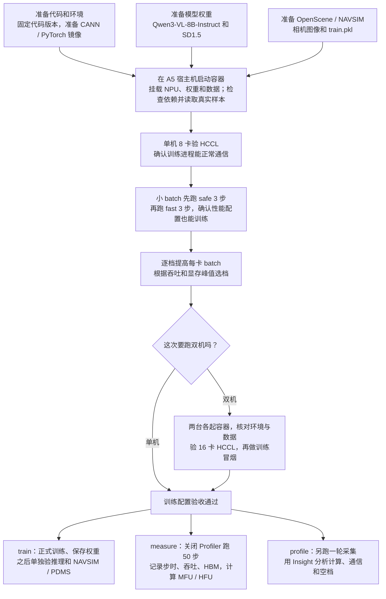
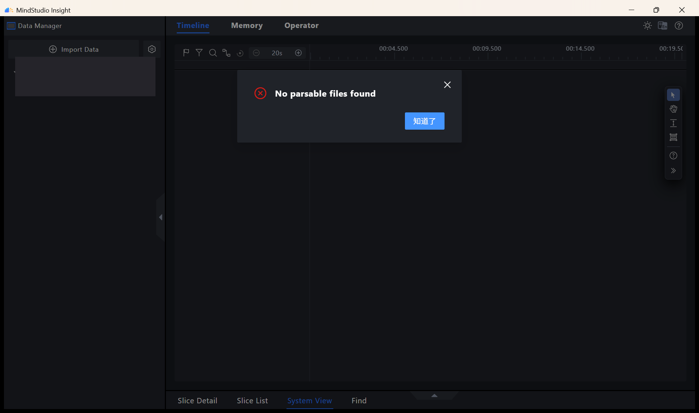
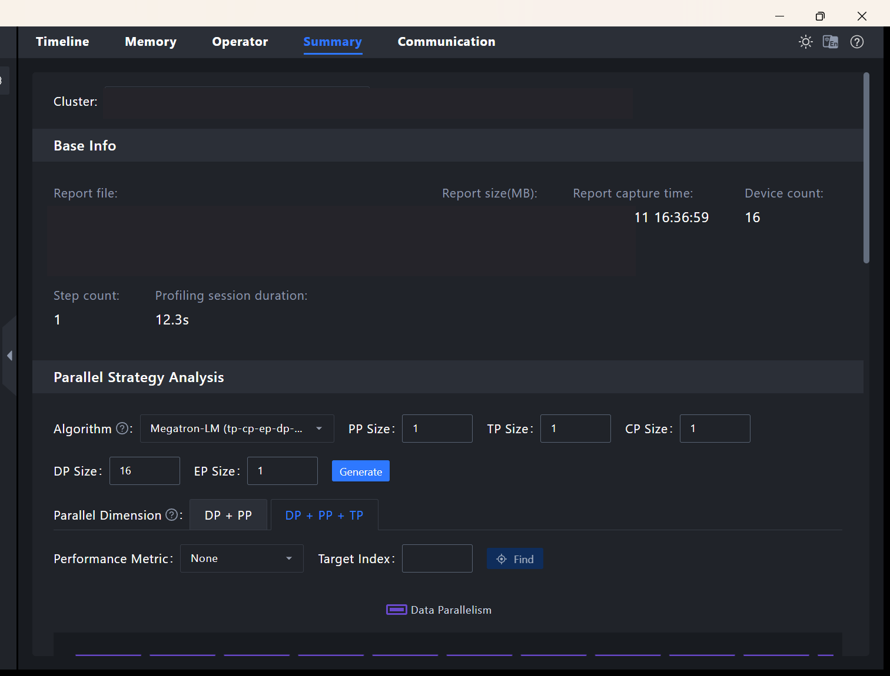

# DriveVLA-W0 部署与训练复盘｜分享逐字稿

引用框里是投屏和停顿提示，不用念。讲完结果后，可以接着讲「复跑时常问的几个问题」；现场答疑按听众的提问选。完整命令放在[启动手册](drivevla-w0-launch-commands.zh-CN.md)，更多实测细节见[复盘](drivevla-w0-deployment-training-common-issues.zh-CN.md)和 [FAQ](drivevla-w0-deployment-training-faq.zh-CN.md)。

## 项目背景：这次想弄清什么

> 投屏：复盘开头的项目背景和配置表。模型、环境各说一句，版本号不用逐个念。

大家好，今天我分享一下我们把 DriveVLA-W0 放到昇腾机器上训练的过程。主要讲三个问题：这个任务怎么从单机跑到双机，过程中哪些问题真把训练卡住过，以及最后那些性能数字是怎么算出来的。

先简单交代一下任务。DriveVLA-W0 要用车载画面等信息来学驾驶动作。我们用的是 Qwen3-VL-8B-Instruct，另外保留了一个叫 ROSS 的训练分支。可以把它想成给模型多出了一道题：除了学接下来怎么开，还要根据当前画面和动作，学习预测下一帧会是什么样。这个任务给训练多提供了一份来自真实画面的反馈。数据用的是 OpenScene/NAVSIM 的 trainval 子集，不是整套数据。

环境是 Docker，每台机器 8 张 Ascend 950DT。我们先用一台机器做基线，再用两台跑同样的模型和数据。两组每张卡都处理 24 条样本，主要想看：卡翻倍后，吞吐能不能跟着翻倍，通信会不会把每一步拖长。性能上我们还有一个目标，就是有效 MFU 到 60%。这个数字说的是算力利用，和模型最终开得好不好是两件事。这 50 步只用来验训练链路和测速度。

背景讲到这里，接下来切到流程图。先看这套模型和数据怎么放到机器上，再看单机跑通之后，怎么走到双机、测速和分析。

## 从零部署到训练验收

> 投屏：下面这张图和复盘里的是同一张。先指上面的准备项，再沿主线讲单机和双机，最后指底部三条分支。



先看图最上面，要准备三样：代码和训练镜像、模型权重、数据。镜像把运行环境带进去，权重和数据从共享盘挂进容器。起容器之后，确认它能看到 NPU、导入依赖，还要真的读一条样本，看看 pkl 能不能找到图片。这些通过后，再做单机八卡的 HCCL 检查，确认所有卡能一起通信。

通过以后，先用 safe 跑三步。safe 是一套更保守的训练配置，用 SDPA 和 ZeRO-3，把一部分训练状态放到 CPU。这一步从每张卡两条样本开始，看数据、反向传播和参数更新能不能走完。三步太短，成绩好不好先不看。

我们之前就遇到过，新容器的状态文件还写着 READY，但实际训练连 Transformers 都导不进来。那行字只是上次留下的结果。现在判断环境好没好，我会看当前容器里的导入和真实样本读取。尤其是数据，pkl 能打开只说明索引能读到，图片还得在对应的目录里找得到。

再用相同的小 batch 切到 fast，跑三步。fast 换成 FlashAttention-2 和 ZeRO-2，不做 CPU 卸载，目的是试实际要测速的那条路。这里常有人问，safe 都跑完了，为什么还要再跑一次 fast？因为换了注意力实现和训练状态的分片方式，有些错误只会在 fast 下触发。小 batch 能把这个差别先找出来，不用等大任务跑到第一步再报错。

这两关过了，再把每卡 batch 慢慢升上去，看吞吐和显存能不能一起接受。换到双机也要重新验 16 卡通信。我们这里是数据并行，每台机器起八个进程，每张卡分到的是不同的样本。双机多出来的卡用来并行处理数据，没有把同一层矩阵乘切给十六张卡。

验收通过后，看图的底部。要出模型权重，就走 train，保存后另做推理和驾驶指标验证。只想知道跑多快，就用 fast 做 measure，关掉 Profiler、不保存模型，跑五十步，取第十一到第五十步算稳态速度。想知道时间花在哪儿，再单独跑 profile，把数据拿到 Insight 里看。这次分享里的速度和耗时拆解，就分别来自后两条分支。

## 案例一：safe 能跑，为什么 fast 第一步就挂了？

> 投屏：下面两行真实日志。指一下 `aclnnAmax` 和错误码，停几秒让大家看清楚。

```text
NPU function error: call aclnnAmax failed, error code is 561000
Launch failed for CopyToNpu, errno:561000.
```

第一个问题就是刚才说的，safe 能跑，切到 fast 后第一步就挂了。报错指到了 NPU 的 Amax 算子，但我们最后查到，触发的地方是 ZeRO-2 的梯度检查。优化器更新前，要先看梯度里有没有 NaN 或无穷大。它第一步就失败，后面的性能数据当然也没法测。

这儿最容易误判的是张量大小。日志里出问题的张量，按它露在外面的大小看，只有一个 BF16 数，也就是两个字节；但它只是从一大块梯度内存里取出来的一个视图，背后那块存储大约有三 GB。可以想成手上只有一个抽屉的标签，但标签指向的是一整柜东西。我们一开始考虑把大张量分成小块，结果没有解决，因为按元素个数看，出错的那个张量本来就只有一个数。

后来在训练子进程加了一个小补丁：遇到这种视图，就直接看那一个值是不是有限；正常情况还走原来的检查。这里不能为了跑通就把 NaN 检查关掉，否则梯度坏掉也可能继续训练，后面的结果就不可信了。

这也解释了为什么只单独拿一个大的 NPU 张量试归约，可能复现不了。触发条件不是单纯「梯度很大」，而是「这个视图只取了一个元素，底层还共用大块存储」。我们也没去改容器里安装好的 DeepSpeed，兼容逻辑就放在项目的启动链里。后面复跑时，能明确知道是哪一路加了这个处理。

改完先测有限值、NaN 和正负无穷，再让 fast 跑三步，最后以同样的小 batch 跑满五十步。这个案例我想强调的是：**先看最早失败的操作，弄清它在做什么，再改最小的一处。** 补丁解决的是 fast 跑不过第一步，不是说改这几行就能让原本正常的训练提速几倍。

## 案例二：batch 一大就崩，先看是哪种内存

> 投屏：下面一行日志，再展示 `16 GiB → 96 GiB`。

```text
RuntimeError: unable to allocate shared memory(shm) for file <…>: Resource temporarily unavailable (11)
```

第二个问题出现在每张卡的 batch 从 8 加到 16 的时候。看到 batch 一大就报错，很容易觉得卡的显存不够。但这里的关键词是 shared memory，出问题的是容器里的 `/dev/shm`。

加载数据的时候，DataLoader 有多个进程，要借一块共享内存把准备好的样本交给训练进程。当时我们自己的容器这块空间上限是 16 GiB，batch 上去后不够用了。我们只把这个容器内的上限调到了 96 GiB，没有改宿主机的全局共享内存，也没有改 NPU 显存。改完从 batch 16 接着扫，16、24、27、32 几档都完成了短测。

这个判断在现场很实用：如果日志里写着 `shm`，就先在容器里看 `/dev/shm`；如果明确报的是 NPU 显存不足，再看每张卡的显存峰值。两种情况都可能在 batch 调大时出现，但改错地方，调半天也不会解决问题。

这里还有个选 batch 的小经验。27 的短测分数最高，实际和 24 的吞吐只差每秒 0.03 条样本，单个 rank 的峰值显存却多了约 5 GB。后续那次 27 的五十步确认又遇到别的任务占卡，没开始训练。所以我们没有拿它的短测成绩当长跑验收。碰到这种情况，先选性能差不多、显存余量更大的档位，通常更好复现。

## 案例三：Insight 空白，和只采到第 28 步不是一回事

> 投屏：先放失败图，再放恢复图。第二张图来自较早的单步采集，不是 14 日的截图。





第三个问题是在本地看数据。第一次导入时已经有采集文件，但 Insight 提示找不到可解析的文件，界面一片空。我们后来把十六个采集目录放到同一个父目录的直接下一级，再导入这个父目录。还是原来那批数据，重新导入后就能识别出十六张卡。这个问题出在目录层级，不需要重跑训练。

但打开以后，另一个问题更容易搞混：为什么报告写训练跑了五十步，Insight 里却只有第 28 步？我们特地查了 14 号单机八份库和双机十六份库，里面都只记了这一步。那天的正式测速跑了五十步，另跑的 Profiler 任务实际跑了三十步。默认采样还会先跳过一段，等一段、预热一段，最后只录一步，工具里就记成了 28。重新导入多少次，都不会出现当时没录的那些步。

还有一种情况是，Summary 里能看到卡数和步数，一切到 Timeline 又空了。这时先看自己选的是哪份文件。我们有一份集群汇总库，里面是每卡每步总耗时和通信统计；要拖时间线、点到某个 MatMul 算子，就要打开那张卡的原始采集。能够看到汇总，跟能否看到逐算子轨道，是两回事。

如果下次要分析偶发慢步，我们就得事先显式开启全程采集，结束后按卡查实际有几条采样记录。注意这个差别：**正式测速可以告诉我们平均跑多快；单步采样只能解释当时那一步慢在哪里。** 这两份数据各有用处，只是不能拿一张单步截图代表整轮。

## 结果：单机和双机到底差多少

> 投屏：这一张表。先指第一、二行，再指第 28 步的两行。MFU 留到下一段讲。

| 指标 | 单机 8 卡 | 双机 16 卡 | 数据来源 |
|---|---:|---:|---|
| 每步处理样本数 | 192 | 384 | 固定每卡 batch 24 |
| 稳态平均步时 | 12,140.5 ms | 12,126.3 ms | 正式测速第 11–50 步 |
| 稳态吞吐 | 15.81 样本/s | 31.67 样本/s | 正式测速第 11–50 步 |
| Stage | 12,202.2 ms | 12,186.1 ms | Insight 第 28 步 |
| 未重叠通信 | 205.3 ms | 217.0 ms | Insight 第 28 步 |
| 有效 MFU | 48.51% | 48.57% | MindSpeed + ROSS |
| HFU（含重算） | 61.79% | 61.86% | 同口径，计入重算 |

结果先看前两行。单机一步处理 192 条样本，双机处理 384 条。它们平均一步都是十二秒出头，只差大约十四毫秒。所以从单机扩到双机，这次看到的收益主要是**同样时间里多处理了一倍样本**。如果只看步时，会以为加机器没用；把一步处理的样本数一起考虑，吞吐就从每秒约 15.8 条变成 31.7 条，接近理想的两倍。说线性度的时候，就是拿实测吞吐倍数除以理想的两倍。这次接近百分之百，不代表再往上扩也一定能保持。

再看第 28 步。双机的通信总覆盖从约 691 毫秒变成 860 毫秒，多了将近 170 毫秒。如果只拿这两个数相减，很容易以为双机每步多等了 170 毫秒。实际上，其中不少通信和计算同时在做。真正没有被计算盖住的时间，是从约 205 毫秒到 217 毫秒，只多了约 12 毫秒。对这一步来说，通信覆盖的时间变长了，直接挡在训练前面的时间变化却很小。

另外，正式测速和 Insight 看到的步时虽然都在十二秒附近，仍是两种统计。正式测速是每一步取这一组里最慢的卡，然后对稳态步取平均；Insight 表里是同一个采集步，分别对单机和双机的所有卡取中位数。一个回答「整组任务平均多久能推进一步」，一个用来拆解「被录下来的这一步，卡上在做什么」。

这两组在这一采集步里，设备计算都占大约九成。这能帮我们选下一步排查方向，比如先看矩阵乘和激活重算。但我们只有第 28 步，所以不能据此说整个五十步都没有通信长尾。要找长尾，还是要补多步的采集。

## MFU：为什么 61.86% 还没到 60%？

> 投屏：留住双机两项百分比，可以同时打出公式。科学计数法不用逐位念。

```text
有效 MFU = 每卡每步有效 FLOPs ÷（每卡理论峰值 FLOP/s × 稳态平均步时）
双机：2.86238 × 10^15 ÷ (486 × 10^12 × 12.12628) ≈ 48.57%
```

最后说很多人会问的一点：报告已经有 61.86% 了，为什么还说没到 60%？

先把两个量说清楚。FLOPs 是运算次数，FLOP/s 是每秒能做多少运算。我们用每张卡每步的有效工作量作分子；分母用每张卡的理论峰值乘以实际步时。这里按每秒 486 万亿次算，乘以双机实测的一步约 12.13 秒。用同样一段时间里有效做的运算量除以理论上最多能做的量，结果是 **48.57%**。剖析第 28 步的 Stage 时间不参与这个计算。

61.86% 那个数字把重算也放进去了。训练为了省显存，有些前向中间结果不一直留着，反向时需要重新算一遍。卡确实干了这些活，所以含重算的 HFU 会更高。但我们看的目标是有效 MFU，不能靠多算几遍把它当成达标。

这个比例也不是直接从设备利用率读出来的。每步的有效计算量会随输入大小变化，即使每张卡都是二十四条样本，图像分辨率、序列长度变了，分子也会变。所以后续再比两次 MFU，我们会把工作量、峰值假设和时间窗口一起带上。

所以这次结果可以用两句话说完：**双机吞吐接近翻倍，扩卡效果不错；有效 MFU 仍低于 60%，接下来要继续压单步耗时。** 下一轮先补多步采集确认哪些热点反复出现，再试少量层不重算，看整步是否变快、显存是否还够。

## 复跑时常问的几个问题

> 投屏：切到 FAQ。这几段可以直接念，也可以看听众更关心哪类问题，挑着讲。

最后我补几个复跑时常问的问题。第一，容器显示 READY，能不能直接跑？我会先在当前容器里确认卡能看到、包能导入、真实样本能读。比如权重目录里有配置文件，不代表权重分片都下全了；`train.pkl` 能打开，也不代表容器能找到相机图片。换成 trainval 时，pkl 和图片根目录要一起换。第一次可以用 mini 检查数据链路，通过后再换正式数据。

第二，单机跑通了，双机卡在第一步怎么办？先看两边用的是不是同一镜像、同一个发布版本和同一套数据，再核对节点编号、会合地址和端口。两台都起来了，也不代表十六张卡都进了通信组。我们会先单独跑一次十六卡 HCCL 检查，再跑训练冒烟。遇到报错，找最先退出的那张卡的日志，其他卡的超时有时只是因为等不到它。

第三，换一个配置后，怎么知道是真的变快了？先把每卡 batch 和输入形状对齐，设备数和测量窗口也要写清楚。一次只改一个变量，关掉采集再测速度；如果改后快了一点，但同配置重跑时本来也会差这么多，就先不下结论。要解释省下来的时间，再单独去看 Insight 里的计算和未重叠通信。

这些具体怎么检查，我都放在 FAQ 和命令手册里了。大家复跑时可以直接翻，也欢迎现在一起看问题。

## 现场答疑备忘

> 按听众的问题选答，不用逐条念。

**Q：什么是 safe 和 fast？为什么要设两套，直接跑 fast 不行吗？**  
A：这是我们给同一个模型、同一份数据准备的两套训练配置。`safe` 用 SDPA 和 ZeRO-3，把参数和优化器状态放到 CPU，先减轻 NPU 显存压力，确认训练能跑通。`fast` 用 FlashAttention-2 和 ZeRO-2，不做 CPU 卸载，准备正式测速。两套都先用同样的小 batch 跑三步：如果 `safe` 都失败，就先查环境、数据和通信这些共用环节；如果 `safe` 能跑、只有 `fast` 失败，就优先查两套配置的差异。比如这次的 `aclnnAmax` 报错，就发生在 `fast` 的 ZeRO-2 梯度检查里。`safe` 是个好用的排查起点，熟悉的环境已经验过时，可以直接从 `fast` 冒烟开始。

**Q：容器怎么起？双机和单机要用不同的镜像吗？**  
A：每台各起一个容器、各挂本机八张卡。两台用一致的镜像和代码，各用自己的工作区，共享同一套权重和数据。机器数和 rank 到训练启动时才配置。可直接翻[启动命令手册](drivevla-w0-launch-commands.zh-CN.md)。

**Q：权重和 pkl 都有了，为什么训练还说文件找不到？**  
A：先分清是找不到权重分片，还是找不到样本里的图片。前者按 `model.safetensors.index.json` 核对每个分片，后者在容器里核对 `ZB_DATA` 和 `ZB_DATA_ROOT`。pkl 是索引，里面的图片相对路径要从正确的根目录开始找，最后用实际的取数代码读几条样本确认。

**Q：双机报 HCCL 初始化失败，换端口就能好吗？**  
A：先查具体是哪种冲突。两边节点编号应不同，会合地址和端口应相同；还要看各自的卡有没有被占用。如果是设备侧 HCCL 端口冲突，或者某台卡上有别的任务，只改 torchrun 的会合端口解决不了。确认资源空闲后，先跑 16 卡 HCCL 验收。

**Q：batch 调大后报内存错，怎么看是共享内存还是显存？**  
A：日志里有 `unable to allocate shared memory(shm)`，先看容器的 `/dev/shm`；明确报 NPU 显存不足，再看各 rank 的 HBM 峰值。第一种查数据加载，第二种先降每卡 batch。两块内存用途不同，调一块不会增加另一块的容量。

**Q：两台一共十六张卡，是不是 TP=16？**  
A：这次没有配置 TP。十六张卡走数据并行，各算各的数据，再做同步。ZeRO 分摊的是训练状态，不等于把同一个矩阵乘拆给十六张卡。

**Q：Insight 只有第 28 步，那整份报告还有参考价值吗？**  
A：有，平均步时、TPS、线性度和 MFU 用的是独立五十步正式测速和计算量估算；只有 Insight 里的 Stage、Computing、通信和空档分解来自第 28 步。要判断其他步是否有相同的等待，得有多步采样。

**Q：下次怎么确认真的采了五十步？**  
A：用支持全程采样的 launcher，设 `ZB_JOB=profile ZB_MFU_STEPS=50 ZB_PROFILE_FULL=1`。跑完逐卡数数据库里的不同 step，不能只确认训练日志跑到 `50/50`。原来的扩卡汇总脚本只接受单步，做多步的比较要用能汇总多步的数据口径。

**Q：离 60% 有效 MFU 还差多少？能只靠通信优化吗？**  
A：按这轮相同的计算量、卡数和峰值假设，双机平均一步要从约 12.13 秒降到约 9.82 秒，还差约 2.31 秒。第 28 步观察到的未重叠通信只有约 0.22 秒，优先看计算和重算有没有办法减少，同时保留对多步通信长尾的核对。
