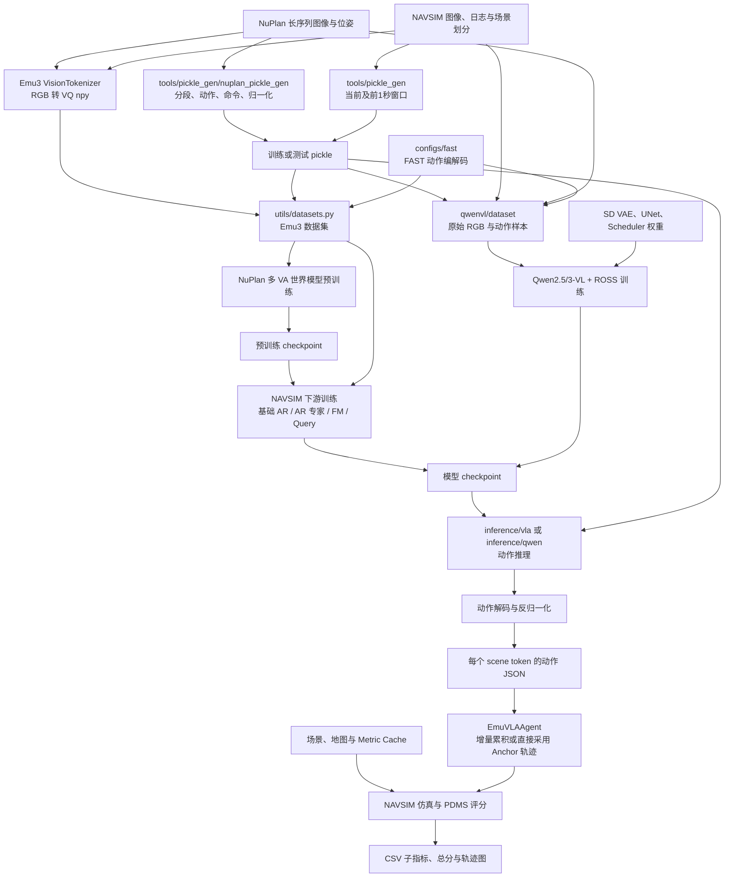
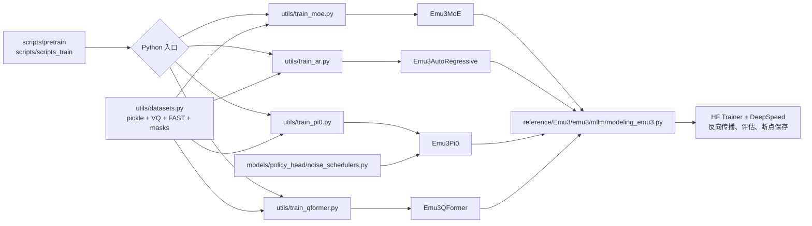
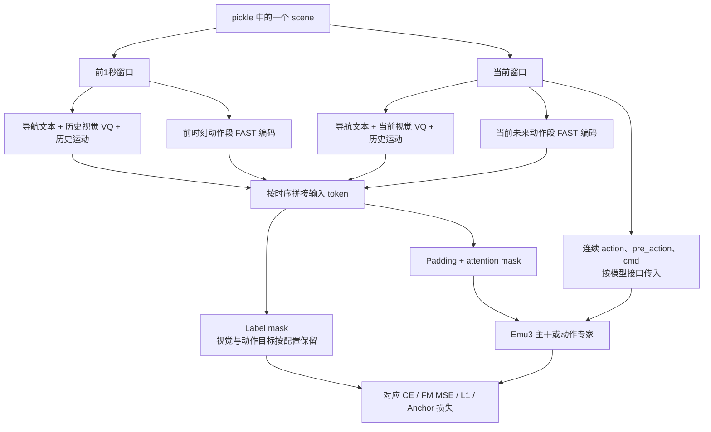
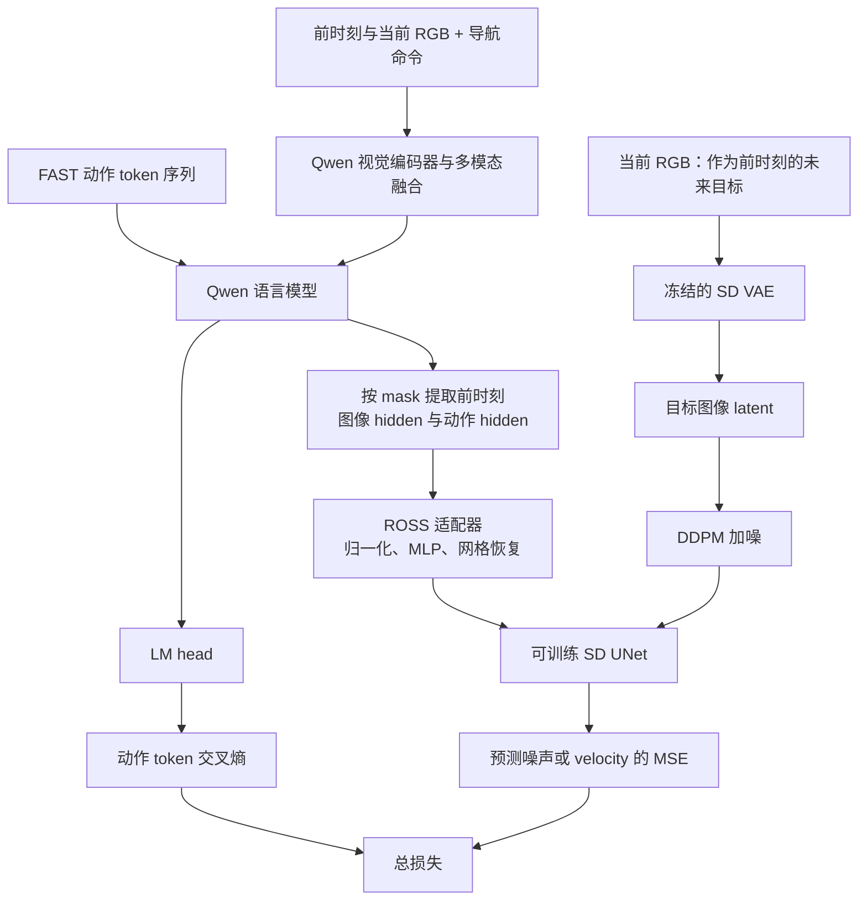
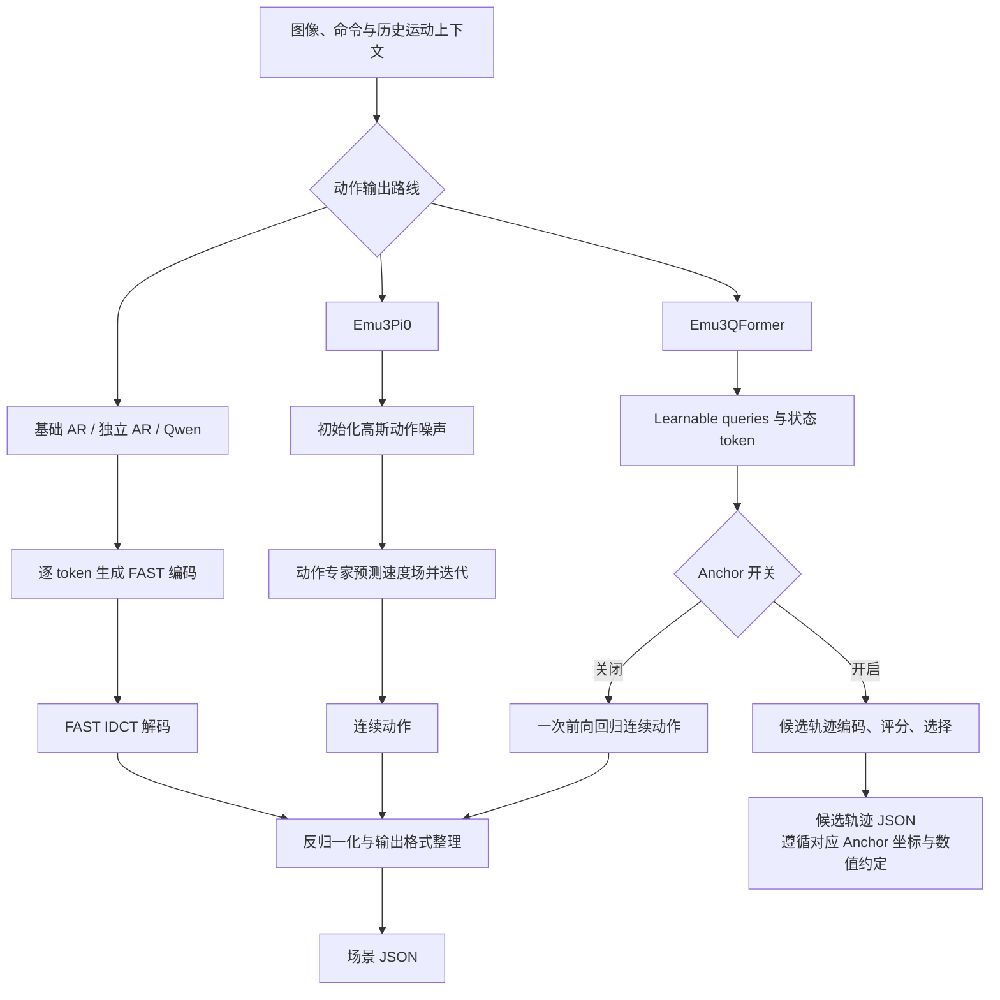
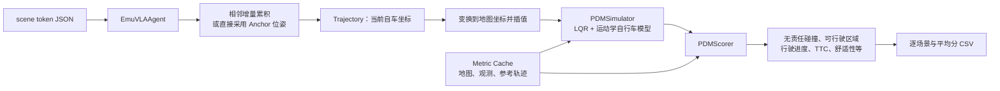

# DriveVLA-W0 代码结构、目录职责与整体流程分析

分析日期：2026-11-05。对象：当前工作区代码快照。

本文基于目录扫描、入口脚本、数据集实现、模型 `forward/sample/generate` 与 NAVSIM 评估调用链的静态分析。没有执行模型训练或推理，没有下载数据、权重或依赖。文中的“支持”指源码包含对应实现，不代表当前环境已验证可运行；已有文档中的性能数字不作为本次复现结论。

## 1. 项目整体在做什么

这是一个研究型自动驾驶视觉—语言—动作（VLA）项目：根据相机画面、导航命令和历史运动，预测未来车辆运动；训练时增加未来视觉状态预测，以提供比单纯轨迹标签更密集的监督。

其主要输入、输出与训练目的如下：

| 项目 | 代码中的含义 |
|---|---|
| 视觉输入 | 主线使用前视 `CAM_F0`；Emu3 读取预计算 VQ 图像码，Qwen 读取原始 RGB 并运行视觉编码器 |
| 语言输入 | `go left`、`go straight`、`go right`、`unknown` 等导航命令；不是开放式路线规划对话 |
| 历史运动 | 过去若干步的三维相对运动，部分动作专家还接收命令 one-hot |
| 动作输出 | 常用设置为未来 8 步、每步 `(dx, dy, dθ)`；NAVSIM 配置为 0.5 秒间隔，共 4 秒 |
| 世界模型目标 | Emu3 学习跨时刻视觉 token；Qwen/ROSS 利用较早时刻特征及动作特征预测较晚图像的 VAE latent |
| 最终产物 | checkpoint、逐场景动作 JSON、轨迹图、NAVSIM PDMS 与子指标 CSV |

**动作在这里主要指车辆局部 SE(2) 运动增量，并非直接输出油门、刹车、方向盘控制量。** 仿真评估再把轨迹交给运动学与跟踪模型。

当前代码有两条需要分开理解的技术路线：

1. **Emu3 主线**：图像离散化 + FAST 动作 token + 自回归世界模型预训练；在此基础上采用基础 AR、独立 AR 动作专家、Flow Matching 动作专家或 Query/Anchor 动作专家。
2. **Qwen 扩展线**：Qwen2.5-VL / Qwen3-VL 视觉语言骨干 + FAST 动作自回归 + ROSS 图像 latent 去噪辅助监督，并包含较多 Ascend NPU 适配、精度对齐与性能统计代码。

项目整体是数据处理、模型训练、离线动作推理和仿真评测工具链。当前仓库未展示完整的实车传感器接入、实时规划控制循环或车辆执行接口。

## 2. 真实目录结构与代码规模

初始扫描时，不计 `.git`，`reference/` 有 5,217 个文件、3,665 个 Python 文件；`inference/` 有 189 个文件、108 个 Python 文件；`utils/` 有 10 个 Python 文件；`models/` 有 6 个 Python 文件。大量文件属于随仓库引入的上游实现，代码数量不等于项目业务模块数量。

```text
DriveVLA-W0/
├── assets/                         项目说明图
├── configs/
│   ├── fast/                       FAST 动作 tokenizer 实现与词表
│   ├── normalizer_navsim_trainval/  NAVSIM 训练归一化统计
│   ├── normalizer_navsim_test/      NAVSIM 测试归一化统计
│   └── normalizer_nuplan/           NuPlan 归一化统计
├── docs/
│   └── superpowers/specs/          开发设计记录
├── models/
│   ├── tokenizer/                  图像 VQ 提取与均匀分箱动作 tokenizer
│   └── policy_head/                Flow Matching 调度与策略组件
├── utils/                          数据集、六类训练入口、FLOPs 统计
├── scripts/
│   ├── pretrain/                   NuPlan 多机预训练
│   ├── scripts_train/              NAVSIM 各模型训练启动器
│   ├── scripts_infer/              基础推理启动与 ADE/FDE
│   ├── tokenizer/                  多卡提取视觉码
│   ├── sft/                        DeepSpeed ZeRO 配置
│   └── misc/                       下载、集群网络检查
├── tools/
│   ├── pickle_gen/
│   │   └── nuplan_pickle_gen/      NuPlan 分段、动作、命令、合并与校验
│   ├── action_tokenizer/           FAST 检查示例
│   ├── ascend_parity/              NPU 融合算子数值检查
│   └── synth/                      Qwen 合成样本生成
├── inference/
│   ├── vla/                        Emu3 各分支推理与评估启动
│   ├── qwen/                       Qwen 动作生成
│   └── navsim/navsim/              内嵌 NAVSIM 工程
└── reference/
    ├── Emu3/                       经扩展的 Emu3 模型与视觉 tokenizer
    ├── Qwen2.5-VL/                 Qwen 数据、训练工具及另一份模型代码
    └── transformers/              本地 Transformers 源码与 Qwen/ROSS 扩展
```

README 树中的 `data/` 在当前快照中不存在；`pretrained_models/`、`logs/` 也不存在，后两者被 `.gitignore` 忽略。它们是外部准备或运行时生成的位置。`train/` 当前不存在，但基础训练脚本会通过软链接将其指向 `utils/`。

全量文件夹清单另见同目录的 `project-directory-inventory.csv`：逐行列出 1,085 个文件夹、归属、职责分类和文件数，不含 `.git` 和 Python 缓存目录。核心符号清单索引了 178 个 Python 文件中的 1,679 个类、函数及类方法。对于 Transformers 的数百个上游模型目录，目录清单按模型家族标注职责；本文深入展开与 DriveVLA 实际入口相连的部分，不把所有上游模型都视为本项目使用的组件。

## 3. 各文件夹的功能

### 3.1 `assets/`：说明材料

`fig1.png` 是项目 README 的总体方法示意图，不参与训练和推理。

### 3.2 `configs/`：模型结构、动作编码和数值约定

| 文件夹 / 文件 | 功能 | 关键说明 |
|---|---|---|
| `moe_fast_video.json` | Emu3 模型配置 | 32 层、hidden size 4096、词表 184622；顶层 `vision_loss_weight=0.5` |
| `moe_fast_video_pretrain.json` | 预训练配置 | 与上者主体结构接近，顶层视觉权重为 1.0 |
| `fast/` | FAST 动作序列编解码 | `processing_action_tokenizer.py` 实现 DCT → 量化 → BPE；反向使用 IDCT |
| `fast/tokenizer.json` 等 | FAST 词表与 processor 配置 | 供 `AutoProcessor.from_pretrained(..., trust_remote_code=True)` 加载 |
| `normalizer_navsim_trainval/` | 训练集动作统计 | `norm_stats.json` 保存 mean/std/q01/q99 等 |
| `normalizer_navsim_test/` | 测试集动作统计 | 是另一套统计值，不能和训练统计混用而不说明 |
| `normalizer_nuplan/` | NuPlan 动作统计 | 用于 NuPlan 数据处理和相应模型的数值变换 |

两个顶层 `moe_fast_video*.json` 的 `action_experts` 都是 `false`。文件名包含 MoE，不能据此认为默认启动了动作专家。其嵌套 `action_config` 保留了 `action_dim=7` 等通用配置，驾驶脚本常用的是 3 维；最终以入口参数与 checkpoint 配置为准。

FAST 与 `models/tokenizer/action_tokenizer.py` 的均匀分箱方案不同：前者压缩整段动作的频域系数，后者逐数值离散化。当前主要驾驶启动脚本选择 FAST。

### 3.3 `utils/`：实际的训练与样本构造中心

虽然目录名是工具类，实际上这里承担主要业务编排。

| 文件 | 主要类 / 函数 | 职责 |
|---|---|---|
| `datasets.py` | `Emu3SFTDataset` | 读取 pickle、加载动作 tokenizer、定义视觉/动作 token 包装和 label mask |
| 同上 | `Emu3DrivingDataset` | 驾驶样本采样、图像码加载、动作拼接 |
| 同上 | `Emu3DrivingVAVADataset` | 将前 1 秒与当前两个视觉—动作段拼接；额外输出连续 action、历史 action 和 cmd |
| 同上 | `Emu3DrivingNuplan6VADataset` | 从 NuPlan 长序列抽取多个视觉—动作对，默认 `va_pair_num=6` |
| 同上 | `Emu3DrivingVAVA_AR_Dataset` | 独立 AR 专家数据；区分 VLM 上下文与动作输入，动作序列固定为 15 token |
| `train.py` | `train()` | 较早的普通 `Emu3ForCausalLM` 训练入口，包含旧环境绝对路径 |
| `train_moe.py` | `LoggingTrainer`、`train()` | `Emu3MoE` 的 NuPlan 预训练与基础 NAVSIM 训练；设备适配、日志、断点续训、hash 与 profiling |
| `train_ar.py` | `load_model()` | 构造 `Emu3AutoRegressive` 独立动作专家，使用 AR 专用数据集 |
| `train_pi0.py` | `load_model()` | 构造或恢复 `Emu3Pi0`，用于连续动作 Flow Matching |
| `train_qformer.py` | `load_model()` | 构造 `Emu3QFormer`，用于查询式动作输出 |
| `train_qwen_vla.py` | `RossTrainer`、`setup_vla_model_and_tokenizer()` | 选择 Qwen2.5/3-VL ROSS 模型，配置视觉/语言/UNet 训练、冻结 VAE、构建数据与训练 |
| `flops.py` | `FlopsCounter` | 运行时 hook 统计矩阵乘、卷积和注意力等 FLOPs |
| `flops_zhao.py` | `FlopsCounterZhao` | 另一种训练 FLOPs/MFU 估计口径 |
| `flops_mindspeed.py` | `Qwen3VLFlopsCounter` | Qwen3-VL 公式估计与 ROSS 模块测算，用于性能分析 |

`train_moe.py` 不是稀疏专家路由训练器的充分证据：它直接加载名为 `Emu3MoE` 的模型，而动作专家是否存在仍由配置控制。主要专家实现是 VLM 和 action stream 的分工与注意力交互；不能直接等同于通用 top-k token-routing MoE。

`LoggingTrainer` 还负责移除数据集中不属于 `Emu3MoE.forward()` 的键，例如 `pre_action/cmd/token`，避免把动作专家专用字段误传给基础模型。其他模型则需要保留相应字段。

### 3.4 `models/`：组件代码，不是全部模型所在位置

| 子目录 / 文件 | 功能 | 当前主调用链中的位置 |
|---|---|---|
| `tokenizer/emu3_tokenizer_navsim.py` | 读取前视 RGB，运行 Emu3 VisionTokenizer，保存 `.npy` 图像码及重建结果 | Emu3 离线预处理 |
| `tokenizer/extract_vq_emu3_navsim.sh` | 视觉码提取启动脚本 | 与 `scripts/tokenizer/` 的同名文件存在重复 |
| `tokenizer/action_tokenizer.py` | OpenVLA 风格均匀分箱动作 tokenizer | 基类保留的替代方案；部分 decode 函数仍有 `pdb.set_trace()` |
| `policy_head/noise_schedulers.py` | `FlowMatchingScheduler`：采样时间、混合动作与高斯噪声 | 被 `reference/Emu3/emu3/mllm/modeling_emu3.py` 明确导入 |
| `policy_head/flow_matching.py` | 通用 Flow Matching 损失与 Euler 采样包装 | 本次主入口追踪未发现其被直接使用 |
| `policy_head/diffusion_policy.py` | `PolicyHead`、动作编码器、时间/位置编码、注意力解码器 | 候选/实验策略组件，不能代替实际 `Emu3Pi0` 调用链 |
| `policy_head/moe_experts.py` | DiT 风格 `Emu3Experts` 与动作投影组件 | 本次主入口追踪未发现其直接接入核心模型 |

定位主模型时应继续进入 `reference/Emu3/emu3/mllm/modeling_emu3.py`，而不是停在这一层。

### 3.5 `reference/Emu3/`：Emu3 主线的核心实现

| 子目录 | 功能 |
|---|---|
| `emu3/mllm/` | 模型配置、文本/多模态 tokenizer、processor、Transformer、全部主要动作专家 |
| `emu3/tokenizer/` | Emu3 视觉 VQ 模型、图像预处理与配置 |
| `emu3/train/` | 随 Emu3 引入的原始训练和数据准备代码；DriveVLA 主启动器主要走根目录 `utils/` |
| `assets/` | Emu3 上游说明资源 |
| `scripts/misc/` | 上游脚本辅助资源 |
| `replicate_demo/` | 上游演示及部署示例，独立于当前 NAVSIM 主评估链 |

`mllm/modeling_emu3.py` 集中承载了多种模型，职责如下：

| 类 | 实际功能 | 训练 / 推理特征 |
|---|---|---|
| `Emu3Model` | embedding + 多层 Transformer + norm | VLM 与动作专家的基础网络 |
| `Emu3ForCausalLM` | 普通语言模型输出头 | 自回归 token 建模 |
| `Emu3MoE` | 基础多模态 LM，可选连续动作分支 | 视觉/动作 token CE；可选 FM loss；训练采用分块 LM-head CE 降低大词表显存 |
| `Emu3Pi0SharedLayer` | 将 VLM 与动作流的 Q/K/V 按规则交互 | 是专家和骨干融合的关键位置 |
| `Emu3Pi0` | VLM + 连续动作专家 + 状态编码 | 加噪动作训练速度场；推理多步积分产生连续动作 |
| `Emu3QFormer` | VLM + learnable action queries + 状态编码 | 普通模式单次输出 8 步动作，L1 监督；Anchor 模式对候选轨迹评分和选择 |
| `Emu3AutoRegressive` | VLM + 独立 AR 动作专家 | 共享词 embedding，动作 LM head 输出 FAST token，包含 VLM KV 缓存路径 |

这里没有必要把“World Model”和“VLA”理解为两个独立服务。Emu3 通过同一模型中的时间序列视觉/动作 token 学习环境与动作关系，再以不同专家结构读取和输出动作。

### 3.6 `reference/Qwen2.5-VL/`：Qwen 数据与训练支撑

| 子目录 | 功能与边界 |
|---|---|
| `qwen-vl-finetune/qwenvl/dataset/` | `data_qwen_vla.py` 构造 NAVSIM/NuPlan 两时刻样本、动作段、图像与动作 token masks；`rope2d.py` 处理多模态位置编码 |
| `qwen-vl-finetune/qwenvl/train/` | 参数 dataclass、Trainer/attention 辅助和上游训练入口；根目录 Qwen 训练器导入这里的参数与辅助 |
| `qwen-vl-finetune/qwenvl/utils/` | `token_utils.py` 增加 BOA/EOA、保留动作词表区域、加载和映射 tokenizer |
| `qwen-vl-finetune/scripts/` | 上游 SFT 启动及 DeepSpeed 配置 |
| `qwen-vl-finetune/tools/` | 样本打包、图像检查等辅助 |
| `qwen-vl-finetune/demo/images/`、`demo/videos/` | 上游演示数据，不是驾驶训练集 |
| `qwen-vl-utils/src/qwen_vl_utils/` | Qwen 图像/视频输入预处理公共工具 |
| `qwen2_5_vl/`、`qwen2_5_vl/modeling_ross/` | 另一份 Qwen2.5/ROSS 实现副本；本项目当前统一训练入口明确导入本地 Transformers 树中的版本 |
| `qwen2_vl/` | 较早 Qwen2-VL 代码；不是当前自动选择的 Qwen3-VL 训练实现 |
| `web_demo_streaming/` | 上游流式演示资源 |

### 3.7 `reference/transformers/`：依赖源码与项目扩展混合区

这不是只用于阅读的参考目录。`requirements_qwen.txt` 使用 `-e ./reference/transformers` 安装它，统一 Qwen 训练器又显式导入其中的 ROSS 模型与 Trainer。

| 目录 | 功能 |
|---|---|
| `src/transformers/` | 配置、模型基类、tokenization、generation、Trainer、integrations 等运行库 |
| `src/transformers/models/qwen2_5_vl/` | Qwen2.5 骨干、`modeling_qwen2_5_vl_ross.py`、`npu_fused_ops.py` |
| `src/transformers/models/qwen2_5_vl/modeling_ross/` | `denoiser_sd.py`、修改的 SD UNet、negative prompt embedding |
| `src/transformers/models/qwen3_vl/` | Qwen3-VL 骨干、processor 和 `modeling_qwen3_vl_ross.py` |
| `src/transformers/integrations/` | 外部平台集成，包含 NPU Flash Attention 等适配 |
| `src/transformers/models/` 的其他模型目录 | 上游支持的其他模型家族；存在不代表被本项目训练使用 |
| `tests/` | Transformers 上游测试为主，不能视为整个 DriveVLA 流程已有集成测试 |
| `examples/` | 上游 PyTorch/TensorFlow/Flax 示例 |
| `docs/`、`i18n/` | 上游 API、教程和多语言说明 |
| `benchmark/`、`notebooks/` | 上游性能测试、交互示例 |
| `docker/` | 容器环境定义 |
| `scripts/`、`utils/`、`templates/` | 上游维护、代码生成、检查及模板 |
| `.github/`、`.circleci/` | 上游 CI 和贡献工作流 |

Qwen2.5 ROSS 代码使用固定 `10×18` 图像 token 网格；Qwen3 ROSS 根据 `image_grid_thw` 和 merge 信息恢复网格，因此不能把两者的输入分辨率与 token 数约束完全等同。

### 3.8 `scripts/`：实验启动和资源编排

| 子目录 | 主要脚本 | 功能 |
|---|---|---|
| `pretrain/` | `train_nuplan_6va_multi_v0.2_master.sh`、`worker.sh` | 配置多机分布式环境和 NuPlan 六组 VA 预训练，目标入口是 `train/train_moe.py` |
| `scripts_train/` | `train_base_ar_withou_moe.sh` | 参数化基础 Emu3 训练；支持设备选择、ZeRO、路径检查；创建 `train → utils` 软链接 |
| 同上 | `train_navsim_ar.sh` | 独立 AR 专家 → `train/train_ar.py` |
| 同上 | `train_navsim_flow_matching.sh` | Flow Matching → `train/train_pi0.py` |
| 同上 | `train_navsim_query_based.sh` | Query 专家 → `train/train_qformer.py` |
| 同上 | `train_qwen_vla_navsim.sh` | Qwen2.5/3-VL ROSS → `utils/train_qwen_vla.py`；数据与 SD 权重预检、设备/分布式设置 |
| `scripts_infer/` | `infer_navsim_vava.sh` | 基础 Emu3 推理启动 |
| 同上 | `eval_action_metrics.py` | 由相对运动重建轨迹，计算 ADE/FDE；与 PDMS 属于不同评估口径 |
| `tokenizer/` | `extract_vq_emu3_navsim.sh` | 8 个进程分片提取图像 VQ 码 |
| `sft/` | `zero2*.json`、`zero3*.json` | DeepSpeed 优化器、分片和 CPU offload 配置 |
| `misc/` | 下载预训练模型、主从节点网络检查 | 实验环境准备 |
| 根级脚本 | `setup_and_run_cuda.sh`、`setup_and_run_npu.sh` | 准备数据路径、调用基础训练和后续推理等流程 |

Shell 是启动层，不直接实现模型数学逻辑。理解一次实验应顺着“Shell 参数 → Python dataclass → 选用 Dataset → 选用模型类 → forward/sample”阅读。

### 3.9 `tools/`：离线数据加工、检查与调试

| 子目录 / 文件 | 职责 |
|---|---|
| `pickle_gen/pickle_generation_navsim_pre_1s.py` | 读取 NAVSIM 日志，计算局部相邻运动，组装当前和前 1 秒窗口，计算统计并归一化，保存 pickle |
| `pickle_gen/pickle_generation_navsim_mini.py` | 较轻量、带参数的 NAVSIM 样本生成 |
| `pickle_gen/navsim_coor.py` | `StateSE2`、角度规范化、绝对/相对轨迹转换 |
| `pickle_gen/replicate_pickle.py` | 扩大/复制 pickle 样本，用于运行规模等实验；不是增加独立真实驾驶数据 |
| `pickle_gen/filter_pickle_by_images.py` | 按图像是否存在过滤样本 |
| `pickle_gen/download_openscene_camera.sh` | 相机数据下载辅助 |
| `pickle_gen/nuplan_pickle_gen/` | NuPlan 的完整多步骤预处理和分析流水线，见下表 |
| `action_tokenizer/test_fast.py` | FAST 动作分段/编解码示例与检查 |
| `ascend_parity/check_fused_ops.py` | 比较融合算子与参考实现的输出等数值行为 |
| `synth/synth_qwen_vla_data.py` | 生成合成图像与驾驶样本，用于 Qwen 流程调试，不能验证真实驾驶效果 |
| `fix_pickle_paths.py` | 对 pickle 内嵌路径进行递归替换 |

NuPlan 子目录内各步骤：

| 文件组 | 功能 |
|---|---|
| `run_all.py` | 串行调度分段 → 动作 → 位移阈值分析 → 命令 → 合并 → 校验 |
| `step1_segment_videos.py` | 检查日志、图像与 VQ 完整性，划分有效序列片段 |
| `step2_generate_actions.py` | 从 pose 生成每帧未来动作，分析并与 NAVSIM 对照 |
| `step2_generate_actions_seq_optimized.py` | 按原始序列分组处理，减少重复读取；主控选择的版本 |
| `step3a_analyze_displacement_distribution.py` | 分析横向位移分布和阈值候选，包含交互选择 |
| `step3b_generate_commands.py` | 根据阈值为每帧生成导航命令 |
| `step4_merge_pickle.py` | 合并图像码、动作、命令，统计 q01/q99 并归一化 |
| `verify_final.py` | 检查最终 pickle 的字段与结构 |
| `check_pose_quality.py` | pose 矩阵与运动质量检查 |
| `check_navsim_command_mapping.py` | 检查导航命令类别含义 |
| `compare_navsim_nuplan_absolute_error.py` | 两来源动作/轨迹的绝对误差比较 |
| `analyze_navsim_20m_distance_based.py` | 以行驶距离为条件分析命令阈值 |
| `visualize_action_distributions.py` | 动作增量与重建轨迹的统计分布可视化 |

### 3.10 `inference/vla/`：Emu3 推理及配置

| 文件 | 对应模型与作用 |
|---|---|
| `inference_action_navsim_with_previous_action_last_VAVA.py` | 基础 Emu3 的 FAST 动作生成；约束动作词表并健壮解码 |
| `inference_action_navsim_ar_vava.py` | 独立 AR 动作专家生成 |
| `inference_action_navsim_flow_matching_vava.py` | `Emu3Pi0.sample_actions()`，多步连续动作采样 |
| `inference_action_navsim_query_based_vava.py` | `Emu3QFormer.sample_actions()`，Query 或 Anchor 输出 |
| `config.py` | 项目路径初始化、默认值、YAML 与环境变量配置 |
| `config.yaml.example` | checkpoint/tokenizer/统计路径，以及动作维度、帧数、dtype、worker 等示例 |
| `infer_navsim_flow_matching_PDMS_87.2.sh` | 特定实验 checkpoint 的推理参数模板 |
| `infer_navsim_query_based_with_anchor_PDMS_90.2.sh` | Anchor 实验推理参数模板 |
| `eval_navsim_metric_from_json*.sh` | 调用 NAVSIM `run_pdm_score.py`，区分普通相对增量和 Anchor 轨迹 |

Shell 文件名中的 87.2/90.2 是仓库实验命名，不代表本次分析测出的分数。

### 3.11 `inference/qwen/`：Qwen 离线动作生成

`inference_action_navsim_vava.py` 读取原始图像，构建前时刻与当前时刻的对话/动作上下文，限制输出为 FAST 动作 token 或 EOA，解码和反归一化后写 JSON；`inference_2va.sh` 提供启动方式。

当前脚本明确使用 `Qwen2_5_VLForConditionalGeneration`，分布式和 attention 配置也偏 CUDA。尽管统一训练器可选择 Qwen3-VL，不能据此推断这一推理脚本已完成 Qwen3/NPU 全路线兼容。训练时 ROSS 提供辅助监督，动作推理本身无需每步生成未来 RGB。

### 3.12 `inference/navsim/navsim/`：独立的仿真评估工程

路径重复来自外层项目目录和内层 Python 包目录，不是三个不同评测器。

| 子目录 | 功能 |
|---|---|
| `navsim/common/` | Scene、Trajectory、传感器配置、枚举、日志加载器 |
| `navsim/agents/` | 通用 agent 接口，`emu_vla_agent.py` 读取本项目 JSON；包含 human、恒速、ego-MLP、external 等基线 |
| `navsim/agents/transfuser/` | 内嵌的 Transfuser 模型、特征、损失、配置、回调等另一套基线 |
| `navsim/evaluate/` | `pdm_score.py` 变换轨迹、插值、仿真并提取指标 |
| `navsim/planning/scenario_builder/` | 将场景组织为仿真所需结构 |
| `navsim/planning/metric_caching/` | 缓存地图、参考轨迹、观测等评估材料 |
| `navsim/planning/training/`、`callbacks/` | NAVSIM 自有训练 Dataset、LightningModule、特征目标构造和训练回调；不是根目录 VLA Trainer |
| `navsim/planning/script/` | 训练、数据缓存、指标缓存、评分、提交 pickle 生成与合并入口 |
| `navsim/planning/script/builders/` | planner、simulation、observation、worker pool 构建 |
| `navsim/planning/script/config/common/` | agent、worker、数据划分与 scene filter 配置 |
| `navsim/planning/script/config/training/` | NAVSIM 基线训练配置 |
| `navsim/planning/script/config/metric_caching/` | 指标缓存任务配置 |
| `navsim/planning/script/config/pdm_scoring/` | PDMS 与提交评分配置 |
| `navsim/planning/utils/multithreading/` | Ray 等并行 worker 辅助 |
| `navsim/planning/simulation/planner/pdm_planner/` | PDM planner 核心，细分见下表 |
| `navsim/visualization/` | BEV、轨迹、相机、LiDAR 绘制；有 LiDAR 工具不表示 DriveVLA 主模型使用 LiDAR |
| `scripts/evaluation/`、`training/`、`submission/` | NAVSIM 官方风格任务启动示例 |
| `download/` | 数据下载脚本 |
| `docs/` | 数据、缓存、agent、指标与提交说明 |
| `tutorial/` | Notebook 示例 |
| `assets/` | 评估工程说明图 |

PDM 子模块的具体分工：

| 子目录 | 功能 |
|---|---|
| `observation/` | 占用地图、对象与交通观测组织 |
| `proposal/` | 候选轨迹生成、IDM 等策略 |
| `simulation/` | 批量 LQR 跟踪、运动学自行车模型与轨迹仿真 |
| `scoring/` | 碰撞、可行驶区域、进度、TTC、舒适性等评分 |
| `utils/` | 几何、路径、路线、数据表示、紧急制动等公共逻辑 |
| `utils/graph_search/` | Dijkstra 与道路块 BFS，支撑路线处理 |

### 3.13 `docs/`、根目录文档与隐藏目录

| 位置 | 用途 |
|---|---|
| `docs/qwen3vl-backbone-architecture.md` | Qwen3-VL + ROSS 架构说明，包含特定 profiling 配置下的参数量和 shape |
| `docs/diffusion-primer.md` | 扩散/去噪原理说明 |
| `docs/superpowers/specs/` | FLOPs 计数设计记录 |
| `README.md`、`Training.md` | 方法、快速使用和分阶段训练说明；部分路径/步骤文字需要和源码交叉验证 |
| `SETUP.md` | 环境、权重与数据准备 |
| `npu-port.md`、`npu-port.zh-CN.md` | Ascend 移植与性能/精度适配记录 |
| `PRECISION_ALIGNMENT.md` | GPU/NPU 可复现性和精度对齐说明 |
| `CHANGES.md`、`fix.md` | 更改和修复记录 |
| `requirements.txt`、`requirements_ascend.txt` | Emu3 路线依赖约定 |
| `requirements_qwen.txt` | Qwen 路线独立依赖，本地 editable Transformers 和 diffusers 等 |
| `environment.yaml` | Conda 环境描述 |
| `check_pickle_paths.py` | 根级 pickle 路径检查脚本 |
| `.cursor/plans/` | 编辑器开发计划记录 |
| `.idea/inspectionProfiles/` 等 | IDE 项目与检查配置 |
| `.workbuddy/memory/` | 本地协作工具记录；初始 git 状态为未跟踪内容，不属于模型运行链 |
| `.git/` | 版本管理内部数据，不作为项目功能模块展开 |

## 4. 核心数据结构与数学含义

### 4.1 NAVSIM pickle 是各模块之间的数据契约

`pickle_generation_navsim_pre_1s.py` 生成的每个 scene 大致为：

```python
{
    "token": "scene_token",
    "text": [...],             # 当前中心窗口，12 个位置
    "image": [...],            # 对应视觉码 .npy 路径，可含边界 None
    "action": [...],           # 12 × 3，归一化相邻运动增量
    "pre_1s_text": [...],      # 中心向前 1 秒的另一窗口
    "pre_1s_image": [...],
    "pre_1s_action": [...],
}
```

`WINDOW=12`、`CENTER_IDX=3`，索引覆盖相对当前的 -3 到 +8；当前动作监督通常截取 `action[3:11]` 共 8 步。`image` 保存路径而非像素或大型 embedding，因此 pickle、VQ 目录和 RGB 目录的映射必须一致。

Emu3 常用 256×144 图像，其 NAVSIM 数据集实际把单帧视觉码 reshape 为 `18×32`，每帧 576 个 VQ token。NuPlan 数据集另有可配置 `resolution`，不能将这个尺寸推广给全部分支。

### 4.2 动作归一化与反归一化

预处理常用分位数归一化：

```text
a_norm = clip(2 × (a - q01) / (q99 - q01 + ε) - 1, -1, 1)
a_physical = 0.5 × (a_norm + 1) × (q99 - q01) + q01
```

动作 token 编码前使用归一化值；写入标准评估 JSON 前通常恢复物理单位。归一化包含裁剪，极端动作的信息会丢失，所以它不是严格可逆变换。统计 JSON 的 `libero` 是沿用的键名，不能据此认为训练数据是 LIBERO 机器人任务。

### 4.3 VAVA 序列如何支持世界模型

Emu3 的两段样本可概括为：

```text
BOS
  命令(t-1s) + 视觉码(t-1s) + 历史动作(t-1s) + BOA 动作段 EOA
  命令(t)    + 视觉码(t)    + 历史动作(t)    + BOA 动作段 EOA
PAD ...
```

视觉与动作标签由 mask 控制；文本、历史条件和 padding 可以使用 `-100` 排除监督。自回归序列中，较晚视觉 token 的预测能利用前面已经出现的视觉/动作上下文，形成动力学学习信号。并非每个 token 或每一帧都具有相同训练语义，需检查所选数据类和 label 配置。

NuPlan 六段预训练把多个时刻的 VA 对串接，提供更长的视觉与动作变化。源码默认每个 VA 索引相隔 10 个原始帧，历史动作采样按 `action_hz` 换算；不能把所有数据源的原始帧率和 NAVSIM 的 2Hz 输出混为一谈。

### 4.4 相对动作如何变成轨迹

普通模式下，JSON 的第 i 行是上一步局部坐标中的运动。`EmuVLAAgent` 从 `(0,0,0)` 开始累积：

```text
x_next   = x + cos(yaw) × dx - sin(yaw) × dy
y_next   = y + sin(yaw) × dx + cos(yaw) × dy
yaw_next = wrap(yaw + dθ)
```

这里累积得到的是“以当前自车为原点的未来位姿”；随后 `evaluate/pdm_score.py` 根据真实初始自车状态再变换到地图坐标。应区分相邻步增量、当前自车坐标下的位姿和地图绝对位姿三种语义。

Anchor 版本可直接选择候选轨迹，`anchor_based=true` 时 agent 直接采用输入轨迹。它不能再按普通相对增量重复累积。

## 5. 训练分支对比

| 路线 | Python 入口 / 数据类 | 主模型 | 动作输出与主要损失 |
|---|---|---|---|
| 普通早期训练 | `train.py` / SFT | `Emu3ForCausalLM` | token CE |
| NuPlan 世界模型预训练 | `train_moe.py` / `Emu3DrivingNuplan6VADataset` | `Emu3MoE` | 多 VA 序列视觉/动作 token CE，取决于 mask 与配置 |
| 基础 NAVSIM AR | `train_moe.py` / VAVA | `Emu3MoE` | 单一主干自回归 FAST token；现有基础配置关闭 action experts |
| 独立 AR 动作专家 | `train_ar.py` / VAVA_AR | `Emu3AutoRegressive` | 独立动作流 token CE；源码中 `vlm_loss_weight` 初始写为 0 |
| Flow Matching 专家 | `train_pi0.py` / VAVA | `Emu3Pi0` | 连续动作速度场 MSE；可包含 VLM 辅助损失，受分支控制 |
| Query 专家 | `train_qformer.py` / VAVA | `Emu3QFormer` | learnable queries → 连续动作，普通模式 L1 |
| Query + Anchor | QFormer 的配置分支 | `Emu3QFormer(anchor=True)` | 外部轨迹簇 + 评分监督，选择候选轨迹；并非普通回归 |
| Qwen + ROSS | `train_qwen_vla.py` / `LazySupervised*2VAROSSDataset` | Qwen2.5/3-VL ROSS | 动作 token CE + 图像 latent 去噪 MSE |

需要特别注意：**预训练阶段利用世界模型，不表示每种下游微调都继续以相同权重训练视觉预测。** QFormer 普通模式当前 `forward()` 返回动作 L1；AR 独立专家中 VLM loss 初始权重为 0。不能统一写成“所有分支始终联合优化同一套视觉损失与动作损失”。

Flow Matching 采用：`x_t=(1-t)a+tε`，目标速度为 `ε-a`。推理从噪声开始，按预测速度反向迭代得到动作；其 `num_inference_steps` 是积分迭代次数，不是要预测的动作时间步数。

Qwen ROSS 则为图像 latent 施加扩散噪声并预测噪声/velocity；这与 Flow Matching 动作专家作用于不同对象。两者虽都有噪声训练过程，不能当作同一个模块。

## 6. 流程图

### 图 1：项目全链路



### 图 2：Emu3 训练的实际调用关系



### 图 3：Emu3 样本构造与监督



### 图 4：Qwen + ROSS 的双重监督



### 图 5：各动作生成分支



### 图 6：NAVSIM 评估链路



图中的路线表示实现中的数据和调用关系；外部数据/权重需另行准备。图 1 中预训练 checkpoint 也可直接下载获得，并不要求每次从头跑 NuPlan。

## 7. 从源码看出的工程边界与注意事项

以下是理解和运行项目所需的现状分析，不是本次已修复的问题。

| 现状 | 源码依据 | 影响 |
|---|---|---|
| 核心业务和依赖混放 | 自定义模型在 `reference/Emu3/` 和 `reference/transformers/` | 只阅读或修改 `models/` 会遗漏真正执行的网络 |
| `train/` 是兼容别名 | 基础脚本执行 `ln -sf "$ROOT/utils" "$ROOT/train"`，其他启动器仍使用 `train/train_*.py` | 基础脚本提供兼容；单独启动其他脚本或 Windows 环境需确认模块路径 |
| 正式 NAVSIM/NuPlan 预处理缺少本地归一化模块 | 两处预处理导入 `utils.dataset.normalize_pi0`，当前 `utils/` 没有此子包 | 从原始数据完整重建 pickle 需要补齐或替代该模块；不是所有数据生成器都缺失 |
| 旧环境路径仍多 | 预处理、预训练、部分 checkpoint/anchor 配置保留 `/mnt/...`、`/share/...`；`run_all.py` 指向旧 OmniSim 目录 | 复制仓库不等于能够直接运行全部入口；参数化程度各分支不同 |
| 文档的数据准备步骤名称与真实职责对调 | README/Training 将 pickle 脚本置于“VQ generation”，将视觉码提取 shell 置于“pickle generation” | 实际 VQ 由 `emu3_tokenizer_navsim.py` 生成，pickle 由 `pickle_generation*.py` 生成；应按源码依赖理解 |
| 两条依赖路线不相同 | Emu3 requirements 固定较早 Transformers；Qwen requirements editable 安装本地树 | 不应把所有 requirements 当作同一个环境的追加清单 |
| NPU 支持不是全入口等价覆盖 | `train_moe.py`、Qwen 训练器有设备抽象；多份推理仍硬编码 NCCL/CUDA；`train_moe.py` 顶部无条件导入 msprobe | 训练器设备检测不能证明整套预处理/推理都能在 CPU/NPU 运行 |
| 某些可选路径未完成 | `create_pi0_style_attention_mask()` 直接 `raise NotImplementedError`；实际使用的是 causal-style 路径 | 不能把函数名存在视为已实现该注意力方案 |
| 默认维度与硬编码并存 | 配置保留 7 维动作；驾驶常用 3 维；AR 数据固定 `MAX_AR_LEN=15`；NAVSIM 数据 reshape 为 `18×32` | 改动作维度、FAST 词表、分辨率或 horizon 时需跨模块同步检查 |
| 归一化与坐标协议影响结果 | 存在 trainval/test 两套统计和 Anchor 直接轨迹模式；Query 推理脚本将预测反归一化语句注释掉，直接写出模型值 | Anchor 候选轨迹可能已在物理坐标中，但普通 Query 回归目标来自归一化动作；普通模式需核对输出数值尺度后才能评分 |
| 验证划分以样本随机进行 | 多个 `train_test_split` 用 shuffled indices + 5% `Subset` | 相邻/重叠窗口可能分入不同集合；应评估按 log/scenario 划分是否更符合实验目的 |
| Anchor 依赖外部产物 | `_ensure_anchor_setup()` 读取轨迹簇，训练使用外部场景评分 | 普通 Query 能否运行与 Anchor 能否复现是两个问题；候选簇及评分文件不在当前目录 |
| ADE/FDE 脚本有静默 GT 回退 | `data.get("action_gt_denorm", data.get("action"))` | JSON 缺少 GT 时会拿预测自身比较，误产生零误差；不能作为有效模型评估 |

`EmuVLAAgent` 当前还在评分时写逐场景差异 JSON 和绘制 BEV PNG，评估不仅消耗仿真时间，也包含文件输出和绘图开销。其后面的平均差异辅助函数对列表使用 `abs()`，与上方保存的列表格式不匹配；这不应与主 PDMS 流程混为一谈。

## 8. 推荐阅读顺序与改动落点

理解 Emu3 全链路，按以下顺序阅读：

1. `scripts/scripts_train/train_base_ar_withou_moe.sh`：确认启动参数与目录兼容处理。
2. `utils/train_moe.py`：理解模型/数据类选择和 Trainer。
3. `utils/datasets.py`：重点看 VAVA 与 NuPlan6VA 的 `__getitem__()`、label mask、FAST 映射。
4. `reference/Emu3/emu3/mllm/modeling_emu3.py`：先读 `Emu3MoE`，再读 SharedLayer 和三类专家。
5. `inference/vla/inference_action_navsim_*`：确认推理上下文截断、动作生成与反归一化。
6. `navsim/agents/emu_vla_agent.py` → `navsim/evaluate/pdm_score.py`：理解坐标转换与评分。

理解 Qwen 扩展，按以下顺序阅读：

1. `scripts/scripts_train/train_qwen_vla_navsim.sh` 与 `utils/train_qwen_vla.py`。
2. `reference/Qwen2.5-VL/qwen-vl-finetune/qwenvl/dataset/data_qwen_vla.py`。
3. 本地 Transformers 中的 `modeling_qwen2_5_vl_ross.py` 或 `modeling_qwen3_vl_ross.py`。
4. `qwen2_5_vl/modeling_ross/denoiser_sd.py` 与 `unet_2d_condition.py`。
5. `docs/qwen3vl-backbone-architecture.md`、NPU/precision 文档和 FLOPs 工具。

| 要做的改动 | 优先查看的位置 |
|---|---|
| 接入新驾驶数据 | `tools/pickle_gen/` → pickle 契约 → `utils/datasets.py` 或 Qwen dataset |
| 改未来动作步数/频率 | 预处理时间采样、DataArguments、model config、FAST decode、NAVSIM TrajectorySampling |
| 改动作表示 | `navsim_coor.py`、归一化统计、FAST、模型 loss、JSON 输出与 agent 坐标转换 |
| 改视觉分辨率 | VQ 提取配置及 `18×32` reshape；或 Qwen image processor 与 ROSS grid |
| 改动作专家结构 | `reference/Emu3/emu3/mllm/modeling_emu3.py` 和对应训练/推理入口 |
| 改 Qwen 世界模型监督 | ROSS wrapper、denoiser、UNet、数据 masks 与 VAE target |
| 改 PDMS/坐标处理 | `EmuVLAAgent`、`evaluate/pdm_score.py`、PDM scorer；保持不同实验指标可比 |

## 9. 关键源码定位

下面链接指向本次分析工作区的真实文件；括号中给出主要符号所在行，便于编辑器内定位。

- [数据集中心](D:/OTT9/DriveVLA-W0/utils/datasets.py)：VAVA 602，NuPlan6VA 811，VAVA_AR 965。
- [基础训练入口](D:/OTT9/DriveVLA-W0/utils/train_moe.py)：模型加载 604，数据选择 674，训练入口 763。
- [Emu3 主模型与专家](D:/OTT9/DriveVLA-W0/reference/Emu3/emu3/mllm/modeling_emu3.py)：Emu3MoE 1610，Pi0 2127，QFormer 2916，AR 3469。
- [统一 Qwen 训练](D:/OTT9/DriveVLA-W0/utils/train_qwen_vla.py)：模型设置 526，训练入口 751。
- [Qwen 驾驶样本](D:/OTT9/DriveVLA-W0/reference/Qwen2.5-VL/qwen-vl-finetune/qwenvl/dataset/data_qwen_vla.py)：NAVSIM dataset 238，NuPlan dataset 696。
- [Qwen2.5 ROSS](D:/OTT9/DriveVLA-W0/reference/transformers/src/transformers/models/qwen2_5_vl/modeling_qwen2_5_vl_ross.py)：模型类 55，forward 231。
- [Qwen3 ROSS](D:/OTT9/DriveVLA-W0/reference/transformers/src/transformers/models/qwen3_vl/modeling_qwen3_vl_ross.py)：模型类 51。
- [ROSS 去噪器](D:/OTT9/DriveVLA-W0/reference/transformers/src/transformers/models/qwen2_5_vl/modeling_ross/denoiser_sd.py)：图像/动作条件与去噪损失。
- [NAVSIM pickle 生成](D:/OTT9/DriveVLA-W0/tools/pickle_gen/pickle_generation_navsim_pre_1s.py)：窗口、运动增量和归一化。
- [Emu3 FM 推理](D:/OTT9/DriveVLA-W0/inference/vla/inference_action_navsim_flow_matching_vava.py)：数据复用、采样和 JSON 输出。
- [评估 agent](D:/OTT9/DriveVLA-W0/inference/navsim/navsim/navsim/agents/emu_vla_agent.py)：相对运动转换和 Anchor 模式。
- [PDMS 计算](D:/OTT9/DriveVLA-W0/inference/navsim/navsim/navsim/evaluate/pdm_score.py)：插值、仿真和评分。
- [评分任务入口](D:/OTT9/DriveVLA-W0/inference/navsim/navsim/navsim/planning/script/run_pdm_score.py)：加载 agent/cache、并行评估与 CSV 汇总。

更细的 Python 符号定位见 `project-core-symbols.csv`。符号清单仅记录定义位置及函数签名，不替代运行验证。
