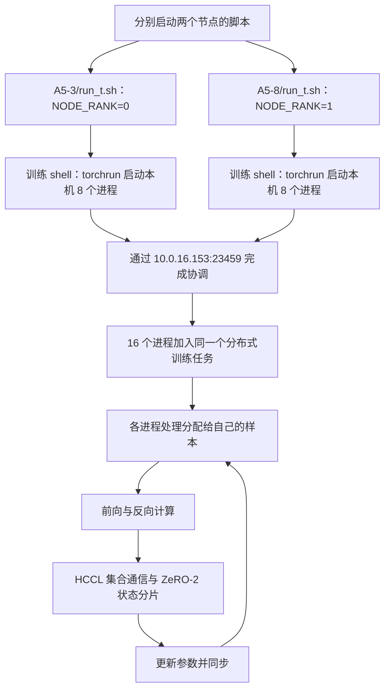

# zjj/run_t.sh 双机启动分析

分析时间：2026-11-06。通过恢复后的 SSH 转发入口读取共享盘文件；没有启动训练、部署容器或修改远端文件。

## 读取范围与连接状态

远端项目根目录：`/mnt/sfs_turbo/zjj/driverVLA-W0`。

已读取 `multi-node/A5-3/run_t.sh`、`multi-node/A5-8/run_t.sh`、`multi-node/start_multi_node.sh`、`multi-node/launch_all.sh`、`multi-node/deploy_container.sh`、`code/scripts/scripts_train/train_base_ar_withou_moe.sh`、`code/scripts/sft/zero2_noffload.json`，并核对训练 Python 入口及两端指定日志。

本地 SSH 别名 `ott9-a51` 使用的 `23680` 转发入口已恢复。此次实际返回的主机名是 `liteserver-a5-1-00001.novalocal`，主网卡地址为 `10.0.16.160`。因此不能仅凭本地别名把该主机认定为原来的 A51。`ott9-a55` 仍指向 `10.244.5.0`，此次 SSH banner 握手超时；尚未确认 A55 的当前地址及在线状态。

## 核心机制

`A5-3/run_t.sh` 负责启动本机这一半任务。它没有 SSH 命令，也没有自动执行从机脚本。双机成立需要另一台机器也启动配套任务。

两端通过环境变量约定同一个任务：

| 配置 | A5-3/run_t.sh | A5-8/run_t.sh | 作用 |
|---|---|---|---|
| NNODES | 2 | 2 | 总共两个节点 |
| NODE_RANK | 0 | 1 | 节点编号，必须不同 |
| MASTER_ADDR | 10.0.16.153 | 10.0.16.153 | 共同连接的主节点地址 |
| MASTER_PORT | 23459 | 23459 | 共同连接的协调端口 |
| HCCL_SOCKET_IFNAME | enp39s0f3 | enp39s0f3 | HCCL socket 建连使用的接口 |
| batch_size | 32 | 48 | 两端当前配置不一致 |

主节点地址是脚本配置，并不构成当前主机地址或端口正在服务的实测证据。A5-3、A5-8 是文件夹中的角色命名，也不能直接推导成当前 SSH 别名与物理机器的对应关系。

## 从外层脚本到真正的启动命令

`A5-3/run_t.sh` 第 1–2 行加载 CANN 并进入代码目录；第 7–10 行导出组网参数；第 24–32 行执行训练 shell。

训练 shell 默认 `NGPUS=8`，第 375–381 行将环境变量交给 torchrun，等价于在节点 0 执行：

```bash
torchrun \
  --nproc_per_node=8 \
  --nnodes=2 \
  --node_rank=0 \
  --master_addr=10.0.16.153 \
  --master_port=23459 \
  utils/train_moe.py ...
```

节点 1 使用相同命令，将 `--node_rank` 改为 `1`。`export` 让子 shell 及 torchrun 继承这些变量。

每端的 torchrun 分别管理 8 个训练进程；两个节点共 16 个进程。该静态配置下，节点 0 的全局 rank 为 0–7，节点 1 为 8–15；每台机器自己的 LOCAL_RANK 都是 0–7。全局 WORLD_SIZE 为 16，NNODES 为 2，两者含义不同。

Python 入口是 Emu3 路线的 `utils/train_moe.py`，默认模型路径是 `pretrained_models/Emu3-Stage1`。这份脚本没有启动 Qwen2.5-VL 训练入口。

## 启动流程图



主地址和端口用于进程协调，不表示所有训练通信都经由该端口中转。实际集合通信由分布式训练后端和 HCCL 完成；仅凭 `HCCL_SOCKET_IFNAME` 也不能断定全部设备间数据流量经过该管理网卡。

## 谁负责远程拉起另一台机器

这里存在两种入口，不能混为一谈：

1. 原始成对脚本：分别执行 `A5-3/run_t.sh` 和 `A5-8/run_t.sh`，每个只负责本节点。
2. `launch_all.sh`：主机检查本地及远端容器，后台执行本地 `docker exec`，再通过 SSH 在各从机执行 `docker exec`；容器里统一运行 `start_multi_node.sh`，传入不同 node_rank。

`launch_all.sh` 不调用上述两个 `run_t.sh`。它与 `start_multi_node.sh` 是另一套封装。其默认 MASTER_ADDR 是 `115.120.54.132`，WORKERS 也使用另一组硬编码地址；不能把这些地址与 `run_t.sh` 的 `10.0.16.153` 直接拼接使用。

部署脚本定义了 `--network host`、Ascend runtime、8 个可见设备和共享盘挂载。这解释了容器如何使用宿主机地址与同一文件路径，但未对两端当前容器执行 inspect，不能认定现有容器配置一定与脚本完全相同。

## ZeRO、批量和性能开关

训练 shell 第 404 行将 `--batch_size` 转成 `--per_device_train_batch_size`，第 418 行固定梯度累积为 1。

若两端统一每卡 MBS=32，则纯数据并行下每次更新处理 `2×8×32×1=512` 条样本。统一 MBS=48 时为 768 条。

当前两份脚本分别为 32 和 48。如果每个 rank 确实各处理一满批，物理样本数相加是 `8×32+8×48=640`；但不能因此认定框架全局批量、loss 归约权重、吞吐量统计都正确。各 rank 按自己的 MBS 推导全局批量会产生冲突，应先统一 MBS 再作为标准训练配置。尚未重新运行该组合验证其实际行为。

`zero2_noffload.json` 实际设置 `stage: 2`，没有 CPU offload，使用 BF16 自动配置、通信重叠和连续梯度缓冲。训练脚本打印的 `zero_stage: 3` 是另一个未更新的 shell 默认变量；显式传入的 JSON 优先，因此不能凭该打印行断言实际运行 ZeRO-3。

融合算子、`GC_SKIP_LAST_LAYERS=4`、任务队列和 MFU/HBM 监控影响性能与观测，不负责把两台机器组成一个任务。`DRIVEVLA_PEAK_TFLOPS=486.354` 是统计使用的峰值参数，不是测量结果。

## 当前文件中的问题与验证边界

- 两端 MBS 不一致；两个日志名都含 `mbs64`，与脚本参数不符，不能由文件名判断实际批量。
- 指定的两个旧日志打印端口为 23457，而当前脚本为 23459，worker 日志的批量也是 32。它们不是当前脚本版本一致性的证据。主机日志没有可确认的完整 50 步成功结束记录；不能据此宣称这对脚本已完整跑通。
- 外层 `run_t.sh` 使用管道接 tee，却没有 `set -o pipefail`，训练失败时外层可能仍得到 tee 的成功退出码。`start_multi_node.sh` 虽有 `set -e`，同样没有 pipefail。
- `launch_all.sh` 从机预检查中 `... && echo OK || echo FAIL` 通常让 SSH 命令在容器不存在时也返回 0，后面的退出码判断不足以识别这个失败。
- `launch_all.sh` 宣称支持 8 节点，但当前 WORKERS 只配置到 rank6，rank7 缺失且被跳过；8 节点模式会少一个参与者。
- `--skip_inference` 与 `--no_save_weights` 配合当前训练 shell 会跳过推理和权重保存。这是一份短步数训练/性能验证配置，不会自动产出轨迹评测结果。

以上是静态调用链分析和有限日志核对，没有执行脚本来验证现网双机训练，也没有修改相关配置。
